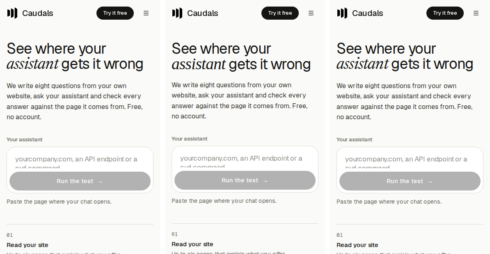
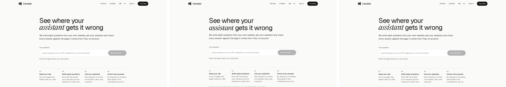
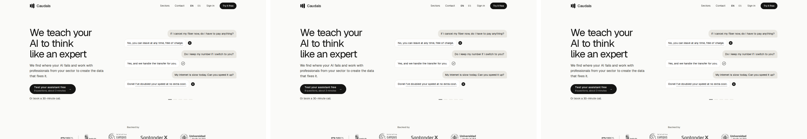

# L-24d · Mobile LCP to budget (L-24c follow-up) — handoff

```text
Package ID / title: L-24d · Mobile LCP to budget (spec v2 P-47, criterion 6 in §1); follow-up to L-24c
Status: done — deployed and verified in production on 2026-10-15. Budget met under the Lighthouse model that treats HTTP/3 as multiplexed (trace_engine 0.0.66, Lighthouse main); not met under the pinned Lighthouse 12.6 (below)
Commits: 6cbd8f6a (parser blockers), 82692fec + 507bc82b (fonts after the first paint), c8dd2a54 tried and reverted by 57dfe752 (chunk merging); docs/handoff [skip ci]
Deploy: app at 507bc82b (no worker code touched; workers unchanged)
Flags / migration: none / none
```

## Why mobile LCP was above budget

Lighthouse's mobile LCP is simulated (Lantern). It replays on slow 4G with a 4× slower CPU every request that **finished before the largest paint in the unthrottled run**, except a script whose first evaluation is a ≥ 10 ms task that starts after that paint (shorter evaluation tasks are pruned from the graph, so Lantern cannot tell and keeps the script). Rebuilding the graph from saved production traces (Lighthouse's own lantern modules, run offline on `-G` artifacts) showed, per page:

- **Scripts.** On production's fast network the stylesheets, Geist and the framework's ~180–215 KB of script all finish within ~20 ms of each other, 100–250 ms before the first paint is presented (layout, then ~20–50 ms of compositor delay in headless Chrome). They are on the path in nearly every run; excluding them alone takes the landing from 3.25 s to 1.86 s. No ordering trick makes them finish after the paint reliably: they are requested together with the CSS.
- **HTTP/3 modelled as HTTP/1.1.** Lighthouse 12.6 (pinned by `@lhci/cli` 0.15.1) and 13.5.0 (current release) multiplex only `h2`; production's HTTP/3 is simulated as six connections with a round trip per request. `@paulirish/trace_engine` 0.0.66 (2026-10-08) adds `isMultiplexedProtocol` (h2 or h3) to the connection pool and reuse estimate; Lighthouse main has used it since `13.5.0-dev.20261009`, no release yet.
- **Late fonts.** Newsreader (normal ~133 KB, italic ~148 KB) and Geist Mono (~24 KB) were requested at the first layout; on fast runs they arrived before the paint was presented and were counted (+0.6–1 s): every 3.5–4.3 s run had them.
- **Parser blockers.** The demo's run-link check was an inline script in front of the headline: it waited for the stylesheets and held the parser, so the first paint showed only the header and the headline (the largest paint) came after the page's scripts had run (demo ES 4.2 s). Cloudflare's email obfuscation rewrote the footer address and injected a parser-blocking `email-decode.min.js` into every public page.

## What shipped (no visible change in the settled page)

1. **No parser-blocking script before the largest paint** (`6cbd8f6a`). The run-link check is an async `data:` script with `blocking="render"` (React hoists it into the head: it runs before the first paint without stopping the parser; checked in Chromium: the run link never paints the start view, the normal page paints the headline in the first frame). The footer's and the call page's `mailto:` go through `components/public/email-link.tsx`, wrapped in Cloudflare's `<!--email_off-->` markers: no `email-decode` script, and the address is in the HTML instead of "[email protected]".
2. **Newsreader and Geist Mono load after the first paint** (`82692fec`, `507bc82b`). `html:not([data-fonts]) .mk-font-gate` (`app/globals.css`) points `--font-newsreader` and `--font-geist-mono` at the metric-matched fallbacks next/font already generates ("Newsreader Fallback", "Geist Mono Fallback"); `components/document/late-fonts.ts` (async `data:` script in `PublicRoot`) sets `data-fonts` once the first contentful paint is presented (four-second fallback), and the faces swap in as before (`font-display: swap`). Geist (the largest paint's face) stays preloaded and ungated. Newsreader keeps its optical-size axis. **Founder review item** (PROGRESS §5); revert with `git revert 507bc82b 82692fec`.
3. **Tried and reverted: merging client chunks** (`c8dd2a54` → `57dfe752`). `experimental.turbopackChunking` (min 150 k, ≤ 5 chunks per group, React DOM allowed to merge) cut entry pages from 13–16 to 9–10 script files, but React DOM and the Next runtime did not merge, the medians moved within noise (landing 3.24 → 3.14 s, sign-up 2.95 → 2.98 s, demo 3.55 → 3.51 s), static chunks grew 4.6 → 6.0 MB (modules duplicated across routes), and under the multiplexed model fewer requests barely matter.
4. **CI ceilings tightened** (`lighthouserc.js`): mobile LCP landing 4.5 → 4.0 s, demo 5.0 → 4.0 s (worst production run after this package 3.57 s); landing TBT ceiling stays 300 ms; sign-up keeps its 2.5 s error. Comments explain the HTTP/3 model.

Not done, on purpose: `content-visibility` on below-the-fold landing sections (cheaper first layout, but the scripts still finish before the paint, so no LCP gain in the graph; adds paint containment risk); `experimental.inlineCss` (the paint could then precede Geist and show its fallback first: a visible change); removing `AuthProvider` (Better Auth stays on sign-up/sign-in through their own `signIn` import, and its `get-session` call also renews the session cookie).

## Font swap review (orchestrator request)

Measured on production with Playwright (`PerformanceObserver` layout shifts, first-paint capture through CDP so it does not wait for fonts), before = the old behaviour (gate removed from the served HTML), after = current:

| Page | Width | CLS from the swap, before → after | Headline height first → settled | Fallback visible after FCP, first visit (fast network) | Repeat visit (cached fonts) |
| --- | --- | --- | --- | --- | --- |
| Landing EN/ES | 390, 1440 | 0 → 0 (no late face above the fold; the 1440 px landing's 0.011–0.018 is the partner-logo row, the same before and after) | unchanged | none | none |
| Demo EN/ES | 390 | 0.0003 → 0.0003 | 77 → 79 px (italic word's line box) | ~35–55 ms → ~130 ms | ~35 ms → ~26 ms |
| Demo EN/ES | 1440 | 0.0003–0.0015 → 0.0014–0.0015 | 124 → 128 px | as above | as above |
| Methodology | 390 / 1440 | 0.0049 / 0.0018 → same | 130 → 135 / 104 → 110 px | as above | as above |
| Sign-up | both | 0 → 0 (no gated face) | unchanged | — | — |

The swap existed before on every load (fonts were never preloaded; even cached they arrive after the first layout); the gate lengthens the fallback phase by ~80 ms on a first visit on a fast connection and changes nothing on slow connections or repeat visits. The shift is the same in both, at most 0.005. Lighthouse CLS after: 0 on mobile for all five pages, desktop landing 0.015, demo 0.002, sign-up 0. Settled pages are pixel-identical (full-page diff, 390 and 1440 px: landing EN/ES, demo EN/ES, sectors hub, methodology, 404; the call page differs only in the live booking slots).

First paint before (left), first paint after (middle) and settled (right), reduced motion, production:

- Demo, 390 px: 
- Demo, 1440 px (half size): 
- Landing, 390 px: 
- Landing, 1440 px (half size): 

On the demo the first frames now show the italic "assistant" and the step numerals in their fallbacks, and the content below moves up 2 px until the swap; the landing's first viewport has no late face.

## Checks

- `npm run typecheck`, `npx eslint` on every changed file, `npm run i18n:check-parity`: pass.
- Vitest `tests/i18n lib/demo lib/i18n lib/public`: 14 files, 192 tests pass.
- UI harness: `a11y.contract.ts` 11/11 (axe on landing/demo EN/ES, reduced motion, keyboard-only funnel); demo, Spanish and public tests (`ui.contract.ts`, `spanish.contract.ts`, filtered) 44/44.
- Production, read-only (`PLAYWRIGHT_BASE_URL=https://caudals.com`, `DEMO_PUBLIC=true`): `e2e/public-routes.spec.ts` + `e2e/a11y-public.spec.ts` + `e2e/smoke.spec.ts` 102 passed, 1 skipped (flag-off case); the two sector front-door tests first failed inside the post-deploy prerender window (L-24b) and passed once regenerated.
- Run-link check in production: `/en/demo#r=…` never paints the start view; `/en/demo` and `/es/demo` paint the headline in the first frame (one LCP entry).

## Lighthouse in production (Chromium 1243 on `atlantic`, simulated mobile, median of 3)

Before: app `141b5d30`, 2026-10-15 07:09 UTC. After: app `507bc82b`, final code, three sets between 08:33 and 09:23 UTC (E5, A, B; host load 1.3–3.1); medians, runs of A and B in brackets.

**Lighthouse 12.6.1** (pinned in `@lhci/cli`; HTTP/3 modelled as HTTP/1.1):

| Page | Before | After (E5 / A / B) |
| --- | --- | --- |
| Landing `/en` | 3.24 s (3.00–3.24) | 3.15 / 3.40 / 3.04 s (2.99–3.44) |
| Landing `/es` | 3.42 s (3.27–4.11) | 3.24 / 3.20 / 3.27 s (3.15–3.40) |
| Demo `/en/demo` | 3.55 s (3.52–3.73) | 3.38 / 2.93 / 3.46 s (2.88–3.57) |
| Demo `/es/demo` | 4.24 s (3.63–4.35) | 3.53 / 3.21 / 3.29 s (2.86–3.42) |
| Sign-up | 2.95 s (2.70–3.24) | 3.09 / 2.52 / 3.10 s (2.11–3.29) |

**Lighthouse `13.5.0-dev.20261014`** (trace_engine 0.0.66, HTTP/3 multiplexed; the next release). Before = the pre-change traces re-audited with it (chunk-merge build, 15 runs; the baseline's own four traces give 2.43 / 2.57 / 2.27 / 1.67 s):

| Page | Before | After (E5 / A / B) |
| --- | --- | --- |
| Landing `/en` | 2.42 s (2.13–2.96) | 2.42 / 2.50 / 2.42 s (2.39–2.57) |
| Landing `/es` | 2.12 s (2.12–3.02) | 2.42 / 2.43 / 2.43 s (2.04–2.57) |
| Demo `/en/demo` | 2.43 s (1.89–2.58) | 2.27 / 1.97 / 2.28 s (1.97–2.43) |
| Demo `/es/demo` | 3.17 s (3.17–3.25) | 2.28 / 2.27 / 2.27 s (1.97–2.35) |
| Sign-up | 2.28 s (1.91–2.29) | 1.99 / 1.69 / 1.78 s (1.61–2.29) |

Lighthouse 13.5.0 (current release, set A): landing 3.24, `/es` 3.22, demo 3.06 / 3.23, sign-up 2.61 s. Desktop (12.6, set A): landing 0.79 s, demo 0.85 s, sign-up 0.79 s; TBT ≤ 22 ms. CLS 0 on mobile everywhere. Mobile TBT (12.6): landing medians 182–243 ms (EN) and 184–313 ms (ES), single runs up to 877 ms under host load, as before this package (L-24c: 185–198 ms); demo 40–124 ms, sign-up 56–145 ms; Lighthouse 13 reports the landing's TBT higher (220–500 ms) on the same pages.

## Not met, and what it would take

- **Under Lighthouse 12.6 / 13.5 the budget is not met** (landing ~3.0–3.4 s, demo ~2.9–3.5 s, sign-up ~2.5–3.1 s). The remaining path is the framework's script (React DOM 74 KB, Next runtime 44 KB, ~60 KB of app code) finishing before the paint, simulated over six HTTP/1.1-style connections. Options, none taken: (a) adopt the Lighthouse release that ships trace_engine ≥ 0.0.66 (the model this table's second half uses; the budget is met there, the landing with the thinnest margin, 2.42–2.50 s); (b) serve HTTP/2 instead of HTTP/3 (Cloudflare zone setting; real mobile visitors lose QUIC; not recommended for a lab number); (c) load the framework after the first paint (delays interactivity; not recommended); (d) cut the landing's pre-paint bytes by ~40 KB to widen its margin under the new model (a public-only Tailwind build instead of the app-wide 21 KB stylesheet, the funnel-events and analytics module loaded after hydration, ~13 KB).
- CI cannot check the 2.5 s target on mobile: `next start` on localhost is HTTP/1.1, so its Lantern keeps the six-connection model whatever the Lighthouse version.
- The Newsreader optical-size decision no longer affects LCP: neither Newsreader file is on the path after this package.

## Founder actions

- Review "fonts load after the first paint (fallback → swap)" (screenshots above). Keep, or revert with `git revert 507bc82b 82692fec` and push (LCP without it: the 12.6 and 13-dev "before" columns above, where runs with the fonts on the path reach 3.0–4.3 s).
- Decide which Lighthouse counts for P-47: the pinned 12.6 (not met) or the next release with HTTP/3 multiplexed (met). When it ships, bump `@lhci/cli` (or pin that Lighthouse) and re-measure.
- The Newsreader axis item in §5 can be closed as far as performance goes.

## Risks

- A public surface rendered outside `PublicRoot` that uses Newsreader or Geist Mono gets no `data-fonts` and keeps the old behaviour (fonts at first layout); one inside it without the gate script would show the fallbacks until the four-second timeout.
- Browsers without paint timing open the font gate after four seconds (fallbacks until then). Chrome, Edge, Firefox and Safari ≥ 14.1 report first-contentful-paint.
- The `data:` scripts rely on `script-src data:` in the CSP (present).
- Prerendered public pages carry the image build's `DEMO_PUBLIC` for up to five minutes after each deploy (unchanged, L-24b); measure or screenshot after they regenerate.
