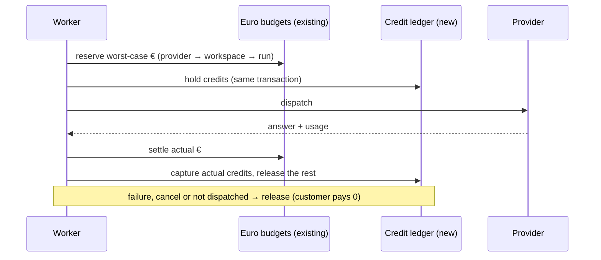
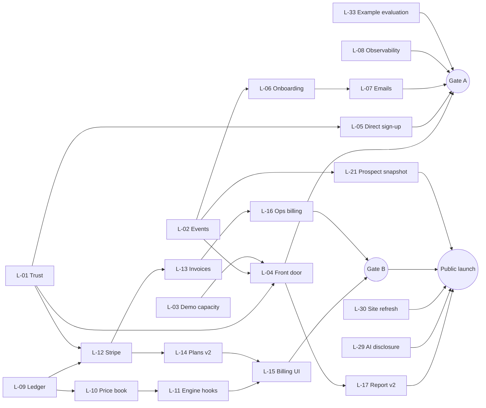

# Caudals launch spec (v2)

| | |
| --- | --- |
| Status | **Approved for implementation on 2026-10-11.** Build progress, decisions and founder actions are tracked in `docs/launch/PROGRESS.md`. |
| Date | 2026-10-11 |
| For | Mario (founder) |
| Evidence | Code on `main` at `4db1582`. Live checks of `caudals.com`, `caudals.com/en/demo` and `app.caudals.com` on 2026-10-11 (HTTP and headless browser, nothing submitted). Read-only aggregate counts from production on 2026-10-11 (no names, emails or content). Web sources dated in §7.12. |
| File name | The prompt names both `launch-spec.md` and `spec-v2.md`; this file follows "Done when". The earlier `spec.md` and the benchmark-options note were not read or reused. |
| History | During the session you committed a partial draft of this file (`b42df72`) and deleted the old `spec.md` (`2558e7f`). Both were left as you made them. Everything after that commit is uncommitted, and this session makes no commits. |

**How to read this.** §1 is the one-page summary. §2 is where we are today. §3 is what I need from you. §4 and §5 cover the product, §6 the credit system, §7 how we sell, §8 the build order, and §9 what we won't do and what can go wrong.

Priorities: **P0** is needed for a launch gate, **P1** is built next, **P2** is built last. Everything gets built (D-15); priority only sets the order. Sizes: **S** is under half an agent session, **M** one session, **L** two sessions, **XL** three or more.

**No calendar dates (D-15).** This spec plans by dependency order and gates, not dates. Targets are measured from the public launch. The dates that do appear are facts: when something was observed, when a source was published, or when a law or provider price takes effect.

---

## 1. Executive summary

**The product is far ahead of the business.** Evaluation stages A–E are live on `app.caudals.com`. They cover website chats, APIs, uploads and private runners, source-cited test sets, grading, reports, sharing, schedules, webhooks and expert review. But the path from a stranger to a paying customer isn't connected:

- **Nobody can find the free demo.** It's unlinked and `noindex`. Six demo runs ever, all on 5–6 Oct, and three of them failed on model rate limits.
- **There is no way to pay.** No billing exists, the app shows no prices, and every contract is manual.
- **The live site undermines trust.** The legal notice still shows `[legal company name]` and `[NIF/CIF]`, and the Terms and Privacy pages are written for the old marketplace (buyers, suppliers, payouts).
- **We can't see the funnel.** Only page visits are tracked.
- **The pipeline is idle.** Both prospecting campaigns are paused with 62 researched companies waiting for review, and the newsletter has 2 confirmed subscribers.

**Launch-ready means all of these are true**, measured weekly from Gate A onwards:

| # | Criterion | Target | Measured by |
| --- | --- | --- | --- |
| 1 | The path works end to end without us | A stranger goes from the landing page to the demo, gets a report, creates a free account, runs their own evaluation, buys credits or requests a pilot, pays, and receives a valid invoice | Weekly scripted production run, plus the funnel dashboard |
| 2 | The demo is reliable | ≥ 90 % of demo starts on supported inputs end in a report. p50 ≤ 4 min, p90 ≤ 8 min. 0 runs lost to "busy" | `demo.run` outcomes, demo events |
| 3 | New accounts activate | ≥ 40 % of new accounts get a report on their own system within 7 days | Product events |
| 4 | Payments are correct | Credits are usable ≤ 60 s after payment. The ledger matches Stripe to the cent every day. 0 double charges. Every paid order has a correct IVA invoice | Daily reconciliation job |
| 5 | Trust pages are complete | Legal notice complete. Terms, Privacy, DPA, sub-processors and a security page for the evaluation product. Terms acceptance recorded at sign-up and checkout | Page checks, database rows |
| 6 | Quality bars hold | EN/ES parity 100 % across site, app, emails and PDFs. 0 serious or critical axe issues on 10 core screens. Landing and demo LCP < 2.5 s on mobile. App API reads p95 < 500 ms. Errors are tracked. Public uptime ≥ 99.5 % | CI and monitors |
| 7 | First paying customers | The first paid euro arrives **before the public launch**, from a founding pilot. **10 paying customers and ≥ €12,000 booked within 12 weeks of the public launch**. These are targets, not forecasts | Billing and CRM |

*Paying customer*: an organisation that has paid at least €20 (one credit top-up) or signed a paid order (pilot, subscription or dataset). *Booked*: paid credits, plus signed pilot and dataset fees, plus the first three months of each signed subscription.

**The plan has three gates, in order:**

| Gate | When | What ships | Exit test |
| --- | --- | --- | --- |
| **A · Open the funnel** | When its packages (L-01…L-08 and L-33) are live | Trust pages, demo linked and indexed, direct sign-up, demo queue and fallback model, funnel analytics, first-run onboarding, the example evaluation, branded EN/ES emails, error alerts | Criteria 2 and 5. Events flowing |
| **B · Take money** | When its packages (L-09…L-16) are live | Credits, Stripe top-ups, invoices with IVA, billing and usage screens, run cost estimates, ops grants and refunds | Criterion 4. The founder buys €20 in production |
| **C · Launch and sell** | Public launch once Gates A and B pass and the launch-prep packages (L-17, L-21, L-29, L-30) are live. Then the remaining packages are built | Launch week, evidence-first outbound, report v2, AI-disclosure check, partner programme, re-runs and alerts, integrations | Criteria 3, 6 and 7 |

**Founder-led selling starts now, in parallel.** The three founding pilots (€1,500 each, from the product brief) need no new code: they are delivered with the existing operator workflow and invoiced manually.

**Decisions (§3).** You answered all 9 critical decisions (★) on 2026-10-11:
- the SL as the legal entity
- credits at €0.01 priced at model cost × 1.5, plus per-question fees and smaller bonuses
- Stripe plus a Spanish invoicing API
- prices shown only in the app
- the demo plus direct work-email sign-up
- AI-product software companies as the ICP
- evidence-first, founder-led outbound
- no dates in the spec, and build everything

The other 8 stay open with my recommendation. The one hard blocker left is the SL's real data. The values in §3.2 are realistic-format **placeholders**, and they must be replaced before the legal notice goes live and before Stripe live mode.

---

## 2. Where we are today

### 2.1 What exists and works

| Area | Status on 2026-10-11 | Evidence |
| --- | --- | --- |
| Public site | Landing, 8 sector pages, contact form, call booking and legal pages, in EN and ES. Fast: TTFB 27–73 ms and full load under 2.3 s, with no console errors | Playwright run, 16 page loads |
| Public demo | Works end to end: reads up to 6 pages, writes 8 cited questions, asks a website chat or API, grades the answers and offers an account. Proof of work instead of a CAPTCHA, plus per-visitor and per-site limits. Runs on the DGX (DeepSeek V4 Flash) | `lib/demo/*`, `demo.run` |
| Self-serve sign-up | Only from a finished demo, through an emailed one-time link. Creates a free workspace (1 system, 50 tests per set, 3 runs a month, local models only) and imports the demo | migration 075, `evals.enroll_self_serve` |
| Evaluation app | Connect → Prepare tests → Run → Results. Website chats with assisted teaching, OpenAI-compatible and generic HTTPS APIs, uploads, a private runner, test-set review and versions, grading v2, reports (web, PDF, Word, CSV, CEF), private share links, notification centre, schedules, signed webhooks, read-only API tokens, pause/stop/restart controls, EN/ES interface | `app/(evaluation)`, 142 API route files |
| Operations | Clients, review queue, library, expert work (feature-gated), platform (providers, models, prices, inference, usage, accounts, audit), run inspector | `/ops/*` |
| Engine accounting | Every engine call creates an attempt, reserves worst-case cost against the provider account, the workspace and the run, then settles it with actual usage. Unknown outcomes stay unresolved | `lib/evals/queue/worker.ts`, `lib/evals/budget/ledger.ts` |

### 2.2 Baseline numbers

All figures are read-only aggregates as of 2026-10-11. Demo rows are deleted after 7 days, so older demo runs aren't visible.

| Metric | Value |
| --- | --- |
| Tracked site sessions per week (`funnel_visit`) | 11 · 91 · 125 · 110 (weeks of Sep 14, 21, 28 and Oct 5) |
| `/demo` page views, last 30 days | 13 (11 ES, 2 EN) |
| Demo runs | 6: 3 done, 3 failed with `model_rate_limited`, all on 5–6 Oct. **0 since 7 Oct** |
| Self-serve sign-up links / accounts created | 1 / 1 (6 Oct) |
| Contact-form evaluation requests | 2 in September, 0 in October so far |
| Workspaces / members | 7 (all on the `managed` plan) / 8 owners and 1 operator |
| Evaluations / runs / published reports | 77 / 60 (38 completed, 7 partial, 9 canceled, 4 failed, 2 paused) / 36, plus 6 drafts and 4 withdrawn |
| Share links created | 8 |
| External model spend | **€0**. All four engine roles run on the DGX. Internal GPU-time estimate: €2.41 in total |
| Engine tokens per evaluation (31 evaluations) | p50 ≈ 98 k input + 13.5 k output. p90 ≈ 198 k + 24 k |
| Commercial providers registered | OpenRouter, NVIDIA NIM and Google AI Studio, all at **€0 per token**, including one paid-model alias. The cost ledger can't bound commercial spend until prices are real |
| Newsletter | 2 confirmed, 3 pending, 6 unsubscribed. Last issue sent 2026-08-12 |
| Prospecting (Hermes) | Both campaigns paused. España · Producto de IA: 5 approved, 30 pending, 2 rejected. Caudals CyL v1: 1 approved, 32 pending |

### 2.3 Gaps that block launch

| # | Gap | Evidence | Fixed by |
| --- | --- | --- | --- |
| G1 | The demo is invisible | `noindex`, not linked. The header "Get started" and hero CTA go to the contact form | P-05, L-04 |
| G2 | Accounts can only start from the demo | The sign-in page says "Use the private invitation from your workspace owner" | P-03, L-05 |
| G3 | There is no way to pay | No billing code. The settings page shows "machine execution spend" that "only an authorised operator can raise" | §6, L-09…L-16 |
| G4 | Legal pages are wrong | The legal notice has placeholders. The Terms cover buyers, suppliers and payouts. No DPA, sub-processor list or security page. No terms acceptance at sign-up | P-41, L-01 |
| G5 | The funnel is blind | Only `funnel_visit` is tracked. The event names are pre-pivot (`funnel_dataset_created`, `funnel_fund`) | P-50, L-02 |
| G6 | The demo is fragile under load | 3 of 6 runs failed on rate limits. One DGX model is shared by the demo, the engine and prospecting. `DEMO_MAX_ACTIVE=3`. No queue | P-06, L-03 |
| G7 | Emails are weak | Evaluation emails are plain text and English only. No lifecycle emails | P-37, P-38, L-07 |
| G8 | The workspace budget doesn't reset monthly (**verify**) | `ensureWorkspaceBudget` creates one budget row whose `settled` total never resets, while the monthly limit is checked separately against calendar-month sums. With priced models, a workspace could hit "budget exceeded" after €500 *lifetime* | L-11 |
| G9 | Paid models are priced at €0 | Price revisions are €0 for every registered model | L-10 |
| G10 | Some strings bypass the catalogs | `evaluation-stage.ts` ("Generate the test set", "Add reference material"), expert tabs ("Open", "All"), notification emails | P-45, L-23 |
| G11 | Observability is off by default | Sentry is off unless a DSN is mounted. The observability stack was not running at the last inventory (2026-09-28) | P-48, L-08 |
| G12 | Content channels are hidden | Blog and newsletter are hidden from navigation. The last newsletter went out on 2026-08-12 | L-30, §7.7 |

### 2.4 What not to rebuild

The CEF contracts, RLS tenancy, the attempt and reservation path, frozen model routes, the outbox and queues, the notification engine, exports, shares, schedules and webhooks, the private runner, expert work, and the demo engine are all solid. **Every work package in §8 extends them; none replaces them.**

---

## 3. Decisions for me

★ = critical. These were asked with the question tool on 2026-10-11, and every one was answered. The others stay **open with my recommendation** until you change them. The full answers are in §3.1.

| ID | Decision | Options | Recommendation | Status | Blocks |
| --- | --- | --- | --- | --- | --- |
| D-01 ★ | Legal entity behind the site, Stripe and invoices | (a) an incorporated company, with its legal name, NIF, address and registry entry · (b) an autónomo until incorporation · (c) payments off until incorporation | (a) | **Answered: the SL.** Its real data isn't available yet, so §3.2 holds placeholders | L-01 (publishing), L-12 (live mode), L-13 |
| D-02 ★ | Unit of account | (a) credits, 1 credit = €0.01 excl. VAT · (b) a euro wallet · (c) raw tokens | (a). See §6.2 | **Answered: credits** | L-09…L-16 |
| D-03 ★ | How credits are priced | (a) model cost × a multiplier, plus a small per-question platform fee · (b) model cost × 3, no platform fee · (c) a flat price per question | (a) with × 2.5 | **Answered: model cost × 1.5, keeping the per-question fees** (§6.4) | L-10 |
| D-04 ★ | Payment and invoicing stack | (a) Stripe Checkout and our own ledger, plus a Spanish Verifactu-ready invoicing service through its API · (b) Stripe, with the accountant invoicing by hand · (c) bank transfer only | (a). Stripe isn't a Spanish invoicing system (§6.14) | **Answered: Stripe and a Spanish invoicing API** | L-12, L-13 |
| D-05 | Who can buy | (a) businesses only (NIF or EU VAT ID required) · (b) consumers too | (a). Avoids OSS, consumer withdrawal rules and B2C tax handling | Open | L-12, L-13 |
| D-06 ★ | What pricing is public ("keep the pricing tailored") | (a) the site shows the free demo, the free account and "pay as you go in the app"; credit prices only in the app; pilots, subscriptions and datasets quoted · (b) a public pricing page (lifting the `/pricing` ban) · (c) no self-serve payments | (a) | **Answered: prices only in the app** | L-04, L-30 |
| D-07 ★ | How the funnel opens | (a) the demo as the main CTA, indexed, **plus** direct work-email sign-up · (b) the demo, with demo-only sign-up · (c) keep the soft launch | (a). Needs an edit to the "no other registration path" rule in `docs/evals/AGENTS.md` | **Answered: demo plus direct sign-up** | L-04, L-05 |
| D-08 | Free plan and bonuses | (a) today's limits, a 1,000-credit monthly allowance and top-up bonuses · (b) today's limits only · (c) a bigger free plan | (a) | **Bonuses answered:** 0–10 % on packs and +20 % on the first top-up. The allowance stays open with my recommendation | L-14 |
| D-09 | Default AI models | (a) the local DGX model stays the default, commercial models are opt-in and paid in credits, and the default changes only after measured judge agreement ≥ 85 % · (b) a commercial default for paid workspaces | (a) | Open | L-10, L-11 |
| D-10 | Credit expiry and refunds | (a) purchased credits last 24 months, promotional credits 30 days, and a purchase is refundable within 14 days if unused · (b) credits never expire, no refunds | (a) | Open | L-01, L-09 |
| D-11 | Bring your own provider key (BYOK) | (a) after launch, still charging per-question fees · (b) before launch, with the billing packages · (c) never | (a) | Open | L-27 |
| D-12 ★ | ICP focus for the next 12 weeks | (a) Spanish software companies that ship an AI assistant (fiscal, accounting, payroll, legal, HR, vertical SaaS) · (b) regulated B2C (insurance, energy, telco, travel) · (c) Castilla y León, multi-sector | (a), with (b) as managed pilots on the side | **Answered: AI-product software companies** | §7, L-25 |
| D-13 ★ | Outbound policy | (a) evidence-first and founder-led: LinkedIn, warm intros, and email only where the legal basis is written down; ≤ 25 new contacts a week · (b) Warmbly cold email at volume | (a) | **Answered: evidence-first, founder-led** | §7.6 |
| D-14 | First-customer offer | (a) the 3 founding pilots at €1,500 (case study, recorded call, 2 intros), plus 5,000 credits for 90 days of re-runs · (b) a cheaper self-serve "expert-reviewed report" · (c) free pilots | (a) | Open | §7.5 |
| D-15 ★ | Schedule and targets | (a) fixed calendar dates for the gates and the launch · (b) no dates: build everything in dependency order, with targets measured from the launch | (a) | **Answered: no dates in the spec, build everything** | §7.9, §8 |
| D-16 | Anonymous sector index (public aggregates) | (a) a quarterly sector-level page from our own public snapshots and consenting customers, minimum 10 systems per sector, no names · (b) don't publish | (a), with legal review | Open | L-31 |
| D-17 | Spend on paid enrichment (RocketReach, Apollo company credits) | (a) up to €100 a month, with an idempotency key on every call · (b) €0, using only Apollo's free people search | (a) | Open | §7.6 |

### 3.1 Decision log

| Date | ID | Question | Answer | What changed in this spec |
| --- | --- | --- | --- | --- |
| 2026-10-11 | D-01 | Which legal entity will sell and invoice? | "Our SL. We don't have the info yet, so put some random realistic info." | §3.2 holds realistic-format placeholder data. The values are visibly fictitious (all-zero NIF and registry numbers) so they can't collide with a real company's identifiers. L-01 is blocked from publishing them, and Stripe live mode needs the real data |
| 2026-10-11 | D-04 | How should customers pay for credits, and who issues the invoices? | Stripe plus an invoicing API | §6.14, L-12 and L-13 as designed |
| 2026-10-11 | D-02, D-03 | How should the credit system price usage? | "Credits, cost × 1.5" | Credit rates recomputed at × 1.5 in §6.4, a token margin of about 33 % |
| 2026-10-11 | D-03, D-08 | With cost × 1.5, what happens to the fees and the bonuses? | Keep the fees, smaller bonuses | The 5 / 2 / 1-credit question fees stay. Pack bonuses are now 0–10 %, and the first top-up gets +20 % (§6.5, §6.6) |
| 2026-10-11 | D-06 | What pricing should be public? | Prices only in the app | §7.4 as designed |
| 2026-10-11 | D-07 | How should we open the funnel? | Demo plus direct sign-up | L-04 and L-05 are in Gate A |
| 2026-10-11 | D-12 | Which customer segment for the next 12 weeks? | AI-product software companies | §7.3 as designed |
| 2026-10-11 | D-13 | Which outbound policy? | Evidence-first, founder-led | §7.6 as designed |
| 2026-10-11 | D-15 | Do you approve the launch dates and targets? | "Just detail and build everything. Do not specify dates in the spec." | Every planned date is removed. Gates follow dependencies, targets are measured from the public launch, and all 36 packages are in scope |

### 3.2 Legal entity data: placeholders (D-01)

These values are **realistic in format and fictitious on purpose. Do not publish them.** Invented-but-plausible identifiers could belong to a real company and would make a false legal notice, so the numbers are visibly dummy.

| Field | Placeholder | Replace with |
| --- | --- | --- |
| Legal name | Caudals, S.L. | The name on the deed of incorporation |
| NIF | B00000000 | The SL's NIF issued by the AEAT |
| Registered office | Calle Ejemplo 1, 47001 Valladolid, España | The registered address |
| Commercial registry | Registro Mercantil de Valladolid, Tomo 0000, Folio 0, Hoja VA-00000 | The real registration entry |
| Public contact | hello@caudals.com | Already in use |
| Billing contact | facturacion@caudals.com | A real, monitored mailbox |
| Invoice series | `CAU-` (credits), `CAU-S-` (services), `CAU-R-` (rectifying) | Confirm with the gestor |

Rules:
- L-01 adds a CI check that fails if any placeholder value from this table appears in `content/legal/*`, in Stripe settings or in invoice templates.
- Stripe live mode (L-12) and the invoicing provider (L-13) can't be configured until the real data replaces these values.
- Development and Stripe test mode may use them.

---

## 4. Product

Each item gives the problem, who it is for, a user story, acceptance criteria, priority, size and the work package (§8) that builds it. Items marked *(needs D-xx)* depend on a decision in §3.

### 4.1 First-run onboarding and activation

**P-01 · The demo becomes your first evaluation** · P0 · M · L-06
- **Problem:** After sign-up, the imported demo opens on an evaluation page that still needs a manual "generate tests" step and gives no guidance. New accounts stall.
- **For:** New account owners coming from the demo.
- **Story:** As someone who just created an account from my demo, I want Caudals to start preparing my full test set right away, so that I see real results without learning the product.
- **Acceptance:**
  - Finishing sign-up with an imported demo starts preparation automatically: the website source plus generation up to the plan's test limit. Retries are idempotent.
  - The evaluation page shows a four-step "first evaluation" checklist with live status and an honest time range, not a fixed promise.
  - If the site or chat can't be reached, the page shows the same recovery guidance as the demo plus a "Get help" action that creates an ops task.
  - EN/ES emails go out when the test set is ready and when results are ready.
  - ≥ 60 % of demo sign-ups reach "test set ready" within 30 minutes, measured weekly.

**P-02 · Activation checklist and useful empty states** · P0 · S · L-06
- **Problem:** Empty workspaces show one generic card, and viewers are told to "ask an owner". Nobody sees what a good result looks like.
- **For:** New accounts without a demo import, and invited viewers.
- **Story:** As a new user, I want to see a finished example and the three steps to get mine, so that I know it's worth ten minutes.
- **Acceptance:** A persistent checklist (connect a system, add reference pages, run, read results, invite a colleague) is stored per workspace and can be dismissed. Empty states open the example evaluation (P-55). EN/ES, and works at 390 px.

**P-03 · Direct sign-up with a work email** *(needs D-07)* · P0 · M · L-05
- **Problem:** The only way to get an account is to finish a demo and request the emailed link. Outbound prospects, partners and owners of login-protected chats (which the demo can't reach) have no way in.
- **For:** Prospects from outbound, partners, owners of private assistants.
- **Story:** As a prospect, I want to create a free workspace with my work email, so that I can start even when the demo can't reach my assistant.
- **Acceptance:**
  - A new `/workspace/start` page (EN/ES) asks for a work email and company name, then sends a one-time link. It reuses the existing token pattern (2-day expiry, only the sha256 stored) and the same free-plan enrolment.
  - Disposable and free-mail domains are refused by a configurable list. Rate limits apply per hashed IP and per email domain.
  - Terms acceptance is recorded (P-41).
  - The sign-in page links here, and `docs/evals/AGENTS.md` is updated to allow this second path.

**P-04 · Two-question welcome** · P1 · S · L-06
- **Problem:** We don't know what a new account wants to test or why, so follow-up is blind.
- **For:** The founder and ops, and new users.
- **Story:** As the founder, I want each new account's system type and goal, so that I follow up with the right offer.
- **Acceptance:** After first sign-in, two optional questions: system type, and goal (check before launch / monitor changes / compare vendors / evidence for an AI review). Answers are stored on the workspace, shown in the ops growth view (P-34), and skippable. They never block the user.

**P-55 · Example evaluation in every workspace, reused as the public sample report** · P0 · M · L-33
- **Problem:** Nobody can see what a finished evaluation looks like before investing time. P-02, the sector pages and the sales assets (§7.10) each call for a sample report, and three separate copies would drift.
- **For:** New workspaces and invited viewers, demo finishers, prospects, and the founder in readouts.
- **Story:** As someone deciding whether Caudals is worth ten minutes, I want to explore a complete example (report, failure causes, transcripts, a trend and a comparison), so that I know exactly what I'll get.
- **Acceptance:**
  - One synthetic evaluation of a fictitious insurer's home-policy assistant, built from synthetic policy documents and FAQs. The names are checked against the DGSFP register of insurers and a trademark search so they match no real company.
  - It contains a reviewed-style report revision (executive summary, findings with failure causes, 40–60 results with transcripts and cited source excerpts, improvements), three monthly runs that show a trend, and one comparison (improved / regressed / unchanged). EN and ES.
  - Every screen, page and PDF page carries an "Ejemplo" / "Example" label and the line "Synthetic data about a fictitious company. It shows what a reviewed report looks like; no real expert reviewed it."
  - Every new workspace sees it read-only, from Home, the evaluations list and the empty states. It can't be run, edited, scheduled, shared or deleted. It doesn't count towards plan limits, credits, product metrics or activation. Owners can hide it.
  - It's stored as a versioned fixture that CI validates against `reportSnapshotSchema` and is rendered by the same report components, so it follows report v2 (L-17) without a separate template.
  - The same fixture is public at `/{locale}/sample-report` (`/es/informe-de-ejemplo`) with a downloadable PDF. It's indexed, and linked from the demo report, the sector pages, the landing FAQ and outbound. It replaces the separate sample report in P-02 and §7.10.
  - Event: `example_viewed {surface}`.

### 4.2 Demo → sign-up → paid conversion

**P-05 · Make the demo the front door** *(needs D-07)* · P0 · S · L-04
- **Problem:** The demo is unlinked and `noindex`. Every CTA leads to a 48-hour manual form. `/demo` had 13 views in 30 days.
- **For:** Website visitors, outbound recipients, sector-page visitors.
- **Story:** As a visitor, I want to test my assistant from the homepage, so that I see value in minutes instead of filling in a form.
- **Acceptance:**
  - The hero's primary CTA becomes "Test your assistant free" and goes to `/{locale}/demo`. "Book a call" stays secondary.
  - The header pill points to the demo. A "Sign in" link to the app is added to the header and footer.
  - Sector pages lead to the demo.
  - The demo is indexed, with metadata and an OG image, in the sitemap and `llms.txt`.
  - `/contact?offer=reality-check` stays for people who prefer the manual diagnostic.
  - Funnel events fire for every step (P-50).

**P-06 · A demo that never says "busy"** · P0 · M · L-03
- **Problem:** 3 of 6 demo runs failed with `model_rate_limited`. The demo shares one DGX model with the platform and Hermes, and `DEMO_MAX_ACTIVE=3`. A launch spike would turn into "come back tomorrow".
- **For:** Every demo visitor.
- **Story:** As a visitor arriving at a busy moment, I want to wait in a visible queue or get my report by email, so that I don't lose my test.
- **Acceptance:**
  - A queue with position and an ETA range replaces the `busy` refusal.
  - "Email me the report when it's ready" has a consent checkbox, and the same email later receives the sign-up link.
  - When the DGX is down or rate-limited, the demo falls back to a commercial model with a daily euro cap (`DEMO_FALLBACK_DAILY_EUR`, default €5) and records which model answered.
  - Per-phase timeouts, and every failure reason emitted as an event.
  - Load test: 30 demos in one hour finish with ≥ 90 % success.

**P-07 · A report-to-account card that converts** · P0 · S · L-04
- **Problem:** The account card only asks for an email. It doesn't say what happens next, and there's no way to share the result with a colleague.
- **For:** Demo finishers.
- **Story:** As a demo finisher, I want to keep my results and test my whole assistant, so that I can show my team.
- **Acceptance:**
  - The card says what the free account adds ("your 8 questions, plus up to 50 more from all your pages").
  - Optional company field.
  - CTA order: Create free account (primary), Book a readout, Send to a colleague (one email, rate-limited, sender consent recorded).
  - Events: `demo_signup_requested`, `demo_report_shared`, `readout_link_clicked`.

**P-08 · AI-disclosure check (evidence for AI Act Art. 50)** · P1 · S · L-29
- **Problem:** Since 2 Aug 2026, AI systems that interact with people must tell them they're dealing with an AI (Art. 50(1), §7.12). Many owners don't know whether their chat does. That makes a timely hook, provided we give evidence and not a legal verdict.
- **For:** Demo visitors and customers in the EU.
- **Story:** As an assistant owner, I want to know whether my assistant tells users it's an AI, so that I can fix it before someone complains.
- **Acceptance:**
  - Demo and product runs add one deterministic check: does the greeting or first reply disclose AI use, and how does it answer "Am I talking to a person?".
  - The result reads "Disclosed", "Not disclosed" or "Unclear", with the transcript as evidence.
  - The copy says "evidence for your own assessment, not a legal determination". The words "compliant" and "certified" never appear.
  - A lawyer reviews the wording before release.

**P-09 · Upgrade moments** · P0 · S · L-14
- **Problem:** When a free workspace hits a limit, the database raises `PLAN_LIMIT_*` and the UI shows a generic error. Disabled connection types say "Not enabled for this workspace".
- **For:** Free users at a limit.
- **Story:** As a free user who hit a limit, I want to see what unlocks it and what it costs, so that I can decide in one click.
- **Acceptance:**
  - Each `PLAN_LIMIT_*` opens a localized dialog that names the limit and what credits or a managed plan unlock, with two actions: "Add credits" and "Talk to us".
  - Disabled cards read "Available with credits" or "Available on a managed plan".
  - Event: `limit_hit {kind}`.

**P-10 · "Have an expert review this"** · P1 · M · L-26
- **Problem:** Our highest-value offer, expert-reviewed evaluations and pilots, is invisible inside the product.
- **For:** Owners with a preliminary report.
- **Story:** As an owner, I want to request an expert review or a pilot from my report, so that I can trust and act on the results.
- **Acceptance:**
  - A button on the report and results pages opens a short form (scope, deadline, sector).
  - Submitting creates an ops task, a Warmbly CRM handoff draft and an email to the founders.
  - The customer sees "Requested — we'll reply within one working day".
  - The quote is written by hand (pricing stays tailored).

**P-11 · Book a readout from anywhere** · P0 · S · L-17
- **Problem:** The live readout is part of the offer, but the app only offers a `mailto:` link.
- **For:** Owners with results, demo finishers.
- **Story:** As an owner, I want to book a walkthrough of my results at a time that suits me.
- **Acceptance:** The Cal.com link (existing `CALCOM_LINK`) appears on the report, the demo report, the help panel and lifecycle emails, carrying source context (a hashed workspace id). Clicks are tracked. Bookings are logged by hand until the Cal.com webhook is added (P2).

### 4.3 Workspace UX and navigation

**P-12 · Customer home: "what needs you"** · P1 · M · L-22
- **Problem:** The default page is the evaluations table. With several systems, an owner can't see what changed, what needs action or how many credits are left.
- **For:** Owners and editors.
- **Story:** As an owner, I want one page with the latest score per system, what needs me, and my credits.
- **Acceptance:**
  - "Home" is the first sidebar item. It shows cards for: things needing action (from `stage.needsAction`), the latest score per system with a three-run trend, the next scheduled run, the plan and balance, and shortcuts.
  - p75 load < 1 s on fixtures. EN/ES. Works at 390 px.

**P-13 · Plan and balance always visible** · P0 · S · L-15
- **Problem:** Settings shows "Spend this month 140.40 EUR / 500 EUR — machine execution spend", which means nothing to a customer and becomes misleading once credits exist.
- **For:** Every customer.
- **Story:** As an owner, I want to see my plan, my balance and my limits in plain words.
- **Acceptance:**
  - A sidebar pill shows the plan and credit balance and links to Billing.
  - Settings → General replaces the machine-spend row with "Plan and limits".
  - Operator budget amendments stay in ops only.

**P-14 · Systems page as a connection health centre** · P1 · S · L-22
- **Problem:** Connection failures only surface during runs.
- **For:** Editors.
- **Story:** As an editor, I want to see which systems are healthy and fix the broken ones before a run.
- **Acceptance:**
  - Columns for status (connected / needs attention), last successful check and last score.
  - "Check now" runs a bounded probe. "Fix" links straight to re-teaching the chat or updating the key.
  - The empty state explains the three connection types with examples.

**P-15 · Navigation polish** · P2 · S · L-22
- **Problem:** The command palette and breadcrumbs miss some objects.
- **For:** Frequent users.
- **Story:** As a returning user, I want to jump to any system, report or setting from ⌘K.
- **Acceptance:** ⌘K covers systems, reports, test sets and settings tabs. Breadcrumbs include the system name. Pages remember their last tab.

### 4.4 Run setup and results

**P-16 · An estimate before every run** · P0 · M · L-10, L-15
- **Problem:** Runs start without showing cost or time. With credits, an estimate becomes mandatory.
- **For:** Editors, API users.
- **Story:** As an editor, I want to see the number of questions, the models, the estimated credits and the time before I start, so that I'm never surprised.
- **Acceptance:**
  - The run dialog shows the question count, connection, models (changeable), estimated credits as a p50–p90 range with the euro equivalent, the balance, the hold amount and an ETA from observed throughput.
  - If the balance is below p90, the run is blocked with "Add X credits".
  - The same estimate is available through the API.
  - The estimate is within ±25 % of the actual cost for ≥ 80 % of runs, measured weekly.

**P-17 · Faster test-set review** · P1 · M · L-22
- **Problem:** Generated test sets wait in "Review test set", and self-serve users don't know whether review is required.
- **For:** Free and PAYG editors, and ops.
- **Story:** As a self-serve editor, I want to spot-check a few questions and run, so that review doesn't block me.
- **Acceptance:**
  - Free and PAYG default to "Approve and run" after a 10-question spot check, with the report labelled preliminary.
  - Bulk approve and reject, a source-page filter, inline edit and keyboard shortcuts.
  - Approvals are attributed (existing provenance). Managed workspaces keep full review.

**P-18 · "Fix these first" on results** · P1 · M · L-17
- **Problem:** Results show rates, intervals and causes. A business owner needs a ranked to-do list.
- **For:** Owners and their vendors.
- **Story:** As an owner, I want the three to five fixes that matter most, each with its evidence.
- **Acceptance:**
  - Fixes group failures by cause and source page (for example, "Your FAQ page on X contradicts your terms"), each with evidence links and "Re-run these questions".
  - Exportable as CSV or Markdown for a vendor.
  - Root causes are labelled as hypotheses and never claimed as verified.

**P-19 · Re-run and compare in one click** · P1 · S · L-18
- **Problem:** Comparisons exist but are hard to find.
- **For:** Owners iterating on fixes.
- **Story:** As an owner who fixed something, I want to re-run the same questions and see what changed.
- **Acceptance:** "Run again" on results reuses the frozen test set and shows an estimate. After the second run, the comparison (improved / regressed / unchanged) opens on its own.

**P-56 · Better document intake** · P1 · L · L-34
- **Problem:** Prepare accepts several files only through the file picker. The website source reads at most 50 same-origin pages from one URL and ignores sitemaps. A scanned PDF fails late with `source_text_empty`. And the context profile the generator builds (`buildContextProfile`: purpose, users, tasks, source authority, dates, risks, each with a confidence and a basis) is never shown, so a wrong assumption only surfaces in the results.
- **For:** Editors setting up an evaluation, and ops on managed pilots.
- **Story:** As an editor, I want to drop my documents or point at my help centre, then confirm on one screen what Caudals understood, so that the tests are written for the assistant I actually have.
- **Acceptance:**
  - **Drag and drop** up to 50 files at once of the types already accepted (TXT, MD, DOCX, PDF, CSV, XLSX). Type and size are checked before upload, duplicates are skipped by content hash, and each file shows its own progress and error without failing the batch. The picker and keyboard paths stay.
  - **"Importar centro de ayuda" / "Import help centre":** a help-centre URL or a sitemap URL becomes an ordinary website source. The crawl is bounded: same origin, `robots.txt` honoured, an optional path prefix, and a page cap from the plan (default 50 on free and 200 on PAYG, set in plans v2). Before anything is read, the user sees the page list to include or exclude and an estimate in credits (1 per page, §6.3). It reuses the existing browser reader and egress proxy; there is no new crawler.
  - **Scan detection:** a PDF that averages under about 50 extracted characters a page, or has more than half its pages empty, is flagged "This looks like a scanned document" before generation. The ask is clear: upload a text version (an exported PDF or DOCX) or the matching web page, or leave it out. The flag is per file and never blocks the other sources. There is no OCR in this window.
  - **"Lo que hemos entendido de tu asistente" / "What we understood about your assistant":** one screen that states the context profile in plain words: purpose, who uses it, main tasks, languages, jurisdiction and reference date, which source wins when sources disagree, what it must not do, and the open questions generation raised. Low-confidence fields are highlighted and their source excerpts are one click away. The user corrects fields inline and confirms once. The confirmation is a new profile revision recorded with author and time, before generation. Skipping keeps the inferred profile and the report says "Context not confirmed by the customer".
  - Confirming and editing are free; pages read use the existing meter. EN/ES, works at 390 px.
  - Events: `sources_added {kind, count}`, `scan_detected`, `context_confirmed {edited_fields}`.

### 4.5 Reports and sharing

**P-20 · An executive summary for business owners** · P0 · M · L-17
- **Problem:** The report opens with strict pass rate, interval, coverage and critical failures. It's accurate but dense for a director.
- **For:** Owners, and their managers who receive the share link.
- **Story:** As a director, I want three sentences that tell me how good the assistant is, what's wrong and what to do first.
- **Acceptance:**
  - The first block is plain language in EN/ES: "X of Y answers matched your sources. The main problems are… Start with…". Sample size and preliminary/reviewed status sit in the same block.
  - It's built only from structured metrics (no unsupported claims) and is identical across web, PDF and Word.
  - A CTA row: Share · Download · Book a readout · Request expert review.

**P-21 · A share page that sells itself** · P1 · M · L-17
- **Problem:** People who receive a shared report are buyers, but the share page doesn't explain Caudals or invite them to test their own assistant, and owners can't see whether it was opened.
- **For:** Report recipients and owners.
- **Story:** As a recipient, I want to understand what I'm looking at and try it on my own assistant.
- **Acceptance:**
  - A header explaining "what this report is", with a methodology link.
  - A footer CTA, "Test your own assistant free", that goes to the demo with a referral code.
  - The owner sees "Opened N times, last on …" (from `share_access_event`).
  - Expiry presets of 7, 30 and 90 days. Revocation is unchanged.

**P-22 · Polished exports** · P1 · S · L-17
- **Problem:** PDF and Word exports are accurate but plain.
- **For:** Owners who forward reports.
- **Story:** As an owner, I want a document I can send to my board.
- **Acceptance:** A cover page and the executive summary first. EN/ES. Page numbers. File names like `Caudals-<system>-<date>.pdf`. No clipped tables in a visual check of three fixtures.

**P-23 · Opt-in public results page** · P2 · M · L-31
- **Problem:** Happy customers have no public way to show their evidence.
- **For:** Customers with good results.
- **Story:** As a customer, I want a public page that shows how and when my assistant was tested.
- **Acceptance:** Written consent is recorded. The page shows date, scope, sample size, methodology and limits. The wording is reviewed so it can't be read as a certification; no badge or seal artwork. Revocable.

**P-57 · Readout (presentation) mode** · P1 · M · L-35
- **Problem:** The live readout is in every offer and is where pilots and subscriptions are sold (script in §7.5), but the operator presents by scrolling the report page or the PDF.
- **For:** The founder and operators running readouts, and owners presenting to their own management.
- **Story:** As the operator running a 20-minute readout, I want a full-screen walk-through of the report revision with my notes, so that the session follows the script and ends on a clear next step.
- **Acceptance:**
  - "Present" on any report revision opens a full-screen, slide-like sequence: cover (system, date, scope, review status) → verdict (the executive summary, P-20) → causes (findings grouped by cause, with frequencies) → five to seven transcripts → fixes (P-18) → next steps (pilot or subscription, preselected from the workspace's plan and editable).
  - Transcripts default to the highest-severity failure for each cause. The operator can swap them, and each shows its result id and source excerpt.
  - Every slide is built only from the revision snapshot, and its numbers match the report (the same cross-format check as L-17).
  - Keyboard: ← / → and Space to move, Home / End, number keys to jump, Esc to exit, and P for a presenter view in a second window (current and next slide, notes, timer).
  - Presenter notes per slide are written by operators and default to the §7.5 script. They are visible only to operators, and never appear in exports, share links or the customer's view. Owners and editors can present without notes.
  - The transcript selection and notes are saved per revision, so a readout can be repeated.
  - Export to PDF (16:9, one slide per page) through the document worker, EN/ES, with the usual file-name pattern.
  - Readable on a projector (body text ≥ 24 px). Respects reduced motion.
  - Events: `readout_presented`, `readout_exported`.

**P-58 · "Pregunta a tu informe" (Ask your report)** · P2 · M · L-36
- **Problem:** Owners and their managers have questions the report already answers but that are hard to find ("Which failures are about water damage?", "Why did question 14 fail?"). Today those questions reach us by email.
- **For:** Workspace members reading a report.
- **Story:** As an owner, I want to ask my report a question in plain words and get an answer that points to the exact results, so that I don't have to read 60 transcripts.
- **Acceptance:**
  - A panel on the report page answers using only that revision's snapshot: metrics, findings, results, improvements and methodology. No other report, live source or web content enters the prompt. Snapshot text is passed as quoted data, and instructions inside transcripts are ignored.
  - Every claim cites result ids or finding ids from the snapshot, shown as links to the evidence drawer. An answer whose citations don't validate against the snapshot is discarded and replaced with "I can't answer that from this report."
  - Questions outside the report (general advice, other systems, legal conclusions, "are we compliant?") get a fixed refusal that points to the methodology page and "Book a readout". The words "compliant" and "certified" never appear in an answer.
  - It's a bounded model job: a frozen model route from the workspace's permitted models (local only on free), capped input and output tokens, a timeout, and at most 20 questions per report a day (10 a month on free). Each question is reserved, captured or refunded on the credit ledger like any engine call (§6.8), and the panel shows the typical cost before first use.
  - Questions and answers are stored with the revision id, model and prompt revisions, tokens and credits. Workspace members can see them and owners can delete them. They are never shown to experts or used for training.
  - Not available on share links in this window. Answers come in the language of the question.
  - Release check on the example evaluation (P-55): ≥ 95 % valid citations on 50 fixed questions, and a refusal on all 15 out-of-scope prompts.
  - Event: `report_question_asked {outcome, credits}`.

### 4.6 Monthly re-runs and regression alerts

**P-24 · Self-serve schedules** · P1 · M · L-18
- **Problem:** Schedules exist, but `can_schedule` is false on the free plan and only operators set it, so PAYG customers can't monitor.
- **For:** PAYG and managed customers.
- **Story:** As an owner, I want my assistant re-tested every month on the same questions.
- **Acceptance:**
  - PAYG and managed workspaces can create monthly or weekly schedules on a frozen test set, each with an estimate.
  - A run is skipped, with an alert, when the balance or cap is insufficient.
  - Existing DST and catch-up rules are unchanged.

**P-25 · Regression alerts people read** · P1 · M · L-18, L-19
- **Problem:** Webhooks fire, but humans get no readable summary.
- **For:** Owners and their teams.
- **Story:** As an owner, I want a short message when something that used to work breaks.
- **Acceptance:**
  - After each scheduled run, an email and a Slack/Teams/in-app message show the score against last time, up to five newly broken questions with links, and "not comparable" when the test sets differ.
  - Deduplicated, EN/ES.

**P-26 · New questions every month** · P1 · L · L-25
- **Problem:** The subscription promises about 25 new questions a month, but there's no tooling to propose them.
- **For:** Managed subscribers, and PAYG users who opt in.
- **Story:** As a subscriber, I want my test set to grow as my documentation changes.
- **Acceptance:**
  - A monthly job re-reads sources, detects new or changed pages and drafts candidate questions into a "proposed" set.
  - An owner or expert approves them into a new test-set version, with provenance kept.

### 4.7 Integrations

**P-27 · CI trigger API** · P1 · M · L-19
- **Problem:** Customer tokens are read-only (`runs:read`, `reports:read`, `schedules:read`), and the CI endpoint only reports the latest *scheduled* run. A deploy pipeline can't start a test.
- **For:** Software vendors (ICP-1).
- **Story:** As an engineer, I want my pipeline to run the frozen test set before each release and fail if the score drops.
- **Acceptance:**
  - A new `runs:write` scope. `POST /api/evals/v1/integrations/runs` takes a test-set version, a system version and an idempotency key, and returns a run id.
  - `GET …/runs/:id/gate` returns `pass`, `fail` (below a threshold set on the test set) or `unknown` (infrastructure).
  - Credit estimate and caps are enforced.
  - A GitHub Action example and a curl snippet in the Developers tab. Rate-limited.

**P-28 · Slack, Teams and email alerts out of the box** · P1 · S · L-19
- **Problem:** Webhooks send signed JSON (`event_id`, `event_kind`, …). Slack incoming webhooks expect a `text` or blocks payload, so pasting a Slack URL (the form's own placeholder is "Slack relay") won't render.
- **For:** Owners and engineers.
- **Story:** As an owner, I want alerts in our Slack channel without writing code.
- **Acceptance:**
  - A destination picker: Slack, Microsoft Teams, email, or a generic signed webhook.
  - Readable Slack and Teams messages with links, and a "send test" button.
  - The same egress protections apply. Generic signed webhooks are unchanged.

**P-29 · API reference in the app** · P1 · S · L-20
- **Problem:** No documentation for tokens, endpoints or webhook signatures.
- **For:** Engineers at ICP-1 customers.
- **Story:** As an engineer, I want copy-paste examples to integrate in minutes.
- **Acceptance:** The Developers tab documents endpoints, scopes, curl examples, webhook signature verification (Node and Python) and rate limits, generated from route schemas where possible. EN/ES.

### 4.8 Sector case libraries

**P-30 · Sector packs v1 for the ICP** · P1 · L · L-25
- **Problem:** Every evaluation starts only from the customer's pages, and the overview's compounding asset — reusable sector questions — doesn't exist in the product yet.
- **For:** ICP-1 (fiscal, accounting, payroll software) first, then insurance, energy and telco.
- **Story:** As an owner in a sector, I want the questions every assistant in my sector must get right added to my test.
- **Acceptance:**
  - Versioned packs, each with ≥ 60 sector-generic questions drawn from public or licensed sources, with citations and an expert reviewer. Two packs within 8 weeks of launch.
  - The Prepare step suggests "Add N sector questions".
  - Items are tagged `sector_generic` with rights recorded. Customer-specific items never enter a pack.

**P-31 · Library authoring workflow** · P1 · M · L-25
- **Problem:** No flow exists for drafting, reviewing and publishing pack versions.
- **For:** Ops and experts.
- **Story:** As an expert, I want to draft and review sector questions with their sources.
- **Acceptance:** Draft → review → publish, with deduplication, a source-freshness date and anonymous per-item failure stats across customers.

### 4.9 Expert review workflow

**P-32 · From request to reviewed report** · P1 · L · L-26
- **Problem:** Stage E (assignments, blind review, QA) exists behind a flag, but it isn't connected to customer requests or to report revisions.
- **For:** Customers who buy review, ops and experts.
- **Story:** As a customer who ordered a review, I want a new report version that says which experts reviewed what.
- **Acceptance:**
  - Ops turns a request (P-10) into an order: scope, experts, due date and a quoted price.
  - Assignments carry redacted excerpts only.
  - Reviews produce a new report revision labelled "Reviewed by N experts on \<date\>, scope …".
  - The customer is notified. Time to review is tracked.

**P-33 · Expert bench readiness** · P2 · M · L-26
- **Problem:** The roster is a target, not a recruited team.
- **For:** Ops.
- **Story:** As ops, I want each expert vetted, contracted and calibrated before their first task.
- **Acceptance:** An onboarding checklist (credentials, contract with IP assignment, DPA, a paid trial against gold items, an agreement threshold), a roster per sector, availability and manual payment tracking. No marketplace.

### 4.10 Ops efficiency

**P-34 · Growth pipeline in Ops** · P0 · M · L-02 (v1), L-21 (v2)
- **Problem:** Funnel data is split across `demo.run`, `evals.*` and Warmbly. The founder can't see who tried what, or whom to call.
- **For:** The founders.
- **Story:** As the founder, I want one list of new accounts and their progress, so that I call the right people today.
- **Acceptance:**
  - `/ops/growth` lists new accounts with company, date, source, system type, activation stage, last activity, latest score and credits bought.
  - Daily demo stats, with no visitor personal data.
  - A weekly cohort table.
  - "Create CRM draft" creates a Warmbly handoff draft. It's an explicit action and never sends anything automatically.

**P-35 · One-click prospect snapshot** · P0 · M · L-21
- **Problem:** The free 40-question diagnostic is assembled by hand in internal workspaces.
- **For:** The founder and operators.
- **Story:** As an operator, I want to paste a public chat URL and a help-centre URL and get an outreach-ready private snapshot.
- **Acceptance:**
  - Creates a sandbox workspace and evaluation with ordinary questions only, following the policy for third-party snapshots: public information, traffic limits, no adversarial tests, testing basis recorded.
  - Produces a private share link valid for 30 days and labelled "external snapshot", plus an EN/ES outreach summary for the operator to edit.
  - A daily cap.

**P-36 · Weekly ops digest** · P1 · S · L-21
- **Problem:** Problems and opportunities are found by browsing tables.
- **For:** The founders.
- **Story:** As the founder, I want a Monday email with the numbers and the to-dos.
- **Acceptance:** Monday 08:00 Madrid. Funnel numbers against targets, stuck runs, failed demos by reason, holds older than 24 h, low-balance accounts, and new sign-ups to call.

### 4.11 Notifications and lifecycle emails

**P-37 · Branded EN/ES transactional emails** · P0 · M · L-07
- **Problem:** Evaluation notification emails are plain text and English only. The demo sign-up email is plain text.
- **For:** Every user.
- **Story:** As a Spanish-speaking owner, I want clear Spanish emails that look like they come from a real company.
- **Acceptance:**
  - React-email templates in the user's locale for: sign-up link, welcome, test set ready, results ready, run failed, input required, export failed, invitation, password reset, payment receipt, low balance, auto-recharge done or failed, and credits expiring.
  - Render tests. SPF, DKIM and DMARC verified on the transactional domain. Unsubscribe on non-essential emails.

**P-38 · Lifecycle sequence** · P0 (D0–D7) / P1 (rest) · M · L-07
- **Problem:** New accounts receive nothing after sign-up.
- **For:** New and inactive accounts.
- **Story:** As a new user who got distracted, I want a timely nudge that helps me finish.
- **Acceptance:**
  - D0 welcome. D1 if no test set ("we're on it / need help?"). D3 if no run. D7 if no report ("book a 15-minute setup call"). After the first report: "share with your team / book a readout". D21: "re-run after your fixes". D30 inactive: win-back.
  - Every step stops on conversion. Per-person preferences.
  - Kept apart from newsletter and cold-outreach lists (Leads rules).

### 4.12 Help and docs

**P-39 · In-app help centre** · P1 · M · L-20
- **Problem:** The help panel covers four topics and contact details only.
- **For:** Every user.
- **Story:** As a user stuck on connecting my chat, I want a short article right where I'm stuck.
- **Acceptance:**
  - 12 short EN/ES articles (connecting a website chat, an API, uploads, reading results, credits and billing, data handling, and so on), searchable in the help panel and readable at `/workspace/help/<slug>`.
  - Contextual "?" links on the connect, prepare, run, results and billing screens.
  - Markdown in the repo, each article with a review date.

**P-40 · Public methodology page** · P1 · S · L-20
- **Problem:** Credibility needs a public explanation of how questions are written, graded and reviewed, and `/docs` is a removed route.
- **For:** Prospects, recipients of shared reports, AI search engines.
- **Story:** As a sceptical buyer, I want to understand how the score is produced before I trust it.
- **Acceptance:**
  - `/{locale}/methodology` in the Paper design covers: questions from sources, grading by meaning, outcome labels, sample sizes and intervals, review levels, limits, and what we never do (adversarial tests without authorisation, certification).
  - Linked from reports, the demo, the footer and `llms.txt`.

### 4.13 Trust: security, data handling, DPA

**P-41 · Legal and trust pages for the evaluation product** · P0 · M · L-01
- **Problem:** The legal notice shows `[legal company name]`, `[NIF/CIF]` and `[registered address]`. The Terms talk about buyers, suppliers and payouts, and the Privacy page about "dataset workflow activity". There is no DPA, no sub-processor list, no security page, and no terms acceptance at sign-up.
- **For:** Every visitor and customer, and procurement teams.
- **Story:** As a buyer's legal team, I want standard documents that describe what Caudals actually does.
- **Acceptance:**
  - The legal notice is complete (D-01).
  - New Terms of Service cover: the evaluation SaaS, the free plan, credits (expiry, refunds, D-10), acceptable use (only systems you own or are authorised to test, ordinary questions, no adversarial tests without written authorisation), B2B only (D-05), liability and Spanish law.
  - A new Privacy policy covers demo data (7 days), workspace retention, sub-processors, transfers and rights.
  - New pages: `/legal/dpa` (summary plus downloadable template), `/legal/subprocessors` and `/legal/security` (how data is protected, no certification claims). All three are under `/legal`, because `/security` and `/docs` stay removed.
  - Terms and Privacy acceptance stored with version and timestamp at sign-up and checkout.
  - A lawyer reviews everything before Gate B.

**P-42 · DPA acceptance in the product** · P1 · S · L-01 (records), L-30 (UI)
- **Problem:** DPAs are negotiated by email.
- **For:** Owners and procurement.
- **Story:** As an owner, I want to accept the DPA in a click, or download it for signature.
- **Acceptance:** Click-through acceptance records version, date and signer. Status shows in Settings. Ops can attach a countersigned PDF for managed customers.

**P-43 · Account security for a public launch** · P0 · S · L-08
- **Problem:** The implementation spec requires MFA for platform admins before public self-service. Operator login is password-only by policy.
- **For:** Platform admins and operators.
- **Story:** As the founder, I want a stolen password not to be enough to issue credits or read every workspace.
- **Acceptance:**
  - TOTP required for platform admin and operator roles; optional for customers.
  - Recent sign-in required for billing actions.
  - Rate limits on sign-in, sign-up and top-ups. Audit events for every billing action.

**P-44 · Data controls** · P2 · M · L-32
- **Problem:** Customers can't set retention or export everything themselves.
- **For:** Owners.
- **Story:** As an owner, I want to choose how long answers are kept and to export everything.
- **Acceptance:** A retention setting (30, 90 or 365 days for observations). "Export all workspace data" (CEF plus reports) as a job. Workspace deletion surfaced in Danger zone with its consequences spelled out.

### 4.14 EN/ES parity

**P-45 · Parity guard and sweep** · P0 · S · L-23
- **Problem:** The app catalogs match (1,637 keys in each language), but some strings bypass them: the setup labels in `evaluation-stage.ts`, the expert workbench tabs, and notification emails.
- **For:** Spanish-speaking users, who are most of our market.
- **Story:** As a Spanish user, I never want to see an English sentence.
- **Acceptance:**
  - A lint rule forbids string literals in labels under `components/evals` and `components/demo`, with an allowlist for brand names.
  - Every email, PDF/Word export and legal page exists in both languages.
  - CI runs the parity checks for the site and the app.
  - A native speaker reviews 10 core screens.

### 4.15 Accessibility

**P-46 · WCAG 2.2 AA on core flows** · P1 · M · L-24
- **Problem:** The harness checks focus and layouts, but there's no audit of the funnel.
- **For:** Every user, and public-sector-adjacent buyers.
- **Story:** As a keyboard or screen-reader user, I want to complete the funnel without a mouse.
- **Acceptance:**
  - axe reports 0 serious or critical issues in CI on: landing, demo (start, live, report), sign-up, sign-in, evaluations list, new evaluation, evaluation page, report, billing and top-up.
  - The funnel can be completed with the keyboard only.
  - Dialog focus is managed, progress uses live regions, verdict contrast is checked, and reduced motion is respected.

### 4.16 Performance

**P-47 · Performance budgets** · P1 · S · L-24
- **Problem:** Today's speed (TTFB 27–73 ms, load events < 0.4 s, measured 2026-10-11) isn't protected against regressions.
- **For:** Every visitor.
- **Story:** As a visitor on a phone, I want the demo to feel instant.
- **Acceptance:**
  - Lighthouse CI budgets on landing, demo and sign-up: mobile LCP < 2.5 s, CLS < 0.1, TBT < 200 ms.
  - Demo: first question visible ≤ 90 s at p50.
  - App reads p95 < 500 ms on the three heaviest endpoints (workspace summary, report, results).
  - Indexes in place for the new billing queries.

### 4.17 Reliability and observability

**P-48 · See problems before customers do** · P0 · M · L-08
- **Problem:** Sentry is off without a DSN, the observability stack wasn't running at the last inventory, and failed demos are found by reading tables.
- **For:** The founders.
- **Story:** As the founder, I want an alert on my phone when the demo, the queue or payments break.
- **Acceptance:**
  - Sentry on for web and workers, with no personal data.
  - Uptime checks every minute on the landing page, the demo API, app sign-in and Stripe webhook health.
  - Alerts when: demo failures exceed 20 % in an hour, queue age exceeds 15 min, the DGX is down, a hold stays unresolved for more than 24 h, webhooks fail, or disk use exceeds 85 %.
  - A billing-incident runbook. A notice on the demo page when the service is degraded.

**P-49 · Billing-grade reliability** · P0 · M · L-11, L-16
- **Problem:** Money needs stronger guarantees than engine budgets.
- **For:** Customers and the founders.
- **Story:** As a customer, I'm never charged twice or for work that failed.
- **Acceptance:**
  - A daily Stripe ↔ orders ↔ ledger reconciliation with zero unexplained differences.
  - Idempotency tests on every write path.
  - The restore rehearsal includes billing tables and replays Stripe events safely.
  - Kill-the-worker tests during capture never produce a double charge.

### 4.18 Product analytics

**P-50 · Funnel events and dashboard** · P0 · M · L-02
- **Problem:** Only `funnel_visit` is tracked, and the legacy names (`funnel_dataset_created`, `funnel_fund`) describe the old marketplace.
- **For:** The founders.
- **Story:** As the founder, I want to know every week where people drop out.
- **Acceptance:**
  - The events in §4.20, emitted server-side for state changes and client-side (after consent) for views and clicks.
  - Stored in `product_analytics_event` with workspace and run ids but no email. Umami mirrors the client events.
  - A weekly funnel and cohorts in `/ops/growth`. The legacy names are removed. Each event is documented.

**P-51 · Attribution through the funnel** · P1 · S · L-02
- **Problem:** We can't tell which channel produced a paying customer.
- **For:** The founders.
- **Story:** As the founder, I want revenue by source (LinkedIn, newsletter, partner, outbound snapshot).
- **Acceptance:** UTM, ref and partner codes are captured on the first consented visit and carried to the demo run, sign-up and first payment, using the existing attribution journey ids. A report by source in `/ops/growth`.

### 4.19 Growth loops (ambitious)

**P-52 · Partner workspaces and referral codes** · P1 · L · L-28
- **Problem:** Agencies and integrators that build assistants have no way to resell us or refer clients.
- **For:** ICP-2 partners.
- **Story:** As an agency, I want to evaluate all my clients' assistants from one account and earn on referrals.
- **Acceptance:**
  - A partner account manages several client workspaces, using the operator client model scoped to the partner.
  - Referral links for the demo and sign-up drive attribution.
  - The partner earns credits or a revenue share, per the partner terms.
  - Optional partner logo on PDFs.

**P-53 · Anonymous Spanish assistant accuracy index** *(needs D-16)* · P2 · M · L-31
- **Problem:** We have no public, data-backed reason to be talked about.
- **For:** The press, prospects, LinkedIn.
- **Story:** As a journalist, I want sector-level numbers on how often Spanish AI assistants get things wrong.
- **Acceptance:** A quarterly page built only from our own public snapshots and consenting customers. At least 10 systems per sector, no names, methodology published. Reviewed against the no-named-findings rule and by a lawyer.

**P-54 · "Send to my vendor" fix list** · P2 · S · L-17
- **Problem:** Owners whose assistant is built by a vendor have to forward failures by hand.
- **For:** Owners, and their vendors (future partners).
- **Story:** As an owner, I want to send my vendor exactly what to fix.
- **Acceptance:** A share link limited to the fix list and its evidence. The vendor sees the partner programme CTA.

### 4.20 Event taxonomy (for P-50)

| Event | Emitted | Key properties (no personal data) |
| --- | --- | --- |
| `page_view` | client, after consent | path, locale, referrer, utm |
| `demo_viewed` | client | locale |
| `demo_started` | server | target kind, docs given, locale, queue wait s |
| `demo_finished` | server | outcome, error code, duration s, scored, correct, model used |
| `demo_signup_requested` / `demo_report_shared` | server | run id (hashed) |
| `account_created` | server | source (demo / direct / invite / partner), plan |
| `evaluation_created` | server | connection kind |
| `test_set_ready` | server | question count, duration |
| `run_started` / `run_finished` | server | questions, models, estimate, credits charged, outcome, duration |
| `report_viewed` / `report_shared` / `export_downloaded` | server | first view, format |
| `limit_hit` | server | kind |
| `top_up_started` / `top_up_paid` / `auto_recharge_paid` | server | pack, net amount, first purchase |
| `expert_review_requested` / `pilot_requested` / `readout_link_clicked` | server or client | source screen |
| `schedule_created` / `api_token_created` / `webhook_created` | server | destination type |
| `example_viewed` | server or client | surface (workspace / public / PDF) |
| `sources_added` / `scan_detected` / `context_confirmed` | server | source kind, count, edited fields |
| `readout_presented` / `readout_exported` | server | report revision (hashed), slide count |
| `report_question_asked` | server | outcome (answered / refused / failed), credits |

---

## 5. UI/UX polish, screen by screen

"Today" describes what was observed on 2026-10-11: the live site, the live app sign-in, and the UI harness, which renders the real components with fixture data. Every change follows `docs/DESIGN.md`: Paper for public pages, the platform kit for the app, and no blending of the two.

### 5.1 Public site (`caudals.com`)

| Screen | Today | Change | Pri | WP |
| --- | --- | --- | --- | --- |
| Header (all pages) | Sectors · Contact · EN/ES · "Get started" pill to the contact form. No sign-in | The pill becomes "Try it free" (to the demo). Add a quiet "Sign in" link. Keep Contact | P0 | L-04 |
| Landing hero | "We teach your AI to think like an expert". CTA "Get a free diagnostic" goes to the form. "Or book a 30-minute call" | Primary CTA "Test your assistant free — 8 questions, about 3 minutes" to the demo. Call stays secondary. The chat animation stays. Add one proof line once a case study exists | P0 | L-04 |
| Landing steps and FAQ | Five steps. The FAQ promises a diagnostic within 48 h. No mention of the demo or the free account | Step 1 mentions the free test. "How much does it cost?" answers: free test and account, pay-as-you-go credits in the app, fixed-price pilots by quote | P0 | L-30 |
| Footer | Legal links, "Ask AI about Caudals", socials | Add Methodology, Trust (DPA, sub-processors, security) and Sign in | P1 | L-30 |
| Sector pages | CTA goes to the form with the sector preselected | Primary CTA to the demo. Secondary to a pilot request. Link the sector's example questions to the sample report (P-55) | P1 | L-30, L-33 |
| Demo · start | One clean field. Footnote "One free test a day…" | Add an example chip ("Try it on our sample assistant") and a privacy line ("no account, deleted after 7 days"). When busy, show the queue position. For login-protected chats, say "Create a free account to test it" | P0 | L-03, L-04 |
| Demo · live run | Steps, a ledger that fills in, an elapsed clock | Add an ETA range. Show tips if "Finding the chat" takes over 60 s. Show queue position. Keep reduced motion | P0 | L-03 |
| Demo · report | Score, causes, expandable ledger, account card, docked bar | CTA order: Create free account · Book a readout · Send to a colleague. Add one "what this means" sentence, the AI-disclosure result (P-08) and a methodology link | P0 | L-04, L-29 |
| Contact | Long structured intake form | Keep it for pilots but cut it to 5 fields. Add "Prefer to try it yourself? Run the free test" | P1 | L-30 |
| Call | Cal.com embed | Add a three-line agenda and a localized confirmation | P2 | L-30 |
| Legal pages | Placeholders in the legal notice. Marketplace-era Terms and Privacy | Complete content (P-41), readable typography, last-updated dates. New `/legal/dpa`, `/legal/subprocessors` and `/legal/security` | P0 | L-01 |
| 404 | Localized | Add a CTA to the demo | P2 | L-30 |
| Methodology (new) | — | Paper-style page (P-40) | P1 | L-20 |
| Sample report (new) | — | The example evaluation as a public page and PDF, labelled "Example" (P-55) | P0 | L-33 |

### 5.2 Customer app (`app.caudals.com`)

| Screen | Today | Change | Pri | WP |
| --- | --- | --- | --- | --- |
| Sign in | "New to Caudals? Use the private invitation from your workspace owner…" | "New here? Create a free account" goes to `/workspace/start` (D-07) or the demo | P0 | L-05 |
| Sign up (from link) | Email and workspace prefilled, name, password (12+ characters) | Terms and Privacy checkbox (recorded). A "What happens next" line: your demo is imported and we start preparing the full test set. A password strength hint | P0 | L-01, L-06 |
| Shell and sidebar | Workspace switcher, Evaluations, Systems, Reports, Test sets (once one exists), Settings | Add Home (P-12), a plan and credits pill (P-13) and a visible Help entry | P1 | L-22, L-15 |
| Evaluations list | Status pills, latest result, updated | Score trend, a "next step" hint on rows that need action, and an empty state with the example evaluation and checklist | P1 | L-06, L-22 |
| Example evaluation (new) | — | Read-only "Ejemplo" evaluation with report, trend and comparison in every workspace; hideable (P-55) | P0 | L-33 |
| New evaluation | Name, purpose, 2×2 connection grid. Disabled cards say "Not enabled for this workspace" | Disabled cards explain how to unlock them (credits or managed plan). Inline help per connection type. Purpose pre-filled from the site when known | P0 | L-14 |
| Evaluation · Connect | Collapsible panel. AI models for platform admins | For customers: connection health and "Check now". The model picker shows the catalog with credit rates on PAYG | P1 | L-15, L-22 |
| Evaluation · Prepare | Sources, generate, review | Auto-start for demo imports. Progress with honest ranges. A 10-question spot check, then "Approve and run" | P0 | L-06, L-22 |
| Prepare · sources | File picker (several files), one website URL, late `source_text_empty` errors | Drag and drop, "Import help centre" with a page preview and estimate, scan detection with a clear ask (P-56) | P1 | L-34 |
| Prepare · context (new) | — | "What we understood about your assistant": confirm or correct the context profile on one screen (P-56) | P1 | L-34 |
| Evaluation · Run | Run button, paused and runner states | Estimate dialog (P-16). A "Paused — add credits to continue" state with one-click resume. ETA | P0 | L-15 |
| Evaluation · Results | "Open report". Regrade and upload for operators | "Fix these first", "Run again", "Compare" | P1 | L-17, L-18 |
| Report · Overview | Preliminary and Incomplete badges, strict pass rate "50.0 %", interval, quality score, coverage, critical failures, findings | Executive summary first (P-20). Whole-percent headline, with decimals kept in Methodology. One-line explanations of the badges. CTA row | P0 | L-17 |
| Report · other tabs | Findings, test results, improvements, methodology | Default sort by severity. Evidence drawer polish. "Copy question" and "Export failing" | P1 | L-17 |
| Report · Present (new) | — | Full-screen readout with presenter view and PDF export (P-57) | P1 | L-35 |
| Report · Ask (new) | — | "Pregunta a tu informe" panel with cited answers (P-58) | P2 | L-36 |
| Share dialog and shared page | Private link and exports | Expiry presets, open counts, a branded page with a CTA (P-21) | P1 | L-17 |
| Systems | List of connections | Health columns and "Check now" (P-14) | P1 | L-22 |
| Test sets | Hidden until one exists | Explain versions. Fork, export, add sector questions | P2 | L-25 |
| Settings · General | Workspace, language, role, "Spend this month … machine execution spend", run allowance, connections, exports and scheduling | Replace the spend and entitlement rows with "Plan and limits". Machine spend moves to ops | P0 | L-15 |
| Settings · Billing and usage (new) | — | Balance, top-up, auto-recharge, invoices, usage, caps and billing details (§6.12) | P0 | L-15 |
| Settings · Notifications | In-app and email toggles | Per-person email categories, including billing and regressions | P1 | L-07 |
| Settings · Monitoring and Developers | Schedules, tokens, webhooks | Destination types (Slack, Teams, email, webhook), API reference, CI snippet | P1 | L-19, L-20 |
| Notification centre | Notifications and Activity tabs | Billing notices. Grouping by evaluation | P2 | L-15 |
| Help panel | How it works, labels, data, contact | Search and articles (P-39). "Book a call" | P1 | L-20 |
| Mobile (390 px) | The current shell works | Check every new dialog (estimate, top-up, limits) at 390, 768 and 1440 px in the harness | P0 | every UI WP |

### 5.3 Operations (`/ops`)

| Screen | Today | Change | Pri | WP |
| --- | --- | --- | --- | --- |
| Overview | Clients, needs action, in progress, reports published | Add growth KPIs (sign-ups, activation, paying customers) and demo health | P1 | L-21 |
| Growth (new) | — | Pipeline, demo stats, cohorts, CRM draft (P-34) | P0 | L-02, L-21 |
| Clients | Client list and "New client" | Plan, credits, last activity, email domain and filters | P1 | L-21 |
| Review queue | Test sets awaiting approval, results needing review | SLA timers, "Assign to me", bulk approve | P1 | L-21 |
| Platform · Providers and models | Providers, models, price revisions (all €0 today) | Warn on a €0 price for any non-free model. Link to the price book | P0 | L-10 |
| Platform · Usage and budgets | Workspace budgets | Credits sold, consumed, held and expired per workspace | P0 | L-16 |
| Billing console (new) | — | Grants, refunds, adjustments, price book, reconciliation (§6.13) | P0 | L-16 |
| Run inspector | Frozen plan, timeline, attempt costs | Credits charged next to our cost per attempt | P1 | L-16 |
| Prospect snapshot (new) | — | URL in, private snapshot and outreach summary out (P-35) | P0 | L-21 |
| Report · readout notes (new) | — | Per-slide presenter notes and transcript picks for a report revision (P-57) | P1 | L-35 |

### 5.4 Experts (`/review`)

| Screen | Today | Change | Pri | WP |
| --- | --- | --- | --- | --- |
| Assigned work | "Open" and "All" tabs as English literals | Localize. Due dates and SLA | P1 | L-23, L-26 |
| Workbench | Source and rubric side by side | Keyboard shortcuts, visible autosave state, a guideline link | P2 | L-26 |

### 5.5 Emails and documents

| Item | Today | Change | Pri | WP |
| --- | --- | --- | --- | --- |
| Evaluation notifications | Plain text, English | Branded EN/ES templates (P-37) | P0 | L-07 |
| Demo sign-up email | Plain text EN/ES | Branded, with a one-line score summary | P0 | L-07 |
| PDF and Word report | Accurate, plain | Cover and executive summary first (P-22) | P1 | L-17 |
| Readout PDF (new) | — | 16:9 slides from readout mode, without presenter notes (P-57) | P1 | L-35 |
| Sample report PDF (new) | — | The example evaluation, labelled "Example" on every page (P-55) | P0 | L-33 |
| Receipts and invoices | — | Payment receipt email and a legally valid invoice PDF from the invoicing provider | P0 | L-12, L-13 |

---

## 6. The credit system

Users top up a balance and spend it on our AI models and evaluation work. This section is the full design. The build is split across L-09 to L-16, and BYOK is L-27.

### 6.1 Principles

1. **Customers pay only for completed work.** Failed, retried, cancelled and unknown-outcome calls are on us.
2. **Every credit movement is a ledger entry.** Balances are derived from entries and kept in the same transaction. Nothing is ever edited.
3. **Prices are versioned and frozen into each run when it starts,** the same way model routes are frozen today. A running or scheduled run never changes price midway.
4. **Each kind of data has one home.** Money lives in Stripe, credits in our ledger, invoices in the invoicing service. All three are reconciled daily.
5. **Credits are the self-serve layer.** Managed work (pilots, subscriptions, expert datasets) stays quoted: the pricing stays tailored.
6. **Customer billing is separate from our cost controls.** The existing euro budgets (provider account, workspace, run) remain our guardrails, and credits sit on top of them.

### 6.2 Unit of account: credits

**Recommendation (D-02): 1 credit = €0.01 excl. VAT.** The ledger stores micro-credits (1 credit = 1,000,000 µcr) as `bigint`. Screens show whole credits, rounded up per run, with the euro equivalent alongside.

| Option | Why not, or why |
| --- | --- |
| Raw tokens | Our buyers are business owners, not engineers. Tokens mean different things for each model. Much of our cost isn't tokens: browser time, page reading, searches, DGX time. Tokens would also expose every provider price change |
| Euro wallet | Clear, but it invites line-by-line comparison with provider list prices, and bonuses and grants become "money" |
| **Credits at €0.01** | One unit covers tokens and non-token work. Bonuses, grants and allowances are easy. The unit stays stable while provider prices move. The maths stays trivial: 100 credits = €1. Cekura (credits at $0.05) and Braintrust ("model credits") use the same pattern (§7.12) |

### 6.3 What costs credits

| Meter | Unit | Credits | Our cost basis | Charged when |
| --- | --- | --- | --- | --- |
| Engine tokens (question writing, context analysis, grading, report narrative) | per 1 M input or output tokens | by model (§6.4) | Provider list price, or the DGX GPU-time estimate | The engine call completes |
| Website chat question | per question per run | 5 | Browser worker time (one Chromium slot on the VPS) | The answer is captured (`succeeded`) |
| API question | per question per run | 2 | Worker and egress. The customer pays their own model provider | The answer is captured |
| Graded imported answer | per answer | 1 | Grading orchestration | The answer is graded |
| Reference web page read | per page | 1 | Crawler and extraction | The source is finalized |
| Document page extracted | per page | 0.5 | Document worker | The source is finalized |
| Web search query (research) | per query | 2 | Search-engine plan | The query returns |

**Report questions** (P-58) are engine tokens on the report's model route, with no separate meter.

**Free:** the demo, sign-up, viewing and sharing reports, the example evaluation, confirming the context profile, readout mode and its PDF, exports, connection checks, re-grades caused by our own grader fixes, every failed, retried, cancelled or unknown call, and operator work on managed contracts.

### 6.4 Per-model price table

**Method.** Our cost = provider list price (official pages, accessed 2026-10-11) × FX × routing fee.
- FX is the ECB reference rate of 1 EUR = 1.1605 USD on 19 Aug 2026, the latest found, so €0.8617 per USD.
- The routing fee is +5.5 % when a model is bought through OpenRouter credits (secondary sources, §7.12). Google is billed directly.

**Credit rate** = our cost × **1.5** (D-03), × 100, rounded up to the next 5 credits per 1 M tokens, with a minimum of 10.
- That gives a ≈ 33 % gross margin on tokens at list price. Rounding adds a little on the cheapest models.
- It falls to ≈ 27 % on the biggest pack with its 10 % bonus, and to 20 % on a first top-up with its 20 % bonus.
- Card fees (1.6–2.8 %) come out of that.
- The per-question fees (§6.3) carry their own margin over our fixed browser and VPS cost.

| Model (route) | List price $/1M (in · out) | Our cost €/1M (in · out) | **Credits per 1M (in · out)** | Token margin | Engine credits for a 50-question run* |
| --- | --- | --- | --- | --- | --- |
| **Caudals Local**: DeepSeek V4 Flash on our DGX (private, never leaves our servers) | — | ≈ 0.5 blended (internal GPU-time estimate; the cash cost is electricity) | **50 · 200** | capacity-priced | 8 |
| GPT-6 Luna (OpenAI) | 0.10 · 0.50 | 0.091 · 0.455 | **15 · 70** | 35–39 % | 3 |
| Claude Haiku 5.5, prompts ≤ 100 K (Anthropic) | 0.10 · 0.50 | 0.091 · 0.455 | **15 · 70** | 35–39 % | 3 |
| Claude Haiku 5.5, prompts > 100 K | 0.50 · 2.50 | 0.455 · 2.273 | **70 · 345** | 34–35 % | 12 |
| Gemini 3.1 Flash-Lite (Google) | 0.25 · 1.50 | 0.215 · 1.293 | **35 · 195** | 34–39 % | 6 |
| DeepSeek V4.1 Flash, peak hours (DeepSeek) | 0.30 · 1.20 | 0.273 · 1.091 | **45 · 165** | 34–39 % | 7 |
| Mistral Large (Mistral, EU) | 0.50 · 1.50 | 0.455 · 1.364 | **70 · 205** | 34–35 % | 10 |
| Gemini 3.8 Flash, until 31 Dec 2026 | 0.75 · 3.75 | 0.646 · 3.231 | **100 · 485** | 33–35 % | 17 |
| Gemini 3.8 Flash, from 1 Jan 2027 (announced increase) | 1.50 · 7.50 | 1.293 · 6.463 | **195 · 970** | 33–34 % | 34 |
| DeepSeek V4 Pro, peak hours | 1.32 · 3.96 | 1.200 · 3.600 | **180 · 540** | 33 % | 26 |
| Gemini 3.1 Pro preview, ≤ 200 K | 2.00 · 12.00 | 1.723 · 10.340 | **260 · 1,555** | 33–34 % | 49 |
| GPT-6.1 Sol (OpenAI) | 2.00 · 10.00 | 1.818 · 9.091 | **275 · 1,365** | 33–34 % | 48 |
| Claude Sonnet 5.5 (Anthropic) | 2.00 · 10.00 | 1.818 · 9.091 | **275 · 1,365** | 33–34 % | 48 |
| Claude Opus 5.5 (Anthropic) | 4.00 · 20.00 | 3.636 · 18.182 | **550 · 2,730** | 33–34 % | 96 |

\*Planning assumption: 100 k input + 15 k output engine tokens per 50-question evaluation, close to the measured p50 (98 k + 13.5 k), and 250 k + 40 k per 150 questions. The live estimator (§6.7) replaces these with measured medians.

**What a typical evaluation costs a customer.** Engine tokens, plus 5 credits per website question, plus reference pages:

| Run | Local | Gemini 3.8 Flash | Sonnet 5.5 | Opus 5.5 |
| --- | --- | --- | --- | --- |
| 50 website questions, 10 pages | 268 credits (€2.68) | 277 (€2.77) | 308 (€3.08) | 356 (€3.56) |
| 150 website questions, 25 pages | 796 (€7.96) | 819 (€8.19) | 898 (€8.98) | 1,022 (€10.22) |

These amounts are deliberately low. They're comparable to automated testing tools (Cekura charges $0.025 per chat reply), and they make the first payment frictionless. The revenue comes from pilots, subscriptions and datasets (§6.17). The credit layer exists to turn free users into paying customers with a card on file, to monetise heavy self-serve use and premium models, and to cap abuse.

**How prices get updated:**
- **Sources.** A weekly script compares provider prices, from official pages and OpenRouter's model API, with the active price book and alerts ops on any change. FX is taken from the ECB on the first working day of each month.
- **Trigger.** Credit rates are recomputed when provider cost or FX moves more than 3 %.
- **Decreases** apply immediately.
- **Increases** need at least 30 days' notice, in the app and by email, to owners who used the model in the last 90 days. When a provider gives us less notice, we absorb the difference until our notice period ends.
- **Mechanism.** The price book has revisions that move draft → scheduled → active → retired, each with an effective date. Every run freezes the active revision when it starts.
- **Example.** Google's page says Gemini 3.8 Flash prices double from 1 Jan 2027. The price book gets a revision effective on that date, and the notice goes out 30 days before it.
- **Guardrail (fixes G9).** A model can't be offered to customers with a €0 price unless it is explicitly flagged `free_model`. Free models (OpenRouter `:free`) are used only as a demo fallback, never in paid evaluations.
- **Default routing (D-09).** Customer content goes to a commercial model only when the workspace opts in (data routing `approved_providers`). The local model stays the default.

### 6.5 Free grant and per-plan allowances

| Plan | Monthly allowance | Limits | Models | Also included |
| --- | --- | --- | --- | --- |
| **Free** | 1,000 credits; expires at month end; no cash value | 1 system · 50 questions per test set · 3 runs a month · 1 active run | Local only | PDF, Word and CSV exports |
| **Pay as you go** (any workspace that has bought credits; businesses only) | The same 1,000-credit allowance, plus purchased credits | 10 systems · 500 questions per set · runs limited by balance and caps · 2 active runs | Full catalog, opt-in | Schedules, CI API, uploads, CEF export, 10 members |
| **Managed** (pilot or subscription contract) | Set per contract, e.g. the agreed monthly re-runs + 20 % | Per contract | Per contract, BYOK included | Named support, expert review per order |
| **Partner** | Per agreement | Per agreement | Full catalog | Client workspaces, referral attribution |

**Promotions:**
- **First top-up bonus:** +20 % credits on the first pack (D-08), once per workspace and once per company domain. It doesn't stack with the pack bonus: the larger of the two applies, so tokens are never sold below cost. This is the main lever for winning the first payment.
- **Founding pilots (D-14):** 5,000 credits valid 90 days after delivery, for re-runs after fixes. This drives the subscription conversation.
- **Design-partner codes:** 5,000 credits, valid 30 days, issued by ops.

**What the free allowance costs us.** The free plan's 3 runs of 50 website questions on Local come to about 800 credits a month. The cash cost is roughly electricity plus browser time on a fixed VPS. The plan limits and the DGX queue cap total exposure.

### 6.6 Top-up packs and auto-recharge

| Pack (excl. VAT) | Credits | Bonus | € per credit | Our card fee (EEA standard card) |
| --- | --- | --- | --- | --- |
| €20 | 2,000 | — | 0.0100 | €0.55 (2.8 %) |
| €50 | 5,150 | +3 % | 0.0097 | €1.00 (2.0 %) |
| €100 | 10,500 | +5 % | 0.0095 | €1.75 (1.8 %) |
| €250 | 27,000 | +8 % | 0.0093 | €4.00 (1.6 %) |
| €500 | 55,000 | +10 % | 0.0091 | €7.75 (1.6 %) |
| ≥ €1,000 a year | Tailored quote, invoice, bank transfer | negotiated | — | — |

VAT is added at checkout (§6.14).

**Auto-recharge** is off by default. When the owner turns it on:
- Settings: a threshold (default 500 credits), a pack (default €50) and a monthly cap (default 3 recharges or €300).
- It charges the saved card off-session. The card is saved at first purchase (`setup_future_usage=off_session`).
- If the bank asks for authentication, the owner gets a payment link by email, and runs pause when the balance reaches zero.
- Only one recharge is in flight at a time. Its idempotency key is the workspace plus the threshold-crossing id.
- On failure: an email and an in-app notice, one retry after 24 h, then auto-recharge switches off.
- Events: `auto_recharge_paid` and `auto_recharge_failed`.

### 6.7 Cost estimate before each run

- **Inputs:**
  - the frozen test set (questions by connection kind) and repetitions
  - the frozen models per role
  - whether new test generation is needed
  - the sources still to read (pages, documents)
- **Estimator:**
  - Medians and p90 of tokens per role and model come from the last 60 days of `execution_result` usage.
  - Until there are 20 samples, it falls back to measured Sept–Oct averages: judge ≈ 2.2 k input + 0.33 k output tokens per call, generator ≈ 28 k + 2.5 k per call, context analyzer ≈ 22 k + 4 k per call.
  - Platform meters are counted exactly.
- **Output:** p50 and p90 credits with the euro equivalent, the largest single hold, and a time range from observed throughput per connection kind.
- **Gate:** a run can start when available credits ≥ the p90 estimate, or when auto-recharge would cover the gap. Otherwise the dialog offers "Add X credits".
- **Copy:** "About 270–340 credits (≈ €2.70–€3.40). You have 1,820. You're only charged for completed work. Unused holds are released."
- **Surfaces:** the run dialog, schedules (per run plus a monthly projection), and the API (`POST /api/evals/v1/billing/estimates`, also used by the CI trigger).
- **Accuracy:** estimate against actual is logged per run. A weekly report checks the target of ±25 % for 80 % of runs.

### 6.8 Reservation → settlement → refund (on the existing path)

**What exists today** (`lib/evals/queue/worker.ts`, `lib/evals/budget/ledger.ts`):

1. `claim()` freezes the attempt and computes the worst-case euro cost with `worstCase(price, inputBound, maxOutputTokens)`.
2. It then calls `acquireCapacity()` and `reserve()`, which locks the provider account and then the ordered workspace and run budgets, and inserts `budget_reservation`.
3. On success, `settle()` records the provider-reported usage, or a bounded estimate.
4. On failure, `finishFailure()` marks dispatched-but-unknown calls as `unresolved` and settles everything else.
5. `recover()` handles expired leases.

Entitlements and the run queue (`max_active_runs`, connection types, plan triggers) are checked before any of this.

**The credit layer adds, inside the same transactions and in the same lock order:**

| Step | Where | What happens |
| --- | --- | --- |
| 1 · Admission | Run start, resume, schedule dispatch, CI trigger | The estimator's p90 is checked against available credits. The active `price_book_revision_id` is frozen into the run and generation-job snapshot next to `model_routes` |
| 2 · Hold | `claim()`, right after `reserve()` | `billing.hold(org, key='attempt:'+id, µcr = model rate × the same token bound)`. Lock order: provider account → workspace and run budgets → `billing.credit_account` → lots. If credits are short, `CreditsExhausted` sends the run down the existing pause path with reason `credits_exhausted`, shown as "Paused — add credits to continue". Resuming puts it back in the queue |
| 3 · Capture | `settle()` on success | `billing.capture(key, µcr = rate × actual usage)`, capped at the hold. Any overage is ours. The remainder is released. Lots are consumed oldest-expiring first |
| 4 · Release | `finishFailure()`, a cancel before dispatch, `recover()` | `billing.release(key)`. The customer pays nothing for failed, retried, cancelled or unknown calls. Unknown outcomes keep their hold for up to 24 h, then the reconciler releases it. Our provider liability stays tracked in `budget_reservation` |
| 5 · Platform meters | The transaction that writes an observation, a grade or a source | `billing.charge_action(org, key='unit:'+case_unit_id, action, µcr)`, only for `succeeded` units and finalized sources. Never for `capture_incomplete`, `timeout`, `target_error` or `unknown_external_outcome` |
| 6 · Run refund | Reconciler | If a run ends `failed` with no usable result for platform reasons, all its charges are refunded with the idempotent key `run-refund:<run_id>` |
| 7 · Contract mode | Workspace `billing_mode = contract` | No holds. Costs are tracked exactly as today against the contract budget |

It also fixes the monthly window (G8). The workspace euro budget becomes a monthly window (`period_start`), so lifetime spend can no longer trip "budget exceeded".

### 6.9 Append-only, idempotent ledger with an audit trail

- **Account.** One `billing.credit_account` per workspace: `billing_mode` (free, credits or contract), `available_ucr`, `held_ucr`, `frozen_reason` and `version`.
- **Lots.** `billing.credit_lot` has one row per purchase, grant, allowance or bonus. It records the source, original and remaining µcr, the euro unit price actually paid (used for refunds and revenue) and the expiry. Lots are consumed oldest-expiring first.
- **Entries.** `billing.ledger_entry` is append-only: a trigger blocks UPDATE and DELETE.
  - Types: purchase, grant, allowance, bonus, hold, release, capture, action, refund, adjustment, expiry, chargeback, reversal.
  - Each entry carries: signed µcr, lot allocations, an idempotency key unique per workspace, references (Stripe ids, run, attempt and case-unit ids, price revision), the actor (user, system or worker), a reason (required for ops actions), the request id and a timestamp.
- **Holds.** `billing.credit_hold` moves from held to captured, released or expired, with one hold per key.
- **Idempotency.** Every function takes a key. Replaying a key returns the original entry, and replaying it with different values raises `IDEMPOTENCY_CONFLICT`.
- **Corrections** are new reversal entries, never edits.
- **Audit.** Every ops action also writes `evals.audit_event` with before and after values. A monthly statement per workspace (CSV) is generated from the ledger.
- **Invariants,** tested and verified nightly:
  - `available ≥ 0` and `held ≥ 0`
  - Σ entries = balances
  - Σ remaining lots = available + held
  - capture ≤ hold
  - no lot goes negative
  - a replay never creates a second entry

### 6.10 Spend caps, low-balance alerts and expiry

- **Caps.**
  - A monthly workspace cap is optional for PAYG and defaults to the allowance on managed plans.
  - A per-run cap defaults to 2 × the p90 estimate, and the run pauses when it hits it.
  - There are per-schedule caps, and API runs obey every cap.
  - Any cap hit pauses with `cap_reached` and sends a notification.
- **Alerts,** by email and in the app, deduplicated per period:
  - balance below a threshold (default 500 credits, or 20 % of the last pack)
  - cap at 50, 80 and 100 %
  - auto-recharge succeeded or failed
  - credits expiring in 30 and 7 days
  - unusual spend (3 × the 4-week daily average)
- **Expiry (D-10).**
  - Purchased lots and their bonus credits last 24 months.
  - The monthly allowance ends at month end.
  - Promo credits last 30 days.
  - Contract allowances end with the contract period.
  - A daily job writes `expiry` entries.
  - Expired purchased credits count as breakage revenue. IVA was already accrued at purchase.
- **Refunds (D-10).**
  - An untouched purchase can be refunded within 14 days: a Stripe refund plus a rectifying invoice.
  - Otherwise credits aren't refundable, except where the law requires.

### 6.11 Bring your own provider key (BYOK, D-11)

- **What.** A paid workspace connects its own OpenAI, Anthropic, Google, Mistral or OpenRouter key. That workspace's engine roles then run on it.
- **Billing.** No token charges on BYOK calls. Per-question platform fees still apply, because they pay for browser work, orchestration and storage.
- **Security.**
  - The key is stored as a workspace-scoped, envelope-encrypted secret. Today `evals.provider_connection` is bound to the nil tenant and read only by the inference worker; it gets an `org_id` scope.
  - The key is write-only after saving, probed before use, rotatable and revocable, and audited.
  - It never appears in logs or the browser.
- **Routing.** The workspace route points to a workspace-scoped provider revision, which is frozen into run snapshots as today. Data routing is recorded as `customer_provider` in the methodology.
- **Failures** show as "Your provider key failed: quota exceeded" with a fix link. There's never a silent fallback to our keys (invariant INV-11).
- **Not on the free plan.** Free workspaces still reject external API overrides.

### 6.12 Customer usage and billing screens

**Settings → Billing and usage.** Owners see everything. Editors see the balance and usage. Viewers see none of it.

| Tab | Shows |
| --- | --- |
| Overview | Available and held balance, plan and limits, usage this month against the cap, auto-recharge status, active alerts, next expiry |
| Top up | Packs with a VAT preview, the first-top-up bonus badge, a Stripe Checkout redirect, and a return page with live status |
| Usage | Usage by day (chart), by evaluation and run, and by model and meter. CSV export. Every row links to its run |
| Invoices | Invoices, receipts and credit notes, with PDF download |
| Billing details | Legal name, NIF or VAT ID (with VIES status), address and billing email. Payment methods through the Stripe Customer Portal |
| Limits and alerts | Monthly cap, per-run cap, thresholds and recipients |

**In the flow:**
- the run estimate dialog
- a "Paused — add credits" state with one-click top-up and resume
- a low-balance banner
- a sidebar balance pill
- credit rates in the model picker
- limit dialogs (P-09)

**Emails:** receipt, invoice available, low balance, auto-recharge outcome, credits expiring, cap reached.

### 6.13 Ops tools: grants, refunds and adjustments

`/ops/platform/billing` is for platform admins only. It requires a recent sign-in, and every action is audited.

- **Account view.** Ledger timeline, lots, holds, orders, invoices and alerts for any workspace.
- **Actions.**
  - Grant credits (amount, reason, expiry, campaign tag).
  - Adjust (+ or −, with a reason).
  - Refund credits, or refund money for an untouched purchase within policy.
  - Extend an expiry.
  - Freeze or unfreeze an account (fraud, chargeback).
- **Two-person rule.** A credit action above 10,000 credits (€100), or a money refund above €100, needs a second admin's approval.
- **Price book.**
  - Draft a revision from provider prices and FX.
  - Preview the margin and the impact on typical runs.
  - Schedule it and send the notice, then activate it.
  - Full history.
- **Reconciliation, daily.**
  - Stripe balance transactions ↔ `top_up_order` ↔ ledger purchases.
  - Invoices issued against orders paid.
  - Holds older than 24 h.
  - Inconsistent accounts.
- **Monthly accountant export.** Credits sold (net and VAT), consumed, expired and deferred balance.
- **Fraud queue.** Flagged sign-ups, top-up velocity and disputes.

### 6.14 Payment provider, invoicing and IVA

**Payments: Stripe**, on a Spanish account (D-04).

| Piece | How we use it |
| --- | --- |
| Checkout (hosted) | Top-ups. Collects the tax ID and address. Keeps us in the simplest card-data compliance scope |
| Saved cards | Auto-recharge |
| Customer Portal | Payment methods |
| Radar (default rules) | Card fraud screening |
| Signed webhooks | Payment and dispute events |

Fees (stripe.com/es/pricing, accessed 2026-10-11):
- EEA standard cards 1.5 % + €0.25, EEA premium 2.8 % + €0.25, UK 2.5 % + €0.25, international 3.15 % + €0.25, plus 2 % for currency conversion.
- SEPA Direct Debit €0.35.

Not needed:
- **Stripe Billing** (0.7 %): our own ledger handles credits, and Stripe's billing credits are still a public preview.
- **Stripe Tax** (0.5 % per transaction): our B2B rules below are simple.

Tailored invoices of €1,000 or more can be paid by bank transfer.

**Invoicing.** Stripe isn't a Spanish invoicing system. Verifactu requires compliant invoicing software from **1 Jan 2027** for corporate-tax payers and from **1 Jul 2027** for everyone else (RDL 15/2025; Stripe's own guidance says Stripe doesn't replace it).

Recommendation (D-04): a Spanish invoicing service with an API.
- On `top_up_paid`, we create the invoice with the customer's fiscal data, then store its number and a PDF reference.
- Selection criteria: an API for invoices and rectifying invoices, a Verifactu declaration, and readiness for the B2B e-invoicing mandate. That mandate comes from Ley Crea y Crece and RD 238/2026; Orden HAC/1028/2026, published 5 Oct 2026, starts the 12- and 24-month phase-in.
- Also required: EUR, ES and EN invoice languages, and multiple invoice series.
- Fallback until a vendor is chosen: the accountant issues invoices from the monthly export.

**IVA.** To confirm with the gestor before Gate B.

| Customer | Treatment | On the invoice |
| --- | --- | --- |
| Business in Spain (NIF) | 21 % IVA. It accrues when the top-up is paid (advance payment, art. 75.Dos LIVA). Consuming the credits later isn't taxed again | Full invoice with both NIFs |
| Business elsewhere in the EU with a valid VIES number | No Spanish IVA. Reverse charge, and reported in modelo 349 | "Inversión del sujeto pasivo" |
| Business outside the EU | Not subject to Spanish IVA: B2B services are located where the customer is established | "Operación no sujeta" |
| Consumer | Not accepted at launch (D-05) | — |

- Without a valid VIES number, an EU customer pays Spanish IVA.
- Bonus, allowance and granted credits have no price, so they carry no IVA.
- A refund produces a rectifying invoice (*factura rectificativa*).
- Invoices for pilots, subscriptions and datasets stay with the accountant at first (50 % on signature, 50 % on delivery, per the overview). They move to the same service later.

### 6.15 Abuse and fraud controls

| Risk | Control |
| --- | --- |
| Free-plan farming | Verified email link. Work email required (disposable and free-mail domains blocked). One free plan per company domain. Per-IP-hash and per-domain rate limits (existing `consumeRateLimit`). Demo proof of work stays |
| Using free workspaces against third-party chats | Ordinary questions only (acceptable-use terms). At most 3 runs a day per target host across free workspaces. Flag a free account that hits many different hosts |
| Card testing and stolen cards | Stripe Radar. Authentication through Checkout. First-purchase limit of €100 for 30 days. At most 3 top-ups per 24 h for new accounts. Flag a card country that doesn't match the tax ID |
| Chargebacks | Freeze the account on dispute and hold the remaining credits. A `chargeback` entry may take the balance negative. Ops queue |
| Credit leakage | Credits can't be transferred between workspaces (ops may move them for partners) and have no cash-out. Two-person rule on large grants |
| Cost blow-ups | Per-run and monthly caps. Provider-account ceilings (existing). Daily spend-anomaly alerts. The DGX stays the default |
| Abusing the estimate | Holds are per attempt and capped at the token bound. Admission requires the p90 estimate |

### 6.16 Data model, APIs and migrations

A new `billing` schema, with row-level security by `org_id`. The runtime role reads its own rows. Writes go only through `SECURITY DEFINER` functions granted to the web runtime and worker roles, following the `evals.enroll_self_serve` pattern.

| Table | Key columns |
| --- | --- |
| `credit_account` | `org_id` PK, `billing_mode`, `available_ucr`, `held_ucr`, `frozen_reason`, `version` |
| `credit_lot` | `id`, `org_id`, `source`, `granted_ucr`, `remaining_ucr`, `unit_price_eur`, `expires_at`, `order_id` |
| `ledger_entry` | `id`, `org_id`, `entry_type`, `amount_ucr` (signed), `lot_allocations`, `idempotency_key` (unique per org), `ref_kind`, `ref_id`, `run_id`, `attempt_id`, `case_unit_id`, `price_book_revision_id`, `actor_id`, `reason`, `request_id`, `created_at` |
| `credit_hold` | `id`, `org_id`, `hold_key` (unique), `amount_ucr`, `captured_ucr`, `state`, `expires_at` |
| `price_book` / `model_rate` / `action_rate` | revision, status, `effective_at`, notice sent; per model: µcr per 1M input, output and cached tokens, plus a cost snapshot (USD price, FX rate and date, fees, multiplier); per action: µcr per unit |
| `billing_profile` | `org_id`, legal name, tax id, type, VIES status, country, address, billing email, tax treatment, Stripe customer id |
| `top_up_order` | pack, credits, net, VAT, gross, treatment, status, Stripe session and intent ids, invoice id, idempotency key |
| `invoice` / `credit_note` | series, number, issue date, amounts, provider reference, Verifactu status, PDF artifact |
| `stripe_event` | event id PK, type, payload hash, received and processed timestamps, status |
| `auto_recharge`, `spend_cap`, `alert_state` | settings and deduplication |
| `terms_acceptance` (in `evals`) | user, workspace, document, version, accepted at, context (sign-up or checkout) |

**Functions.** Each one is idempotent by key and writes the ledger and the balances in a single transaction: `billing.grant`, `billing.record_purchase`, `billing.hold`, `billing.capture`, `billing.release`, `billing.charge_action`, `billing.refund_run`, `billing.adjust`, `billing.expire_due`, `billing.verify_account`.

**APIs** live under `/api/evals/v1/billing/`. Every POST takes an `Idempotency-Key`, and every route checks roles server-side.

| Method and path | Who | Purpose |
| --- | --- | --- |
| `GET /summary` | owner, editor | Balance, plan, caps, alerts |
| `GET /ledger?cursor=` | owner | Ledger entries, paginated |
| `GET /usage?from&to&group=` | owner, editor | Usage by day, run, model or meter |
| `POST /estimates` | editor, CI token | Run estimate |
| `GET /packs` · `POST /top-ups` · `GET /top-ups/:id` | owner | Packs with VAT preview, Checkout session, status |
| `PUT /auto-recharge` · `PUT /caps` | owner | Settings |
| `GET/PUT /profile` · `POST /portal` | owner | Fiscal details (VIES check) and Customer Portal |
| `GET /invoices` · `GET /invoices/:id/pdf` | owner | Invoices |
| `POST /stripe/webhook` | Stripe (signed) | `checkout.session.completed`, `payment_intent.succeeded` and `.payment_failed`, `charge.refunded`, `charge.dispute.created` and `.closed` |
| `GET /admin/accounts` · `POST /admin/grants` · `/admin/adjustments` · `/admin/refunds` · `/admin/freeze` | platform admin, with a second approver above the threshold | Ops actions |
| `GET/POST /admin/price-book/revisions` · `POST …/:id/schedule` · `…/activate` | platform admin | Price book |
| `GET /admin/reconciliation?date=` | platform admin | Daily report |

**Migrations.** Numbers are assigned when each one merges and appended to the explicit list in `scripts/evals/migrate.ts`. Rollbacks refuse destructive drops once ledger rows exist, so problems are fixed by repairing forward.

| Migration | Contents | WP |
| --- | --- | --- |
| `billing_core` | Schema, account, lots, ledger (append-only trigger), holds, core functions, RLS, grants, account backfill (managed → `contract`, free → `free`) | L-09 |
| `billing_price_book` | Price book and rates, revision 1 seeded from §6.4, `free_model` guard on provider revisions | L-10 |
| `billing_engine_hooks` | Price revision snapshot on runs and generation jobs, `credits_exhausted` and `cap_reached` reasons, worker grants, monthly workspace budget window | L-11 |
| `billing_payments` | Profile, orders, Stripe events, auto-recharge, caps, alert state | L-12 |
| `billing_invoices` | Invoices, credit notes, series | L-13 |
| `evals_plans_v2` | `workspace_entitlement.plan` gains `payg` and `partner`, with PAYG limits and trigger updates | L-14 |
| `billing_byok` | Workspace-scoped provider connections | L-27 |

### 6.17 How credits coexist with pilots, subscriptions and expert datasets

| Offer | Sold | Paid | Credits |
| --- | --- | --- | --- |
| Demo and free account | Self-serve | Free | Monthly allowance (account only) |
| Pay as you go | Self-serve, prices in the app | Stripe top-ups | Purchased lots |
| Founding pilot (€1,500 × 3) / Pilot (€2,400) / Full evaluation (€4,900) | Quoted, contract | Invoice 50/50, bank transfer | Ops work runs in `contract` mode with no credits. The customer gets 5,000 credits for 90 days after delivery |
| Monitoring subscription (from €890 a month; 12-month term, cancellable in the first 90 days) | Quoted | Monthly invoice in advance (a Stripe subscription later) | A monthly contract allowance sized to scope. Top-ups for extra self-serve use |
| Expert review, dataset builds (€8k–€25k) | Quoted | Invoice by milestone | Never credits: human work is quoted. Machine runs happen in `contract` mode |
| Partners | Agreement | Revenue share or credits | Partner allowance and referral credits |

Rules:
- A `contract` workspace can still buy credits for self-serve extras. The contract allowance is consumed first, then purchased lots.
- Credits never pay for expert hours.
- The pilot fee is still credited against a dataset build signed within 60 days, as in the overview.

### 6.18 Rollout

- **Flags:**
  - `BILLING_CREDITS_ENABLED` on web and workers, default off.
  - `BILLING_STRIPE_MODE`: `test` or `live`.
  - `BILLING_ENFORCE`: `shadow` or `enforce`.
- **Sequence:**
  1. One week in shadow mode: holds, captures and actions are computed but nothing is enforced, then compared with `budget_reservation` and real runs.
  2. Internal workspaces in enforce mode on Stripe test mode.
  3. The founder makes a live €20 purchase.
  4. Five design partners.
  5. Every free workspace gets the allowance and the PAYG path. This is Gate B.
- **Kill switch:** turning off enforcement returns runs to today's entitlement and euro-budget checks. Webhooks keep recording payments, so no money is lost.

---

## 7. Go-to-market

This is the part that is blocked today. Every market fact below is dated and sourced (§7.12). Conversion rates are **planning assumptions**, labelled as such, and get replaced by measured rates after four weeks of data. No customers, results or market sizes are invented.

### 7.1 Why selling is hard today

| Symptom | Evidence (2026-10-11) | What it means |
| --- | --- | --- |
| Nothing to try without asking | Every CTA leads to a manual 48-hour form. The demo is hidden. 2 form requests in September, 0 in October | Buyers have to commit before they see value |
| The pipeline is idle | Both Hermes campaigns are paused. 62 researched companies are waiting for review and 6 are approved | Research effort isn't turning into conversations |
| No audience | 2 confirmed newsletter subscribers. Blog and newsletter hidden. Last issue 2026-08-12 | No warm demand to launch to |
| No proof | No case study, named customer or published benchmark. The landing logos are support programmes, not customers | Every conversation starts from zero trust |
| Spread thin | 8 sector pages, 2 campaigns and 3 entry offers (40-question diagnostic, 30–100-case regional pilot, 150–300-case pilot) | No message is sharp enough to repeat |
| Nothing to buy | No prices, no checkout | Interested people stall |
| Trust friction | Legal notice placeholders. Marketplace-era terms | Procurement and careful buyers stop |

**What works already:**
- You report that España · Producto de IA (AI-product companies with a fiscal, accounting and payroll focus) responds better.
- The demo produces a striking, source-cited artifact in minutes.
- The platform can deliver a pilot quickly.
- The support programmes lend credibility.

**The shift: show the evidence first.** Every touch leads with *the prospect's own assistant's answers, checked against their own pages*, not with a request for a meeting.

### 7.2 Market context (dated)

- **Adoption.**
  - In Spain, 21.1 % of companies with ≥ 10 employees used AI in Q1 2025, up 8.7 points year on year; 25.7 % in services (INE, 22 Oct 2025).
  - In the EU, 19.95 % of enterprises with ≥ 10 employees used AI in 2025, against 13.5 % in 2024. That rises to 55.03 % among large enterprises, and the most common use is analysing written language, at 11.8 % (Eurostat, Dec 2025).
- **Regulation.**
  - Since **2 Aug 2026**, AI systems that interact with people must tell them they're dealing with an AI (AI Act Art. 50). Commission guidelines were adopted on 20 Jul 2026, and fines reach €15 M or 3 % of turnover.
  - High-risk obligations moved to 2 Dec 2027 for Annex III and 2 Aug 2028 for Annex I under Regulation (EU) 2026/1744, in force since 27 Jul 2026.
  - We sell evidence, never compliance.
- **Liability is real.**
  - In *Moffatt v. Air Canada* (Feb 2024), a tribunal held the airline responsible for its chatbot's wrong answer and said it hadn't taken reasonable care to keep the chatbot accurate.
  - In April 2025, Cursor's AI support agent invented a login policy, and cancellations were reported afterwards (AI Incident Database #1039).
- **Competition, from published pages:**
  - **Developer evaluation and observability:**
    - Braintrust: Starter $0, Pro $249 a month.
    - Langfuse: Core $29, Pro $199 a month.
    - Confident AI: from $19.99 per user a month.
  - **Conversational-agent testing:**
    - Cekura: credits at $0.05; chat tests use 0.5 credits per message; a $30 developer plan.
    - Coval raised a $28 M Series A in 2026.
    - Hamming and Cyara Botium don't publish prices.
  - **Open-source red-teaming:**
    - Promptfoo: acquisition by OpenAI announced 9 Mar 2026.
    - Giskard: free open source plus quoted enterprise.

  None of them leads with Spanish, source-cited test sets built from the customer's own documentation and domain experts, a report for business owners, and monthly growth into datasets. That's our wedge. We don't compete as a developer tracing tool, which the overview puts out of scope.
- **Pricing patterns.**
  - Credit models grew 126 % in the PricingSaaS 500 Index during 2025, from 35 to 79 companies, and hybrid subscription-plus-credits is the common pattern.
  - Some vendors are swinging back to simplicity in 2026.
  - Our answer is simple credits for self-serve and quoted managed work.

### 7.3 ICP, buyer and positioning (D-12)

| | **ICP-1 (primary): AI-product companies** | **ICP-2 (channel): builders and integrators** | **ICP-3 (managed): regulated B2C** |
| --- | --- | --- | --- |
| Who | Spanish software companies, 20–500 employees, with an AI assistant or copilot in production in their product. Fiscal, accounting, payroll, legal and HR software first, then other vertical SaaS | Agencies, consultancies and platform partners that build chatbots and agents for Spanish companies | 50–500-employee insurers and brokers, energy retailers, regional telcos and travel companies with a public assistant |
| Buyer / champion | CPO, CTO, Head of AI / the AI feature's product manager | Founder / delivery lead | Head of customer service, digital channel or CX |
| Why now | Their customers ask "how accurate is it?". Every release can break answers. Spanish accuracy matters. The disclosure duty applies since 2 Aug 2026. Evidence helps them sell | Independent QA helps them win and keep clients, with one repeatable test per client | Wrong answers cost money and complaints. The disclosure duty. Boards ask for evidence |
| Signals | Assistant launched in the last 18 months. Public help centre or docs. AI in the changelog or pricing. LLM job posts | A portfolio of chatbot projects. Listed on platform partner pages | A public chat on site, app or WhatsApp. A recent launch announcement |
| How they start | Demo or snapshot → free workspace → PAYG or founding pilot | Partner workspace and referral link | Snapshot → readout → quoted pilot |
| Expansion | Monitoring subscription, CI gate, domain Q&A dataset | Per-client subscriptions, white-label | Subscription, internal assistants, datasets |
| Expected cycle | 2–6 weeks (assumption) | 4–8 weeks to the first referral (assumption) | 2–4 months (assumption) |

**Disqualify:**
- no AI system in production
- low-stakes widgets (store hours, order tracking, bookings)
- the public sector
- companies with more than 2,000 employees, except through partners

**Positioning lines (EN / ES):**
- "Know which answers your AI gets wrong — before your customers do." / "Descubre qué responde mal tu IA antes que tus clientes."
- "Every test shows the sentence from your own documentation that proves the right answer." / "Cada prueba muestra la frase de tu documentación que demuestra la respuesta correcta."
- "Free test in 3 minutes. No account." / "Prueba gratis en 3 minutos. Sin cuenta."
- Never: "certified", "AI Act compliant", invented accuracy statistics.

**Objections:**

| Objection | Answer |
| --- | --- |
| "We already test internally." | Good. We add an independent, source-cited set in Spanish and a monthly regression check you don't maintain. You get the failing questions to add to your own tests |
| "Our chatbot vendor handles quality." | We test the deployed system as your customers see it, against your own documents. Your vendor gets the fix list, and can partner with us |
| "We can't send data outside." | The free test reads only public pages. Workspaces run on our own EU servers with our local model by default. A DPA is available. Commercial models are used only if you opt in |
| "No budget right now." | Start free. Credits from €20. A fixed-price pilot when you need expert-reviewed answers |
| "Is this AI Act compliance?" | No. We produce evidence for your own assessment, such as whether the assistant discloses that it's an AI. We never certify |
| "Eight questions isn't enough." | Agreed. The free account runs up to 50 from all your pages, and a pilot runs 150–300 with expert-reviewed answers |
| "Your grade on question X is wrong." | Every answer shows the source sentence and the grader's reason. Disputes go to review, and a corrected version is published with the original kept |

### 7.4 Pricing, packaging and funnel

**What is public and what is quoted (D-06, "keep the pricing tailored"):**

| Offer | On the website | In the app | Quoted | Internal reference (product brief) |
| --- | --- | --- | --- | --- |
| Free demo (8 questions) | Yes: "free, no account" | — | — | Free |
| Free account | Yes: "free", with limits | Yes | — | Free |
| Pay-as-you-go credits | Yes: "pay as you go in the app", no numbers | Packs and rates (§6.6) | Volumes ≥ €1,000 a year | €20–€500 packs |
| Founding pilot | No | No | Yes | €1,500, three only |
| Pilot evaluation | "Fixed price agreed before we start" | Request button | Yes | €2,400, then €3,200 after ten |
| Full evaluation | No | Request | Yes | €4,900 |
| Monitoring subscription | "Monthly, quoted on scope" | Request | Yes | €890 a month; Plus €1,690 |
| Expert review and dataset builds | Mentioned | Request | Yes | €8,000–€25,000 |
| Partner terms | A partner page later | — | Yes | Revenue share or credits |

Rules carried over from the overview: discount one-off work, never the subscription; fixed offers only, never hourly; pitch the subscription at the first delivery.

**Funnel conversion (planning assumptions, to be replaced by measured rates):**

| Stage | Assumed rate | Lever |
| --- | --- | --- |
| Landing visit → demo start | 15 % | Hero and sector CTAs, outbound links (L-04, L-30) |
| Demo start → report | 90 % | Queue and fallback (L-03) |
| Report → sign-up request | 15 % | Account card (P-07) |
| Request → account | 70 % | Deliverability, branded emails (L-07) |
| Account → activated (own report within 7 days) | 40 % | Auto-prepare (P-01), lifecycle emails (P-38) |
| Activated → paid within 30 days | 15 % | First-top-up bonus, limits, readout CTA |
| Paid self-serve → managed within 90 days | 20 % | Expert review CTA, readout, founder call |

**What these numbers imply:**
- Organic self-serve yields roughly one payer per ~1,200 landing visits. At today's ~110 visits a week, organic traffic alone can't reach the target.
- The plan therefore rests on two things.
  1. **Evidence-first outbound,** where we create the snapshot and skip the first two stages. 25 snapshots a week for 12 weeks is 300. At an assumed 20 % reply rate and 50 % readout rate that's ~30 readouts, and at 25 % conversion ~7–8 paying customers.
  2. **Traffic growth to ≥ 400 visits a week** through the launch, LinkedIn, the newsletter and partners.
- Both assumptions get re-checked after four weeks.

### 7.5 Plan for the first paying customers (D-14)

**Start now, in parallel with the Gate A packages:**
1. Review the 62 pending prospects. Approve about 30 that fit ICP-1, plus a few ICP-3 companies with public assistants.
2. For the top 15, make an evidence snapshot.
   - Today: the demo (3 runs per site per day) or an internal workspace evaluation.
   - From Gate A: the prospect snapshot tool (P-35).
   - Always ordinary questions, public information and traffic limits, with the testing basis recorded.
3. Send personalised evidence-first messages: LinkedIn first, email only where the legal basis is written down (D-13).
4. Book readouts on Cal.com.
5. Make the offer:
   - the **founding pilot**: €1,500, three only, in exchange for a named case study, a recorded 20-minute conversation and two introductions, all written into the contract, plus 5,000 credits for 90 days;
   - or a **free workspace** that converts to credits.
6. Deliver the pilot in 10 working days with the operator workflow, run the readout, and pitch the subscription at delivery.

**Weekly rhythm from Gate A:**
- Monday: 25 accounts chosen, snapshots made.
- Tuesday to Thursday: outreach and readouts.
- Friday: pipeline review in `/ops/growth`, then content.

**Milestones, in order:**
1. **First euro before the public launch:** a pilot signature with its 50 % invoice.
2. **Three founding pilots signed.**
3. **Case study #1 published**, from pilot #1.
4. **First monitoring subscription,** pitched at the first delivery.
5. **10 paying customers and ≥ €12,000 booked within 12 weeks of the public launch.**

**Message templates** (personalise every one; never send a snapshot with weak findings):
- *LinkedIn (ES):* "Hola {nombre}: he probado el asistente de {empresa} con 8 preguntas sacadas de vuestra propia web. 5 bien, 2 incompletas y 1 que contradice vuestras condiciones ({cláusula}). Informe privado: {enlace}. ¿Te enseño en 20 minutos qué arreglaría primero?"
- *LinkedIn (EN):* "Hi {name}, I tested {company}'s assistant with 8 questions taken from your own site. 5 right, 2 incomplete, 1 contradicts your terms ({clause}). Private report: {link}. Worth 20 minutes to show you what I'd fix first?"
- *Email (only with a documented legal basis):*
  - Subject: "{empresa}: una respuesta de vuestro asistente contradice vuestra web". Three lines, the link, our identity and an opt-out.
  - Day 3: one more finding.
  - Day 8: close the loop and offer the free workspace.
- *Readout (20 min):* 2 min context · 8 min of failures with their sources · 5 min on what to fix first · 5 min on the next step (free workspace with the full test set, or a pilot for expert-reviewed answers) and asking for introductions.

### 7.6 Outbound engine: Warmbly, Apollo, RocketReach, Hermes (D-13, D-17)

| Step | Tool | Rule | Volume a week |
| --- | --- | --- | --- |
| Find companies | Hermes: restart "España · Producto de IA" with v12 rules centred on ICP-1; keep CyL paused or low | A human approves every company | 40 researched, 25 approved |
| Find people | Apollo people search (no credits in this integration) | Titles: CPO, CTO, Head of AI, AI product manager; Head of customer service for ICP-3 | 25–40 |
| Verify contacts | RocketReach and Apollo enrichment (paid) | Only approved accounts missing a contact. Spend cap (D-17: €100 a month). Stable idempotency keys | ≤ 15 |
| Evidence | Demo or snapshot (P-35) | Ordinary questions, public information, traffic limits, testing basis recorded | 25 |
| Touch | LinkedIn by hand, warm intros, events, and email through Warmbly only with a documented legal basis | Campaigns stay drafts until you authorise them, with preflight before start. Opt-outs are honoured across systems | ≤ 25 new contacts |
| Follow up | Warmbly sequences (at most 3 steps), manual replies | Stop on reply. Log the outcome | — |
| Learn | Warmbly CRM tags and Hermes campaign learning (approvals and rejections with notes) | Weekly review of objections, wins and losses | — |

**Compliance.**
- LSSI-CE article 21 forbids commercial email that wasn't requested or expressly authorised, unless there's a prior contractual relationship. The AEPD sanctions breaches; one 2024-era case cost a consultancy €5,000, although that one concerned a private individual.
- How this applies to business addresses needs written legal advice, and until we have it LinkedIn, introductions, events and contact forms take priority.
- Never buy lists.
- Record the source and legal basis of every contact.
- The newsletter and outreach lists never merge (Leads rule).

**Deliverability.**
- Outbound only from separate secondary domains with SPF, DKIM and DMARC and warmed mailboxes.
- Daily caps and the bounce circuit breaker (Warmbly).

### 7.7 Content and newsletter

**Channels and cadence:**

| Channel | Cadence |
| --- | --- |
| LinkedIn (founder voice) | 2–3 posts a week |
| *The Data Gap* newsletter | Every two weeks. Restart it and show it in navigation again |
| Blog | 2 articles a month. Show the Blog link again once 4 new posts are live |
| Webinar ("Is your assistant telling the truth? A live test") | Monthly |

**Pillars:**
1. Real failure patterns from our snapshots, anonymised.
2. The Art. 50 disclosure duty in practice.
3. How to test an assistant before launch.
4. What's specific to Spanish.
5. Customer stories, with consent.

**Lead assets:**
- "The 25 questions every {sector} assistant must answer correctly", drawn from the sector packs.
- The methodology page.
- A monthly "what we saw this month" post.

**FiscalQA-ES.** The planned public benchmark (`../leads/docs/GROWTH.md`) is published only once its samples are expert-reviewed.

| Phase (§7.9) | LinkedIn themes | Blog or newsletter | Event |
| --- | --- | --- | --- |
| 1–2 · Foundations, opening the funnel | "We tested 15 Spanish AI assistants with their own help pages" (anonymous patterns) | Newsletter restart: "What an AI gets wrong, with sources" | — |
| At Gate A | The free test is open | Blog: how the free test works | — |
| 3–4 · Billing build, taking money | The Art. 50 disclosure duty in practice | Blog: "Does your assistant say it's an AI?" | Webinar #1 announced |
| 6 · Launch week | Paid credits, first story | Newsletter: launch issue | Webinar #1 |
| 7 · First 4 weeks after launch | Fix-first lists. How to read a score with a sample size | Blog: "Eight questions vs. 150" | — |
| 7 · Weeks 5–12 after launch | Pilot learnings (anonymous), case study #1, sector checklists | Blog: case study. Newsletter every two weeks | Webinar #2 |

### 7.8 Partners and integrators

- **Who:**
  - (a) agencies and integrators that build chatbots and agents on conversational platforms;
  - (b) CX consultancies and contact-centre outsourcers;
  - (c) AI consultancies;
  - (d) the programmes shown on our site, for introductions and events: NVIDIA Inception, Claude for Startups, AWS for Startups, Santander X, Wolaria, Consolida Startup, IdeVa, Universidad de Valladolid, Junta de Castilla y León and Iniciativa Campus Emprendedor. These logos show programme support, not customers or introductions;
  - (e) professional colleges and associations, for expert recruiting and sector credibility.
- **Offer v1, before L-28:**
  - A referral agreement paying 20 % of first-year revenue on referred pilots and subscriptions, or the credit equivalent.
  - A free partner workspace, using the operator client model, to run snapshots for their clients.
  - A co-branded case study.
- **Offer v2 (L-28):** partner accounts, referral links and white-label PDFs.
- **Process:**
  - List 30 candidates from public directories, LinkedIn and the partner pages of conversational platforms such as Barcelona-based Landbot and Hubtype. Verify each programme first; we have no relationship with any of them today.
  - Hold 10 conversations and sign 3 referral agreements within 12 weeks of the public launch.
- **Grant channel.** Kit Consulting (Red.es) had an AI service line in earlier calls, but a secondary source says the 2026 call closed on 31 May 2026. Check with Red.es before relying on it.

### 7.9 Launch sequence (D-15: no dates)

There are no calendar dates. Each phase starts when the previous one's exit test passes. Product packages follow the dependency order in §8, and sales work runs in parallel from the first phase. Don't schedule launch week inside a national holiday period, when B2B replies slow down.

| Phase | Product (§8) | Sales and marketing | Exit |
| --- | --- | --- | --- |
| 1 · Foundations | L-01, L-02, L-03, L-08, L-09 in parallel | Review the 62 prospects. First 15 snapshots. Founding-pilot one-pager. Outreach snippets | All five deployed |
| 2 · Open the funnel | L-04, L-05, L-06, L-07, L-10, L-33 | First 15 evidence-first touches. Partner long-list. Newsletter restart | **Gate A** passes |
| 3 · Billing build | L-11, L-21 and L-12, then L-13 and L-14 | Announce the free test (LinkedIn, newsletter). Readouts. 25 touches a week. Deck, proposal template, security sheet | Packages deployed and the shadow week started |
| 4 · Take money | L-15, L-16, L-17 | First founding pilot signed: the first euro | **Gate B** passes, and you buy €20 in production |
| 5 · Launch prep | L-29, L-30 | Deliver pilot #1. Prepare the launch post, the newsletter issue and the webinar | Launch checklist complete |
| 6 · Public launch week | Fixes only | Launch post, newsletter, partners, Spanish startup communities, webinar #1 | **Public launch** |
| 7 · Build the rest | L-18…L-28, L-31, L-32, L-34, L-35, L-36, in the §8 order | Outbound at 25 touches a week. Pilots #2 and #3. Subscription pitches. Case study #1. Webinar #2. Sector report (if D-16) | Every package deployed, and the 12-week targets measured |

### 7.10 Sales assets

| Asset | Purpose | Contents | Owner | Needed by |
| --- | --- | --- | --- | --- |
| Founding-pilot one-pager (EN/ES) | Close founding pilots | Problem, what we deliver in 10 days, €1,500 for three customers and the conditions, timeline, sample screenshots | Founder | Phase 1 |
| Outreach snippet library | Consistent messages | LinkedIn and email texts, follow-ups and the readout script per ICP, EN/ES | Founder | Phase 1 |
| Sample report (fictitious company) | Show the output | The example evaluation (P-55): public page, PDF and in-app example | L-33 | Gate A |
| Deck (10 slides) | Readouts and partner calls | Problem (with dated incidents), how it works, evidence per answer, sample findings, offer ladder, data and security, team and programmes, next step | Founder | Gate A |
| Proposal template | Quoted work | Scope (system, questions, sources, expert session), deliverables, timeline, price, 50/50 payment terms, assumptions, DPA | Founder | Gate A |
| Security and data-handling sheet | Procurement | EU hosting, tenant isolation, encryption, sub-processors, retention, DPA, no adversarial testing, no certification | Founder and L-01 | Phase 3 |
| Contract templates | Sign fast | Managed-services terms, order form, DPA, NDA, expert freelance agreement (IP assignment, confidentiality, data processing), partner referral agreement | Lawyer | Before Gate B |
| Webinar kit | Monthly live test | Slides, sign-up page, follow-up email | Founder | Phase 5 (launch prep) |
| Partner one-pager | Recruit partners | Why partner, referral terms, how it works | Founder | Launch week |
| Case study template, then case study #1 | Proof | Situation, what we tested, what failed (with consent), fixes, before-and-after re-run, quote | Founder | The template once pilot #1 is delivered; the case study within 12 weeks of launch |

### 7.11 Metrics and weekly targets

Reviewed every Friday in `/ops/growth`. The assumptions are re-set after four weeks of data.

| Metric | Baseline (observed 2026-10-11) | At Gate A | At Gate B | 4 weeks after launch | 12 weeks after launch |
| --- | --- | --- | --- | --- | --- |
| Site sessions a week | 110 | 150 | 250 | 400 | 500 |
| Demo starts a week | 0 | 15 | 40 | 80 | 100 |
| Demo success rate | 50 % (3/6) | ≥ 85 % | ≥ 90 % | ≥ 90 % | ≥ 92 % |
| New accounts a week | 0 | 3 | 6 | 12 | 15 |
| Activation (own report within 7 days) | n/a | 30 % | 35 % | 40 % | 45 % |
| Evidence snapshots sent a week | 0 | 15 | 25 | 25 | 25 |
| Positive replies a week | n/a | 2 | 4 | 5 | 5 |
| Readouts held a week | n/a | 1 | 3 | 4 | 4 |
| Paying customers (cumulative) | 0 | 0 | 1 | 5 | **10** |
| Booked revenue (cumulative) | €0 | €0 | €1,500 | €6,000 | **€12,000** |
| Active monitoring subscriptions | 0 | 0 | 0 | 1 | 2 |
| Confirmed newsletter subscribers | 2 | 20 | 60 | 120 | 200 |
| Signed partners | 0 | 0 | 0 | 1 | 3 |
| Demo p50 duration | n/a | ≤ 5 min | ≤ 4 min | ≤ 4 min | ≤ 4 min |
| Tenant or billing incidents | 0 | 0 | 0 | 0 | 0 |

### 7.12 Sources

All accessed on 2026-10-11 unless stated. Secondary sources are marked.

- INE, ICT use in companies, press release, 22 Oct 2025: <https://www.ine.es/dyngs/Prensa/ETICCE20241T2025.htm>
- Eurostat, *Use of artificial intelligence in enterprises* (data extracted Dec 2025): <https://ec.europa.eu/eurostat/statistics-explained/index.php/Use_of_artificial_intelligence_in_enterprises>
- Lewis Silkin, "The Digital Omnibus on AI enters into force today", 27 Jul 2026: <https://www.lewissilkin.com/insights/2026/07/27/the-digital-omnibus-on-ai-enters-into-force-today-102nedo>
- Gibson Dunn, EU AI Act Omnibus agreement (May 2026): <https://www.gibsondunn.com/eu-ai-act-omnibus-agreement-postponed-high-risk-deadlines/>
- Cooley, "EU AI Act: Transparency Obligations Take Effect 2 August 2026", 3 Aug 2026: <https://www.cooley.com/news/insight/2026/2026-08-03-eu-ai-act-transparency-obligations-take-effect-2-august-2026>
- Mondaq, *Moffatt v. Air Canada* (Feb 2024): <https://www.mondaq.com/canada/new-technology/1427926/airline-ordered-to-compensate-a-bc-man-because-its-chatbot-provided-inaccurate-information>
- AI Incident Database, Cursor support bot, incident 1039 (Apr 2025): <https://incidentdatabase.ai/es/entities/cursor-ai-support-bot-(%22sam%22)/>
- Braintrust pricing: <https://www.braintrust.dev/pricing> · Langfuse pricing: <https://langfuse.com/pricing> · Confident AI pricing: <https://www.confident-ai.com/pricing>
- Cekura pricing and usage-based rates: <https://cekura.ai/pricing>, <https://www.cekura.ai/blogs/voice-ai-testing-usage-based-pricing>
- Coval Series A (2026): <https://thenextweb.com/news/coval-28m-series-a-voice-ai-testing> · Hamming FAQ: <https://eu.hamming.ai/faqs> · Cyara pricing, as described by a competitor (secondary): <https://www.cekura.ai/blogs/cyara-pricing>
- OpenAI to acquire Promptfoo, 9 Mar 2026: <https://securityboulevard.com/2026/03/openai-acquires-security-startup-promptfoo-to-fortify-ai-agents>
- Giskard pricing (aggregator, secondary): <https://costbench.com/software/ai-evaluation/giskard/>
- PricingSaaS Trends Report Q2 2026: <https://pricingsaas.com/reports/pricingsaas-trends-report-2026-q2> · Kyle Poyar note: <https://substack.com/@kylepoyar/note/c-196463953> · Stripo SaaS pricing trends 2026 (secondary): <https://research.stripo.email/saas-pricing-trends-2026>
- Model prices: OpenAI <https://developers.openai.com/api/docs/pricing> · Anthropic <https://claude.com/pricing> · Google Gemini (page updated 2026-10-09) <https://ai.google.dev/gemini-api/docs/pricing> · DeepSeek <https://api-docs.deepseek.com/quick_start/pricing> · Mistral <https://mistral.ai/pricing>
- OpenRouter platform fee (secondary): <https://www.truefoundry.com/blog/openrouter-pricing>
- ECB reference rates: ECB notice of 1 Jul 2026 (1.1383 USD/EUR) <https://www.ecb.europa.eu/stats/exchange/eurofxref/shared/pdf/2026/07/20260701.pdf>; 19 Aug 2026 (1.1605), the latest found, from a third-party table of ECB data (secondary) <https://www.poundsterlinglive.com/ecb/exchange-rates/eurngn?year=2026>
- Stripe Spain pricing: <https://stripe.com/es/pricing> · Stripe billing credits (public preview): <https://docs.stripe.com/billing/subscriptions/usage-based/billing-credits> · Stripe on Verifactu: <https://stripe.com/resources/more/what-is-verifactu-spain>
- Verifactu postponed to 2027 (RDL 15/2025), Legal Today, 4 Dec 2025: <https://www.legaltoday.com/actualidad-juridica/noticias-de-derecho/nueva-prorroga-verifactu-no-sera-obligatorio-hasta-2027-para-sociedades-y-otros-contribuyentes-2025-12-04/>
- B2B e-invoicing: Orden HAC/1028/2026, BOE 5 Oct 2026 <https://www.boe.es/boe/dias/2026/10/05/pdfs/BOE-A-2026-20587.pdf>; Cuatrecasas <https://www.cuatrecasas.com/es/spain/fiscalidad/art/operaciones-b2b-facturacion-electronica-obligatoria>
- IVA on advance payments (art. 75.Dos LIVA), CEF journal: <https://revistas.cef.udima.es/index.php/RCyT/article/download/6629/6111/12947> · DGT on vouchers: <https://www.fiscal-impuestos.com/tratamiento-bonos-convertibles-iva-resolucion-direccion-general-tributos-boe.html>
- LSSI art. 21 and AEPD practice: <https://www.aepd.es/documento/e-02502-2018.pdf>; €5,000 sanction (Economist & Jurist): <https://www.economistjurist.es/actualidad-juridica/jurisprudencia/sancionada-con-5-000-euros-una-consultora-energetica-por-el-envio-constante-y-no-autorizado-de-publicidad-a-una-persona>
- Kit Consulting (La Moncloa, 2024): <https://lamoncloa.gob.es/serviciosdeprensa/notasprensa/transformacion-digital-y-funcion-publica/paginas/2024/kit-consulting-pymes-y-empresas.aspx>; 2026 call status (secondary): <https://ayuda-social.es/kit-consulting-pymes>
- Landbot company facts (secondary): <https://startupshub.catalonia.com/startup/barcelona/landbot/6358>

---

## 8. Work packages

### 8.0 How we ship

These are your constraints, and they apply to every package:

1. **One package = one agent session = one change on `main`.** Work happens on the main branch, as you asked. Packages that run in parallel can be developed in separate worktrees, but they **merge to `main` one at a time**.
2. **Deploy after every package.**
   - Pushing to `main` runs `.github/workflows/deploy.yml` for the app, and `evals-images.yml` when worker paths change.
   - Then: verify in production with the package's checks, enable its flag, and record a short handoff.
   - Changes that touch docs only use `[skip ci]`.
3. **Migrations.**
   - At most one migration per package. Its number is taken at merge time (the next free one, after `080`) and appended to the explicit list in `scripts/evals/migrate.ts`, with a rollback file.
   - Tested first on the disposable database (`scripts/evals/test-db.sh up`).
   - Applied in production with `tsx scripts/evals/migrate.ts` **before** the image that needs it rolls out.
   - Additive only. Problems are fixed by repairing forward.
4. **Flags.** New behaviour ships behind a flag that defaults to off. It's switched on after the smoke checks pass, and its state is noted in the handoff.
5. **Standard checks for every package:**
   - `npm run typecheck`, `npm run lint`
   - the Vitest suites the change touches, run against the disposable database
   - the UI harness Playwright contracts (`npx playwright test --config=e2e/evals/ui.config.ts`) for UI work
   - `npm run i18n:check-parity`
   - the package's own production checks
6. **Docs.** Update only the affected contracts (ARCHITECTURE, FRONTEND, DESIGN, TOOLS, runbooks). Add a handoff in `docs/launch/L-xx.md` using the template in §21.3 of the evals spec.
7. **Never:** secrets in output, adversarial testing, outbound sends, paid API calls beyond small authorised probes, destructive migrations, or bringing back removed routes.

### 8.1 Overview, waves and dependencies

Packages in the same **wave** can run in parallel once their dependencies have landed.

| ID | Title | Gate | Pri | Size | Depends on | Wave | Migration |
| --- | --- | --- | --- | --- | --- | --- | --- |
| L-01 | Trust and legal pages, terms acceptance | A | P0 | M | D-01 (data) | 1 | `evals_terms_acceptance` |
| L-02 | Funnel events and growth dashboard v1 | A | P0 | M | — | 1 | `analytics_event_dimensions` (if needed) |
| L-03 | Demo queue, capacity and fallback model | A | P0 | M | — | 1 | `demo_queue` |
| L-08 | Observability, alerting and admin MFA | A | P0 | M | — | 1 | — |
| L-09 | Billing core: credit ledger | B | P0 | L | D-02 | 1 | `billing_core` |
| L-04 | Front door: demo linked, indexed, CTAs | A | P0 | S | L-01, L-02, L-03, D-07 | 2 | — |
| L-05 | Direct work-email sign-up | A | P0 | M | L-01, D-07 | 2 | `evals_signup_domains` |
| L-06 | First-run onboarding and activation | A | P0 | M | L-02 | 2 | `evals_onboarding` |
| L-07 | Branded EN/ES emails and lifecycle sequence | A | P0 | M | L-02 (L-06 soft) | 2 | `evals_lifecycle_email` |
| L-33 | Example evaluation and public sample report | A | P0 | M | L-02 (L-17 soft) | 2 | — |
| L-10 | Price book, model guard and estimator | B | P0 | M | L-09, D-03 | 2 | `billing_price_book` |
| L-11 | Engine integration: holds, captures, refunds | B | P0 | L | L-09, L-10 | 3 | `billing_engine_hooks` |
| L-21 | Prospect snapshot and ops growth v2 | A+ | P0 | M | L-02 | 3 | `evals_prospect_snapshots` |
| L-12 | Stripe top-ups, auto-recharge and webhooks | B | P0 | L | L-09, L-01, D-01, D-04, D-05 | 3 | `billing_payments` |
| L-13 | Invoicing and IVA | B | P0 | M | L-12, D-04 | 4 | `billing_invoices` |
| L-14 | Plans and limits v2, upgrade moments | B | P0 | M | L-09, L-12, D-08 | 4 | `evals_plans_v2` |
| L-15 | Billing and usage screens, run estimate dialog | B | P0 | L | L-10, L-11, L-12, L-14 | 5 | — |
| L-16 | Ops billing console and reconciliation | B | P0 | M | L-09, L-10, L-12, L-13 | 5 | `billing_approvals` (small) |
| L-17 | Report v2 and share page | C (pre-launch) | P0 | L | L-02, L-04 | 5 | — |
| L-29 | AI-disclosure check (Art. 50 evidence) | C (pre-launch) | P1 | S | L-03 (L-17 soft) | 5 | — |
| L-30 | Public site refresh, DPA acceptance UI | C (pre-launch) | P1 | M | L-01, L-04 (L-20 soft) | 5 | — |
| L-18 | Schedules, re-run and compare, regression alerts | C | P1 | M | L-11, L-14, L-15, L-07 | 6 | `evals_schedule_credits` (small) |
| L-19 | Integrations: CI trigger, Slack/Teams/email | C | P1 | M | L-11, L-18 | 6 | `evals_integrations_v2` |
| L-20 | Help centre, API reference, methodology page | C | P1 | M | — (L-15, L-19 soft) | 6 | — |
| L-22 | Workspace home, systems health, faster review | C | P1 | L | L-06 | 6 | — |
| L-23 | EN/ES parity guard and sweep | C | P0 | S | L-07, L-17 | 6 | — |
| L-24 | Accessibility and performance budgets | C | P1 | M | L-04, L-15, L-17 | 6 | `perf_indexes` (if needed) |
| L-34 | Better document intake | C | P1 | L | L-06, L-14 (L-11 soft) | 6 | `evals_intake_v2` |
| L-35 | Readout (presentation) mode | C | P1 | M | L-17 (L-33 soft) | 6 | `evals_readout_decks` |
| L-25 | Sector packs v1 and monthly new questions | C | P1 | L | L-22, expert capacity | 7 | `evals_sector_packs` |
| L-26 | Expert review: request to reviewed report | C | P1 | L | L-17, Stage E release check | 7 | `evals_review_orders` |
| L-27 | Bring your own provider key | C | P1 | M | L-11, L-15, D-11 | 7 | `billing_byok` |
| L-28 | Partner workspaces and referral codes | C | P1 | L | L-02, L-14, L-17 | 7 | `evals_partners` |
| L-31 | Opt-in public results page, anonymous index | later | P2 | M | L-17, L-21, D-16 | 8 | `evals_publication_consent` |
| L-32 | Data controls: retention and export | later | P2 | M | — | 8 | `evals_retention_setting` |
| L-36 | "Pregunta a tu informe" (Ask your report) | later | P2 | M | L-11, L-17, L-33 | 8 | `evals_report_questions` |

### 8.2 Critical path to launch

The longest chain runs through billing: **L-09 → L-10 → L-11 → L-15 → Gate B**. It is joined by **L-12 → L-14 → L-15** and **L-12 → L-13 → L-16 → Gate B**. Gate A's chain is short: **L-01 → L-04**, fed by L-02 and L-03. Everything in waves 6–8 comes after launch.

**Build order (D-15: no dates, build everything).** Each phase begins when its dependencies are deployed. With 2–3 sessions in parallel, the phases overlap as the waves in §8.1 allow.

| Phase (§7.9) | Packages |
| --- | --- |
| 1 · Foundations | L-01, L-02, L-03, L-08, L-09 |
| 2 · Open the funnel | L-04, L-05, L-06, L-07, L-10, L-33 → **Gate A** |
| 3 · Billing build | L-11, L-21, L-12, then L-13, L-14 |
| 4 · Take money | L-15, L-16, L-17 → **Gate B** |
| 5 · Launch prep | L-29, L-30 → **public launch** |
| 7 · Build the rest | L-18…L-28, L-31, L-32, L-34, L-35, L-36, in wave order |

**When parallel capacity is short.** Everything still gets built, but these items move later within their phase:
- auto-recharge (L-12)
- the price-book UI (L-16; its API comes first)
- L-29
- L-30's contact-form changes

The ledger, holds, Stripe, invoices and the estimate dialog never move later.

### 8.3 Package details

#### L-01 · Trust and legal pages, terms acceptance
- **Goal:** Make the public site and sign-up legally complete for the evaluation product (G4; P-41; P-42 records).
- **Scope:**
  - Complete the legal notice with the entity data (D-01).
  - Rewrite Terms of Service and Privacy in EN and ES, for the evaluation SaaS, the free plan and credits (D-05, D-10).
  - New pages `/legal/dpa` (summary plus a downloadable template), `/legal/subprocessors` and `/legal/security`, with Spanish slugs (`/es/legal/encargo-de-tratamiento`, `/es/legal/subencargados`, `/es/legal/seguridad`). Add them to the footer, the sitemap and `llms.txt`.
  - A Terms and Privacy checkbox at sign-up, recorded with the document version.
  - Version constants in code, and a CI check that no `[placeholder]` remains.
- **Out of scope:** the lawyer's review (you arrange it), cookie banner changes, checkout acceptance (L-12 reuses the table), the DPA click-through UI (L-30).
- **Dependencies:** D-01 for the entity data. Drafting can start without it; publishing needs it.
- **Files and areas:**
  - `content/legal/{en,es}.json`, `app/[locale]/legal/*` (three new pages)
  - `lib/i18n/routing.ts` (`TRANSLATED_PATHS`), `lib/sitemap-xml.ts`, the `llms.txt` handler, the landing footer under `components/landing/*`
  - `components/evals/self-serve-signup.tsx`, `app/api/evals/v1/signup/route.ts`, `lib/evals/messages/{en,es}.ts`
- **Migrations:** `evals_terms_acceptance`: an append-only table (user, workspace, document, version, accepted at, context, request id) and a `SECURITY DEFINER` function for recording.
- **Acceptance criteria:**
  - No placeholder text is left in `content/legal`, and CI fails on `[`-style placeholders.
  - All legal pages exist in EN and ES with hreflang.
  - Sign-up can't finish without the checkbox, and an acceptance row stores the version.
  - The new pages are linked from the footer and the sitemap.
  - `/security`, `/docs` and `/pricing` still return 404 (route gate unchanged).
  - No "certify" or "compliant" claims anywhere.
- **Tests and verification:**
  - A legal-content unit test (completeness, parity) and route tests in `e2e/public-routes.spec.ts`.
  - A sign-up API test (acceptance required) and a migration test on the disposable DB.
  - A visual check at 390 and 1440 px, and a production `curl` of each page in both locales.
- **Risks:** Text that hasn't been reviewed by a lawyer goes live. Mitigation: mark the version "pending review" internally, and Gate B can't pass without the review.
- **Rollout / flag:** The content ships without a flag, because the current pages are already wrong. Enforced acceptance is behind `SIGNUP_TERMS_REQUIRED` (on after deploy).

#### L-02 · Funnel events and growth dashboard v1
- **Goal:** Measure the funnel end to end (G5; P-34 v1, P-50, P-51).
- **Scope:**
  - The event taxonomy in §4.20, minus billing events. State changes are emitted server-side. Views and clicks are emitted client-side after consent through `trackProductEvent`, with Umami mirroring them.
  - Remove the legacy event names.
  - Carry UTM, ref and partner attribution from the first visit through the demo run, sign-up and the first payment (the field is reserved for L-12).
  - `/ops/growth` v1: weekly funnel, demo outcomes by reason (no personal data), new accounts with source and activation stage, an 8-week cohort table.
- **Out of scope:** the CRM draft and snapshots (L-21), billing events (L-12), external BI.
- **Dependencies:** none.
- **Files and areas:**
  - `lib/analytics/funnel-events.ts`, `lib/analytics/funnel-events-server.ts`, `app/(app)/api/analytics/track/route.ts`, `components/analytics/*`
  - Emitters: `lib/demo/runner.ts`, `lib/demo/signup.ts`, `app/api/evals/v1/signup/route.ts`, `lib/evals/repositories/managed.ts`, `lib/evals/repositories/automatic-generation.ts`, `lib/evals/queue/run-status.ts`, the report and export routes
  - New `app/(evaluation)/(authenticated)/ops/growth/page.tsx` and `components/evals/ops-growth.tsx`, plus the shell nav
- **Migrations:** `analytics_event_dimensions` (only if needed): `org_id`, `run_id`, `source` columns and indexes on `product_analytics_event`.
- **Acceptance criteria:**
  - A scripted funnel run produces every non-billing event in §4.20.
  - No email or raw IP is stored. No client event fires before consent.
  - `/ops/growth` loads 8 weeks of data in under 2 s.
  - The event list is documented in ARCHITECTURE.
- **Tests and verification:**
  - Payload sanitisation unit tests.
  - A fixture-DB integration (demo → sign-up → evaluation) asserting the events.
  - A consent test.
  - Harness Playwright for `/ops/growth`.
  - A production check that events arrive after a real demo.
- **Risks:** Double counting between server and client. Mitigation: each event has exactly one source.
- **Rollout / flag:** `ANALYTICS_EVENTS_V2`. The growth page is operator-only.

#### L-03 · Demo queue, capacity and fallback model
- **Goal:** No demo is lost to "busy" or to rate limits (G6; P-06).
- **Scope:**
  - A FIFO queue replaces the `busy` and `capacity` refusals, showing position and an ETA from recent durations.
  - "Email me the report", with consent. The email is stored encrypted until it's sent, then deleted.
  - A fallback chain from the DGX to one commercial model (default Gemini 3.1 Flash-Lite), under a daily cap `DEMO_FALLBACK_DAILY_EUR` (default €5), recording which model answered.
  - Per-phase timeouts, failure events, a degraded-service notice, and a load-test script.
- **Out of scope:** changing the 8-question format, new target kinds, the AI-disclosure check (L-29).
- **Dependencies:** none. The event names are coordinated with L-02.
- **Files and areas:**
  - `lib/demo/{limits,runner,llm,model-settings,store,view}.ts`
  - `app/(app)/api/demo/runs/route.ts`, `app/(app)/api/demo/challenge/route.ts`
  - `components/demo/demo-page.tsx`, `components/demo/demo.css`, the `demo` messages in `lib/i18n/messages/{en,es}.json`
  - `services/evals-browser/demo-worker.ts`
  - `docs/ARCHITECTURE.md` (Public demo), `docs/TOOLS.md`
- **Migrations:** `demo_queue`: on `demo.run`, add `queued_at`, `notify_email_ciphertext`, `notify_requested_at`, `model_used` and `fallback_cost_eur`; plus a new `demo.fallback_usage(day, eur)` table.
- **Acceptance criteria:**
  - With the DGX disabled, demos finish on the fallback until the cap, then queue with an honest message.
  - A 30-demos-in-an-hour load test finishes at ≥ 90 %.
  - Fallback spend never exceeds the cap, including under concurrency.
  - No plaintext email remains after sending.
  - EN/ES messages.
- **Tests and verification:**
  - Unit tests for queue ordering and cap accounting.
  - Integration with a fake provider that simulates rate limits.
  - Demo page states in Playwright.
  - The load script run locally and against production at low volume.
  - A production check that a real website demo succeeds through the fallback when it's forced.
- **Risks:** The fallback sends public page text to a third-party model. Mitigation: disclose it in the demo privacy line and the Privacy policy (L-01), and keep the cap.
- **Rollout / flag:** `DEMO_QUEUE_ENABLED`, `DEMO_FALLBACK_ENABLED`. Deploy the app and the browser image together.

#### L-04 · Front door: demo linked, indexed, CTAs
- **Goal:** The demo becomes the main way in (G1; P-05, P-07).
- **Scope:**
  - The header pill and hero CTA go to the demo; sector CTAs go to the demo; a "Sign in" link to the app.
  - The demo page is indexed (`noIndex` removed), with metadata and an OG image, in the sitemap and `llms.txt`.
  - The demo report's CTA order and "Send to a colleague" (one email, rate-limited, consent recorded).
  - The app sign-in page links to `/workspace/start` (or the demo, if D-07 is (b)).
  - Docs remove the "soft launch" wording.
- **Out of scope:** the wider site refresh (L-30), new sector content.
- **Dependencies:** L-01, L-02, L-03, D-07.
- **Files and areas:**
  - `lib/navigation/public-links.ts`, `components/landing/*`, `app/[locale]/demo/page.tsx`, new `app/[locale]/demo/opengraph-image.tsx`
  - `lib/sitemap-xml.ts`, `llms.txt`
  - `components/demo/demo-page.tsx`, new `app/(app)/api/demo/runs/[id]/share/route.ts`
  - `components/evals/sign-in.tsx`, messages
  - `docs/FRONTEND.md`, `docs/ARCHITECTURE.md`, and the relevant `AGENTS.md` line
- **Migrations:** none.
- **Acceptance criteria:**
  - The demo is one click from any public page in EN and ES.
  - The crawler view (`curl -A "GPTBot/1.2"`) shows title, canonical and hreflang in `<head>`.
  - The demo is listed in the sitemap and `llms.txt`.
  - Share-to-colleague sends exactly one email and enforces its limit.
  - Lighthouse budgets hold, and the funnel events fire.
- **Tests and verification:**
  - Public-route Playwright, SEO metadata tests, demo page contracts.
  - `npm run seo:indexnow` after deploy.
  - A production click-through in both locales.
- **Risks:** A traffic spike before capacity is ready. Mitigation: L-03 lands first, and the alert from L-08 is in place.
- **Rollout / flag:** `NEXT_PUBLIC_DEMO_PUBLIC` switches the CTAs and indexing together, so it can be reverted in one deploy.

#### L-05 · Direct work-email sign-up
- **Goal:** Anyone with a work email can open a free workspace (G2; P-03; D-07).
- **Scope:**
  - `/workspace/start` (EN/ES) and `POST /api/evals/v1/signup/request`, which reuse `evals.request_self_serve_signup` with no demo run, so the same link and enrolment apply.
  - A blocklist of disposable and free-mail domains, held in config.
  - One free workspace per registrable email domain. A second request is told to ask the existing owner for an invitation.
  - Rate limits per hashed IP and per domain.
  - Terms acceptance (L-01).
  - Update the registration rule in `docs/evals/AGENTS.md` and `AGENTS.md`.
- **Out of scope:** SSO or OAuth, changes to invitations.
- **Dependencies:** L-01, D-07.
- **Files and areas:**
  - New `app/(evaluation)/workspace/start/page.tsx`, `components/evals/signup-start.tsx` and `app/api/evals/v1/signup/request/route.ts`
  - `lib/demo/signup.ts` (generalised into `lib/evals/signup.ts`), `lib/security/rate-limit.ts`
  - `proxy.ts` (path allowed on the app host), messages, docs
- **Migrations:** `evals_signup_domains`: a `signup_source` column, a domain index, and a function-level check for one free workspace per domain.
- **Acceptance criteria:**
  - Free-mail addresses are refused with a helpful message.
  - The domain rule holds.
  - Links are single-use and expire after 2 days.
  - Responses never reveal whether an account exists.
  - The existing demo path is unchanged.
- **Tests and verification:**
  - API tests (blocklist, domain rule, limits, enumeration safety), DB tests, the harness flow.
  - A production sign-up with a test domain, afterwards removed through the audited workspace deletion workflow.
- **Risks:** Legitimate small businesses on Gmail are blocked. Mitigation: an ops exception list, plus the demo path stays open.
- **Rollout / flag:** `SELF_SERVE_DIRECT_SIGNUP`.

#### L-06 · First-run onboarding and activation
- **Goal:** New accounts reach their first own report quickly (P-01, P-02, P-04).
- **Scope:**
  - After enrolment and the demo import, start the website source and generation automatically, up to the plan limit. It's idempotent and runs the connection check first.
  - An onboarding checklist, persisted per workspace.
  - Links to the example evaluation (L-33) from the checklist and empty states.
  - The two-question welcome.
  - "Get help" notifies the operators.
  - A "what happens next" panel on the evaluation page.
  - Harness fixtures.
- **Out of scope:** emails (L-07), billing (L-15).
- **Dependencies:** L-02.
- **Files and areas:**
  - `lib/demo/import.ts`, `lib/evals/repositories/automatic-generation.ts`, `app/api/evals/v1/signup/route.ts`
  - `components/evals/{evaluation-detail,workspace-preparation,workspace-evaluations}.tsx`, new `components/evals/onboarding-checklist.tsx`
  - `app/api/evals/v1/workspace/preferences/route.ts`, messages
  - `e2e/evals/ui-harness.tsx`, `e2e/evals/ui.contract.ts`
- **Migrations:** `evals_onboarding`: a workspace onboarding state (checklist and welcome answers).
- **Acceptance criteria:**
  - A new demo sign-up has a generation job within 60 s, and exactly one, even if retried.
  - The checklist reflects real state.
  - The example evaluation (L-33) is reachable from every empty state.
  - Welcome answers appear in `/ops/growth`.
  - After launch, ≥ 60 % reach "test set ready" within 30 minutes.
- **Tests and verification:**
  - A fixture-DB integration (sign-up → import → one job) with idempotency.
  - Harness Playwright at 390, 768 and 1440 px.
  - A production sign-up drill using a test domain.
- **Risks:** Auto-starting on a broken site wastes DGX time. Mitigation: run the connection check first and cap the pages.
- **Rollout / flag:** `ONBOARDING_AUTOSTART`.

#### L-07 · Branded EN/ES emails and lifecycle sequence
- **Goal:** Clear, branded, bilingual emails, and nudges that recover stalled accounts (P-37, P-38).
- **Scope:**
  - React-email templates in EN and ES for every transactional email, chosen by user locale, with render tests.
  - A lifecycle job in the evals scheduler (D0, D1, D3, D7, first report, D21, D30) with deduplication and stop-on-conversion.
  - Email preference categories and an unsubscribe link on non-essential mail.
  - The transactional domain's SPF, DKIM and DMARC checked and documented.
  - Billing email templates prepared here; L-12 triggers them.
- **Out of scope:** the newsletter (Leads) and cold outreach (Warmbly).
- **Dependencies:** L-02 (L-06 for states).
- **Files and areas:**
  - `emails/*.tsx`, `lib/evals/operations/notifications.ts`, `lib/demo/signup.ts`, `lib/auth/better-auth-options.ts` (reset email)
  - The scheduler service job, alongside `lib/evals/monitoring/*`
  - The notifications tab in `components/evals/workspace-settings.tsx`, messages
- **Migrations:** `evals_lifecycle_email`: one row per (user, step), plus preference columns.
- **Acceptance criteria:**
  - Every template renders in both languages.
  - Each lifecycle step sends at most once and stops after conversion.
  - Unsubscribe works.
  - DMARC alignment passes on the transactional domain.
- **Tests and verification:**
  - Template snapshot tests.
  - Scheduler tests (DST, deduplication) with a fake sender.
  - A production send to an internal address in each language.
- **Risks:** Spam complaints hurt the transactional domain. Mitigation: low volume, a clear unsubscribe, and essential and lifecycle mail kept apart.
- **Rollout / flag:** `LIFECYCLE_EMAILS_ENABLED`. D0–D7 first.

#### L-08 · Observability, alerting and admin MFA
- **Goal:** See and fix problems before customers do, and secure admin accounts (P-43, P-48).
- **Scope:**
  - Sentry DSN mounted for web and workers (`npm run observability:configure-sentry`), with release tags and no personal data.
  - External uptime checks on the landing page, the demo API, app sign-in and a webhook health endpoint (provider to choose: a hosted uptime service or Cloudflare health checks).
  - App alerts through the existing host alert timer: demo failure rate, queue age, DGX down, disk, and holds older than 24 h once L-11 lands.
  - TOTP required for platform admin and operator roles, and recent sign-in for sensitive actions.
  - Runbooks.
- **Out of scope:** reviving the full Grafana/Loki stack (optional), MFA for customers.
- **Dependencies:** none.
- **Files and areas:**
  - `sentry.*.config.ts`, `lib/observability/*`, `infra/app-stack.yml`, `infra/evals/production-stack.yml`
  - `scripts/{configure-sentry-runtime,host-health-alerts,install-evals-host-jobs}.sh`
  - `lib/auth/better-auth-options.ts`, `lib/evals/domain/identity.ts`, `components/evals/reauth.tsx`
  - `docs/evals/runbooks.md`, `docs/TOOLS.md`, `docs/VPS_RUNTIME.md`
- **Migrations:** none.
- **Acceptance criteria:**
  - A test error appears in Sentry within a minute, with no personal data.
  - A simulated outage alerts within 2 minutes.
  - Each new alert fires once in a drill and links to its runbook.
  - Operators without TOTP must enrol at their next sign-in.
- **Tests and verification:**
  - `npm run observability:sentry-status -- --fail-on-disabled`.
  - Documented drills.
  - MFA enforcement auth tests.
- **Risks:** Locking out operators. Mitigation: recovery codes, and enforcement switched on only after everyone has enrolled.
- **Rollout / flag:** Sentry on immediately. `EVALS_ADMIN_MFA_REQUIRED` after enrolment.

#### L-09 · Billing core: credit ledger
- **Goal:** An append-only, idempotent credit ledger for every other billing package to build on (§6.9).
- **Scope:**
  - The `billing` schema: accounts, lots, entries, holds.
  - Functions: grant, hold, capture, release, charge_action, adjust, expire_due, verify_account.
  - RLS, and grants to the runtime and worker roles.
  - Account backfill (`billing_mode` from plan).
  - Typed wrappers in `lib/billing/ledger.ts`.
  - A nightly verifier job, and the flag plumbing.
- **Out of scope:** prices (L-10), engine hooks (L-11), Stripe (L-12), UI (L-15, L-16).
- **Dependencies:** D-02. The expiry defaults (D-10) are configurable.
- **Files and areas:**
  - `db/migrations/<n>_billing_core.sql`, `db/rollbacks/<n>_billing_core_down.sql`, `scripts/evals/migrate.ts`, `scripts/evals/test-db.sh` (grants)
  - `lib/billing/{ledger,units}.ts`, `tests/billing/ledger-db.test.ts`
  - The verifier job in the worker or scheduler service, and `docs/ARCHITECTURE.md` (a billing section)
- **Migrations:** `billing_core` (§6.16).
- **Acceptance criteria:**
  - The invariants hold under concurrency: 20 parallel holds and captures per account, property tests.
  - Replays are idempotent, and mismatched replays raise `IDEMPOTENCY_CONFLICT`.
  - UPDATE and DELETE on entries are rejected.
  - Runtime roles can't write tables directly.
  - The verifier reports zero drift.
  - The rollback refuses to run when rows exist.
- **Tests and verification:**
  - DB tests on the disposable Postgres (lock order with the existing budget locks, cross-tenant RLS attempts).
  - Unit tests for µcr maths.
  - A production migration followed by the verifier.
- **Risks:** Deadlocks with the existing budget locks. Mitigation: the documented lock order plus concurrency tests.
- **Rollout / flag:** Deployed dark with `BILLING_CREDITS_ENABLED=false`. Accounts start at zero.

#### L-10 · Price book, model guard and estimator
- **Goal:** Versioned credit prices and honest run estimates (§6.4, §6.7; P-16 backend; G9).
- **Scope:**
  - Price-book tables and the revision workflow, with revision 1 seeded from §6.4, plus action rates.
  - A weekly provider-price check script that produces a diff report.
  - A monthly FX update.
  - A guard: a €0-priced model can't be activated for customer routes unless it's flagged `free_model`.
  - The estimator (60-day medians with seeded defaults) behind `POST /api/evals/v1/billing/estimates`.
  - Admin price-book API endpoints.
  - A €0-price warning in Providers & models.
- **Out of scope:** enforcement (L-11), customer UI (L-15), the price-book UI (L-16).
- **Dependencies:** L-09, D-03.
- **Files and areas:**
  - `db/migrations/<n>_billing_price_book.sql`, `lib/billing/{price-book,estimate}.ts`
  - `app/api/evals/v1/billing/estimates/route.ts`, `app/api/evals/v1/billing/admin/price-book/*`
  - `scripts/billing/check-provider-prices.ts`
  - `lib/evals/repositories/engine-settings.ts`, `components/evals/engine-settings.tsx`
- **Migrations:** `billing_price_book`.
- **Acceptance criteria:**
  - A backtest on read-only production aggregates puts estimates within ±25 % on ≥ 80 % of historical runs.
  - The €0 guard blocks activating a paid model.
  - Active revisions are immutable.
  - Scheduled revisions activate on time.
- **Tests and verification:** Unit tests for rounding and multipliers, the backtest script, role tests for the API, DB immutability tests.
- **Risks:** Stale provider prices. Mitigation: the weekly check with alerts.
- **Rollout / flag:** `BILLING_ESTIMATES_ENABLED`, operators first.

#### L-11 · Engine integration: holds, captures, refunds
- **Goal:** Credits are held, captured and released on the real execution path (§6.8; G8; P-49).
- **Scope:**
  - Freeze `price_book_revision_id` next to `model_routes` on runs and generation jobs.
  - Hold in `InvocationWorker.claim()` after `reserve()`.
  - Capture on success.
  - Release in `finishFailure`, on cancel and in `recover()`.
  - Platform action charges when an observation, grade or source is finalized.
  - Pause with `credits_exhausted` and resume.
  - The run-refund reconciler, and release of unknown holds after 24 h.
  - The monthly window for the workspace euro budget.
  - Shadow mode and metrics.
- **Out of scope:** payments, and UI beyond the new status labels.
- **Dependencies:** L-09, L-10.
- **Files and areas:**
  - `lib/evals/queue/{worker,target-worker,browser-worker,target-ledger,run-status}.ts`, `lib/evals/budget/ledger.ts`
  - `lib/evals/repositories/{model-routes,run-capacity,automatic-generation,stage-c}.ts`
  - The `STATUS` table in `components/evals/primitives.tsx`, `components/evals/evaluation-stage.ts`, messages
  - `services/evals-worker/*`, `tests/evals/billing-engine-*.test.ts`
- **Migrations:** `billing_engine_hooks`.
- **Acceptance criteria:**
  - On fixture runs, captured credits equal rate × actual usage plus actions, exactly.
  - Failed, cancelled and unknown calls are charged 0.
  - Killing the worker before or after dispatch never double-charges; every hold ends captured or released exactly once.
  - Concurrent runs can't push `available` below 0.
  - The shadow-mode report matches enforce-mode maths.
  - The euro budget doesn't accumulate across months (frozen-clock test).
- **Tests and verification:**
  - DB integration with fake providers (success, failure, timeout, unknown).
  - Crash tests that kill the worker between steps.
  - Concurrency tests.
  - The existing Stage A–E suites stay green.
  - A production shadow week with a daily diff report.
- **Risks:** **Highest-risk package**, because it touches the hot path. Mitigations: a week in shadow mode, the flag, workers and web deployed as one release unit, and turning the flag off as the rollback.
- **Rollout / flag:** `BILLING_CREDITS_ENABLED=true` with `BILLING_ENFORCE=shadow` for one week, then `enforce` for internal workspaces. Rebuild the evals images.

#### L-12 · Stripe top-ups, auto-recharge and webhooks
- **Goal:** Customers can buy credits safely (§6.6, §6.14).
- **Scope:**
  - A billing profile with VIES checks.
  - A Checkout session per pack with VAT treatment, tax ID collection and terms acceptance; success and cancel pages.
  - A signed webhook endpoint, idempotent through `billing.stripe_event`. A purchase becomes lots and ledger entries.
  - The first-top-up bonus.
  - A receipt email (template from L-07).
  - A Customer Portal session.
  - Auto-recharge (off-session charge with failure handling).
  - Refunds within policy, dispute freezes, purchase limits.
  - The `test` / `live` mode switch.
- **Out of scope:** invoices (L-13), full billing screens (L-15), the ops console (L-16).
- **Dependencies:** L-09, L-01. D-01 for live mode, D-04, D-05.
- **Files and areas:**
  - `lib/billing/{stripe,tax}.ts`
  - `app/api/evals/v1/billing/{packs,top-ups,top-ups/[id],profile,portal,auto-recharge}/route.ts`, `app/api/evals/v1/billing/stripe/webhook/route.ts`
  - `proxy.ts` (webhook path on the app host, no session), the CSP in `next.config.js`
  - The auto-recharge job, emails, `docs/TOOLS.md`, `docs/ARCHITECTURE.md`
- **Migrations:** `billing_payments`.
- **Acceptance criteria:**
  - A test-mode purchase makes credits available within 60 s.
  - Replaying one event 5× produces one purchase. Out-of-order events are handled.
  - A failed payment adds no credits.
  - An untouched lot refunded within 14 days produces a ledger refund and a Stripe refund.
  - A dispute freezes the account.
  - VAT treatment is right for the ES, EU-with-VIES and non-EU cases.
  - Auto-recharge fires once per threshold crossing and respects its monthly cap.
  - Card data never touches our servers.
- **Tests and verification:**
  - Stripe CLI (`stripe listen` / `stripe trigger`) against a local server.
  - Unit tests for the tax cases, DB idempotency tests.
  - Playwright for the Checkout redirect in test mode.
  - At Gate B, you make one live €20 purchase.
- **Risks:**
  - Webhook secret misconfiguration. Mitigation: a health check and an alert.
  - VIES downtime. Mitigation: retry, then manual review.
  - The entity isn't ready. Mitigation: stay in `test` mode.
- **Rollout / flag:** `BILLING_STRIPE_MODE=test`, then `live` at Gate B.

#### L-13 · Invoicing and IVA
- **Goal:** Every paid order gets a valid Spanish invoice, and every refund a rectifying invoice (§6.14).
- **Scope:**
  - An invoicing-service adapter chosen under D-04: customer sync, an invoice on `top_up_paid`, a rectifying invoice on refund, PDF retrieval.
  - A "manual" fallback adapter.
  - A retry queue.
  - A monthly accountant export.
- **Out of scope:** exchanging e-invoices under the B2B mandate beyond what the provider handles, and automating subscription invoices.
- **Dependencies:** L-12, D-04, with the vendor chosen together with your gestor.
- **Files and areas:**
  - `lib/billing/invoicing/{index,<provider>,manual}.ts`, `app/api/evals/v1/billing/invoices/*`
  - The invoice job, `scripts/billing/monthly-export.ts`, `docs/TOOLS.md`
- **Migrations:** `billing_invoices`.
- **Acceptance criteria:**
  - Each paid order gets exactly one invoice, with the right series, NIFs and VAT lines or mention.
  - A refund produces a rectifying invoice that references the original.
  - Owners can download PDFs.
  - A provider outage queues and retries, and alerts after an hour.
  - The monthly export reconciles to Stripe payouts.
- **Tests and verification:** Adapter contract tests against the provider sandbox, idempotency tests, the three tax cases, and one production invoice for the founder's €20 purchase.
- **Risks:** The vendor doesn't fit Verifactu. Mitigation: the selection criteria and the manual fallback.
- **Rollout / flag:** `BILLING_INVOICING_PROVIDER=<name>|manual`.

#### L-14 · Plans and limits v2, upgrade moments
- **Goal:** A clear progression from free to pay-as-you-go to managed (§6.5; P-09).
- **Scope:**
  - `plan` gains `payg` and `partner`, with the PAYG limits.
  - Free switches to PAYG atomically on the first purchase.
  - The monthly allowance job (idempotent, expiring at month end).
  - The first-top-up bonus rule.
  - Typed `PLAN_LIMIT_*` errors with localized upgrade dialogs.
  - New copy on the disabled connection cards.
  - A plan-summary API.
- **Out of scope:** billing screens (L-15), partner features (L-28).
- **Dependencies:** L-09, L-12, D-08.
- **Files and areas:**
  - `db/migrations/<n>_evals_plans_v2.sql`, `lib/evals/repositories/stage-c.ts`, `lib/evals/domain/errors.ts`
  - `components/evals/workspace-evaluations.tsx`, new `components/evals/limit-dialog.tsx`
  - `lib/billing/allowance.ts`, the scheduler job, messages
- **Migrations:** `evals_plans_v2`.
- **Acceptance criteria:**
  - Every limit shows the right dialog in EN and ES.
  - The first purchase raises limits atomically.
  - The allowance is granted once per month per workspace.
  - Managed workspaces are unchanged.
- **Tests and verification:** Trigger tests per plan, job idempotency tests, dialogs in harness Playwright, and a production check on an internal free workspace.
- **Risks:** Trigger changes block managed flows. Mitigation: managed fixtures stay in the test suite.
- **Rollout / flag:** `PLANS_V2_ENABLED`, switched on at Gate B.

#### L-15 · Billing and usage screens, run estimate dialog
- **Goal:** Customers understand and control their spend (§6.12; P-13, P-16).
- **Scope:**
  - The Settings → Billing and usage tabs.
  - The sidebar plan and balance pill.
  - The run estimate dialog with gating.
  - The paused-for-credits state, with top-up and resume.
  - The low-balance banner.
  - Credit rates in the model picker.
  - Billing notices in the notification centre.
  - Harness fixtures and contracts, in EN and ES.
- **Out of scope:** the ops console (L-16).
- **Dependencies:** L-10, L-11, L-12, L-14. The Invoices tab stays hidden until L-13 lands.
- **Files and areas:**
  - New `components/evals/workspace-billing.tsx` and `components/evals/run-estimate-dialog.tsx`
  - `components/evals/{workspace-settings,shell-frame,evaluation-detail,evaluation-models,notification-center,primitives}.tsx`
  - `app/api/evals/v1/billing/{summary,usage,ledger,caps}/route.ts`
  - `e2e/evals/ui-harness.tsx`, `e2e/evals/ui.contract.ts`, `docs/DESIGN.md`, `docs/FRONTEND.md`
- **Migrations:** none.
- **Acceptance criteria:**
  - An owner can top up from Settings and from a paused run.
  - The estimate dialog shows p50–p90 and blocks when credits are short.
  - The balance updates after purchase without a reload.
  - Viewers see no billing.
  - axe reports 0 serious issues, and layouts hold at 390, 768 and 1440 px.
  - Every number matches the ledger.
- **Tests and verification:** Harness Playwright, API role tests, and a production walk-through with an internal workspace on live mode at Gate B.
- **Risks:** Confusing numbers. Mitigation: a copy review and examples in the help article.
- **Rollout / flag:** `BILLING_CREDITS_ENABLED`, design partners first.

#### L-16 · Ops billing console and reconciliation
- **Goal:** Ops can grant, refund and adjust, and prove the books balance (§6.13; P-49).
- **Scope:**
  - `/ops/platform/billing`: account search, account view, and grant / adjust / refund / freeze / extend actions, each with a reason and a two-person approval above the threshold.
  - The price-book UI (draft, schedule, activate, with a margin preview).
  - The daily reconciliation job and report.
  - The monthly export.
  - The fraud queue.
  - Credits added to the usage page.
- **Out of scope:** automated accounting integration.
- **Dependencies:** L-09, L-10, L-12, L-13.
- **Files and areas:**
  - `app/(evaluation)/(authenticated)/ops/platform/billing/page.tsx`, new `components/evals/ops-billing.tsx`, `components/evals/platform-console.tsx`
  - `app/api/evals/v1/billing/admin/*`, `lib/billing/reconcile.ts`
  - The scheduler job, and a billing runbook in `docs/evals/runbooks.md`
- **Migrations:** `billing_approvals` (pending two-person approvals).
- **Acceptance criteria:**
  - Every action writes the correct ledger entry and an audit event.
  - Large actions need a second admin.
  - Reconciliation flags injected discrepancies and shows zero drift on clean data.
  - The notice rules are enforced.
- **Tests and verification:** API tests with recent-auth checks, reconciliation fixtures, harness contracts. **Gate B needs three consecutive clean reconciliation days.**
- **Risks:** Misuse of privileged actions. Mitigation: the two-person rule, audit, recent sign-in.
- **Rollout / flag:** Operator-only.

#### L-17 · Report v2 and share page
- **Goal:** Reports convince business owners and the people they share them with (P-11, P-18, P-20, P-21, P-22, P-54).
- **Scope:**
  - The executive summary block, built from structured metrics only.
  - A CTA row: share, download, book a readout, and "request expert review" (a link until L-26).
  - "Fix these first", with CSV and Markdown export.
  - A share page with a "what this is" header and a demo CTA carrying a referral code.
  - Open counts and expiry presets.
  - PDF and Word: a cover, with the summary first.
  - The vendor fix-list share (P2, optional).
  - EN/ES throughout.
- **Out of scope:** grading logic, comparisons (L-18).
- **Dependencies:** L-02, L-04.
- **Files and areas:**
  - `components/evals/{report-view,report-actions}.tsx`, `app/(evaluation)/share/page.tsx`, `app/api/evals/v1/share/*`
  - `lib/evals/reports/*` (snapshot fields, `docx.ts`, PDF template, `i18n.ts`)
  - Messages and harness fixtures
- **Migrations:** none. Open counts come from `share_access_event`.
- **Acceptance criteria:**
  - The summary's numbers equal the metrics in web, PDF and Word (automated check).
  - No sentence lacks result ids behind it.
  - The referral from the share page is tracked.
  - The owner sees open counts.
  - Three fixture PDFs pass a visual check with no clipping.
- **Tests and verification:** Report snapshot tests, a cross-format consistency test, harness and share-page Playwright, PDF render checks, and a production check on an internal report.
- **Risks:** Overclaiming in the summary. Mitigation: templates fed only by metrics, and labelled hypotheses.
- **Rollout / flag:** Additive, no flag. Deploy the app and the documents worker image.

#### L-18 · Schedules, re-run and compare, regression alerts
- **Goal:** Monthly monitoring for PAYG and managed customers (P-19, P-24, P-25).
- **Scope:**
  - Schedules allowed on PAYG, with an estimate and caps; a scheduled run is skipped with an alert when credits are short.
  - One-click "Run again".
  - The comparison opens on its own after the second run.
  - A regression summary by email and in the app, with Slack and Teams through L-19.
  - EN/ES.
- **Out of scope:** monthly new questions (L-25), the CI API (L-19).
- **Dependencies:** L-11, L-14, L-15, L-07.
- **Files and areas:**
  - `lib/evals/monitoring/{schedules,alerts}.ts`, `components/evals/{workspace-monitoring,evaluation-detail,report-view}.tsx`
  - `app/api/evals/v1/{schedules,comparisons}/*`, emails
- **Migrations:** `evals_schedule_credits` (small): a per-schedule credit cap.
- **Acceptance criteria:**
  - A PAYG owner can create a monthly schedule, and its runs charge credits correctly.
  - When credits are short, the run is skipped and an alert goes out.
  - The comparison opens after the second run.
  - The regression email lists newly broken questions.
  - No regression alert is sent when the runs aren't comparable.
- **Tests and verification:** Scheduler tests (DST, catch-up), billing integration tests, Playwright, and one production monthly schedule on an internal workspace.
- **Risks:** Unexpected spend. Mitigation: the estimate, caps and alerts.
- **Rollout / flag:** Through PAYG `can_schedule` from plans v2.

#### L-19 · Integrations: CI trigger, Slack/Teams/email destinations
- **Goal:** Fit Caudals into release pipelines and team chat (P-25, P-27, P-28).
- **Scope:**
  - A `runs:write` token scope, an idempotent run-start endpoint and a gate endpoint, with thresholds set on the test set or schedule.
  - A GitHub Action example.
  - Destination types (Slack and Teams formatters, email, signed webhook) with test-send.
  - Egress validation on every destination.
- **Out of scope:** Zapier and Make apps, inbound integrations.
- **Dependencies:** L-11, L-18.
- **Files and areas:**
  - `lib/evals/monitoring/{tokens,webhooks,webhook-protocol}.ts`, `app/api/evals/v1/integrations/*`
  - `components/evals/workspace-monitoring.tsx`, the CI example (in-app snippet)
- **Migrations:** `evals_integrations_v2`: the token scope, destination type and threshold.
- **Acceptance criteria:**
  - Each idempotency key starts exactly one run.
  - The gate returns pass, fail or unknown correctly on fixtures.
  - Slack and Teams test messages render.
  - Destinations reject private IP addresses.
  - Tokens are scoped and expire.
- **Tests and verification:** API tests (scopes, idempotency, rate limits), formatter snapshots, SSRF tests, and one production Slack test message to an internal channel.
- **Risks:** Abuse of `runs:write`. Mitigation: caps, rate limits, short-lived tokens.
- **Rollout / flag:** `INTEGRATIONS_V2_ENABLED`.

#### L-20 · Help centre, API reference, methodology page
- **Goal:** People can help themselves and trust the method (P-29, P-39, P-40).
- **Scope:**
  - 12 EN/ES help articles (Markdown in the repo), with search in the help panel and pages at `/workspace/help/[slug]`.
  - Contextual help links.
  - An API reference in the Developers tab.
  - A public `/{locale}/methodology` page (Spanish slug `/es/metodologia`) in the sitemap and `llms.txt`.
- **Out of scope:** videos, a public docs portal (`/docs` stays removed).
- **Dependencies:** none hard. L-15 and L-19 for their articles.
- **Files and areas:**
  - `content/help/{en,es}/*.md`, `components/evals/help-panel.tsx`, `app/(evaluation)/(authenticated)/workspace/help/[slug]/page.tsx`
  - `app/[locale]/methodology/page.tsx`, `lib/i18n/routing.ts`, `lib/sitemap-xml.ts`, `llms.txt`, messages
- **Migrations:** none.
- **Acceptance criteria:**
  - Every article exists in both languages with a review date.
  - Search finds articles by keyword.
  - The methodology page is linked from reports, the demo and the footer.
  - `/docs` still returns 404.
- **Tests and verification:** A content lint (front matter, parity), route tests, Playwright, and a production crawler-view check of the methodology page.
- **Risks:** Docs drift. Mitigation: review dates and an owner per article.
- **Rollout / flag:** No flag.

#### L-21 · Prospect snapshot and ops growth v2
- **Goal:** Make an evidence-first outreach a two-minute task (P-34 v2, P-35, P-36).
- **Scope:**
  - `/ops/prospects/new`: a chat URL and a help-centre URL produce a sandbox evaluation that follows the ordinary-question policy, with the testing basis recorded and a daily cap.
  - A 30-day "external snapshot" share link.
  - An EN/ES outreach summary for the operator to edit.
  - "Create CRM draft", which hands off to Warmbly as a draft only.
  - A Monday digest email.
  - Growth view additions.
- **Out of scope:** sending anything automatically; Hermes behaviour (the Leads repo).
- **Dependencies:** L-02.
- **Files and areas:**
  - New `app/(evaluation)/(authenticated)/ops/prospects/*` and `components/evals/prospect-snapshot.tsx`
  - `lib/evals/repositories/managed.ts`, `lib/evals/monitoring/crm.ts`, `app/api/evals/v1/crm-handoff-drafts/route.ts`
  - The digest job, messages
- **Migrations:** `evals_prospect_snapshots`: target host, basis, creator, share, expiry.
- **Acceptance criteria:**
  - A snapshot takes ≤ 2 minutes of operator input.
  - The policy checks block any adversarial pack.
  - Traffic limits apply.
  - The link is labelled and expires after 30 days.
  - A CRM draft is created only on click.
  - The digest arrives on Monday at 08:00 Madrid time with correct numbers.
- **Tests and verification:** Policy tests, cap tests, share-expiry tests, digest content tests, and one production snapshot of our own sample assistant.
- **Risks:** Reputational or legal risk from testing third parties. Mitigation: policy enforcement, limits, the basis log, and no public naming.
- **Rollout / flag:** Operator-only.

#### L-22 · Workspace home, systems health, faster review, navigation
- **Goal:** The workspace tells customers what to do next (P-12, P-14, P-15, P-17).
- **Scope:**
  - A Home page and a sidebar entry.
  - Health columns and "Check now" on Systems.
  - A spot-check review, bulk actions and shortcuts for test sets.
  - Wider ⌘K coverage and better breadcrumbs.
  - Harness fixtures.
- **Out of scope:** the billing pill (L-15).
- **Dependencies:** L-06.
- **Files and areas:**
  - New `app/(evaluation)/(authenticated)/workspace/home/page.tsx` and `components/evals/workspace-home.tsx`
  - `components/evals/{shell-frame,workspace-systems,workspace-test-sets,preparation-parts,command-palette}.tsx`
  - `app/api/evals/v1/workspace/summary/route.ts`, messages, the harness
- **Migrations:** none.
- **Acceptance criteria:**
  - Home loads at p75 < 1 s on fixtures.
  - Its "needs action" items match the stage projection.
  - "Check now" runs a bounded probe.
  - Spot-check approvals are attributed.
  - Shortcuts are documented.
  - axe is clean.
- **Tests and verification:** Harness Playwright, API tests, and a production walk-through.
- **Risks:** Scope creep. Mitigation: build only the listed items.
- **Rollout / flag:** `WORKSPACE_HOME_ENABLED` switches the default landing page.

#### L-23 · EN/ES parity guard and sweep
- **Goal:** No English leaks into Spanish screens, or the other way round (P-45; G10).
- **Scope:**
  - A lint rule against string literals in labels under `components/evals` and `components/demo`, with an allowlist.
  - Fix the offenders (`evaluation-stage.ts` setup labels, the expert tabs, and so on).
  - Email, PDF and legal parity checks in CI.
  - A native-speaker review checklist.
- **Out of scope:** new languages.
- **Dependencies:** L-07, L-17. Work on the app can start earlier.
- **Files and areas:** `eslint.config.mjs`, `components/evals/evaluation-stage.ts`, `components/evals/expert-*.tsx`, `lib/evals/messages/*`, `scripts/check-i18n-parity.ts`, `.github/workflows/ci.yml`.
- **Migrations:** none.
- **Acceptance criteria:**
  - Lint passes with only allowlisted exceptions.
  - Parity CI is green.
  - The Spanish review of 10 screens is recorded.
- **Tests and verification:** Lint and parity in CI, then a Spanish production walk-through.
- **Risks:** False positives. Mitigation: the allowlist.
- **Rollout / flag:** A CI gate.

#### L-24 · Accessibility and performance budgets
- **Goal:** Core flows meet WCAG 2.2 AA and stay fast (P-46, P-47).
- **Scope:**
  - axe in Playwright for the listed screens, and fixes.
  - A keyboard-only funnel test.
  - Lighthouse CI budgets for landing, demo and sign-up.
  - API p95 measured from logs.
  - Indexes where needed.
- **Out of scope:** an audit of every page on the site.
- **Dependencies:** L-04, L-15, L-17.
- **Files and areas:** `e2e/**`, `lighthouserc.js`, `.github/workflows/ci.yml`, component fixes, an index migration if needed.
- **Migrations:** `perf_indexes`, only if needed.
- **Acceptance criteria:**
  - 0 serious or critical axe issues.
  - Mobile LCP < 2.5 s on landing and demo.
  - TBT < 200 ms.
  - p95 reads < 500 ms on three endpoints.
- **Tests and verification:** CI, plus a production Lighthouse run.
- **Risks:** Flaky performance tests. Mitigation: budgets with margin and a stable runner.
- **Rollout / flag:** CI gates.

#### L-25 · Sector packs v1 and monthly new questions
- **Goal:** Start the compounding asset (P-26, P-30, P-31).
- **Scope:**
  - A pack model, reusing domain packs where they fit, with an authoring flow (draft, review, publish).
  - Import and validation for two packs: ICP-1 (fiscal, accounting and payroll) and insurance. Experts write the content.
  - "Add N sector questions" suggested in the Prepare step.
  - A monthly job that proposes questions for changed source pages.
- **Out of scope:** licensing packs to third parties, or reusing customer data.
- **Dependencies:** L-22, and expert capacity (P-33).
- **Files and areas:** `app/api/evals/v1/domain-packs/route.ts`, `components/evals/{operator-library,workspace-preparation}.tsx`, `lib/evals/generation/*`, a scheduler job.
- **Migrations:** `evals_sector_packs`: pack items with sector, rights, reviewer and version.
- **Acceptance criteria:**
  - Published packs are immutable.
  - Adding pack items creates a new test-set version with `sector_generic` provenance.
  - A constraint stops customer-specific items from entering packs.
  - The monthly job proposes candidates.
- **Tests and verification:** DB constraint tests, generation fixtures, and a production pack import in an internal workspace.
- **Risks:** Content quality and rights. Mitigation: expert review and the rights fields.
- **Rollout / flag:** `SECTOR_PACKS_ENABLED`.

#### L-26 · Expert review: request to reviewed report
- **Goal:** Sell and deliver expert review inside the product (P-10, P-32, P-33).
- **Scope:**
  - The request button and form, which create an ops task, a CRM draft and an email.
  - Converting a request into an order.
  - Assignments with redacted excerpts.
  - A reviewed report revision with its label, and notifications.
  - The expert onboarding checklist.
  - SLA tracking.
  - Localized expert screens.
- **Out of scope:** automated payouts, an open marketplace.
- **Dependencies:** L-17, and the Stage E release check (`npm run evals:release-check-stage-e`) with `EVALS_EXPERT_WORK_ENABLED=true`.
- **Files and areas:** `components/evals/{report-actions,expert-management,expert-workbench}.tsx`, `app/api/evals/v1/expert-assignments/*`, `lib/evals/experts/*`, `lib/evals/reports/*`.
- **Migrations:** `evals_review_orders`.
- **Acceptance criteria:**
  - A request creates the task, the draft and the email.
  - An order creates the assignments.
  - The revision label shows the expert count and scope.
  - Experts see only their redacted, assigned material (access tests).
- **Tests and verification:** Stage E suites extended, access tests, and one internal end-to-end order in production.
- **Risks:** Expert capacity, and access leaks. Mitigation: a manual SLA, and tests.
- **Rollout / flag:** A flag plus the Stage E release check.

#### L-27 · Bring your own provider key
- **Goal:** Paid customers can run on their own model keys (§6.11).
- **Scope:**
  - Workspace-scoped provider connections (envelope-encrypted) with a validation probe.
  - Per-workspace routing.
  - No token charges on BYOK calls; platform fees still apply.
  - A Settings → AI models UI for PAYG and managed owners.
  - Audit and revocation.
- **Out of scope:** Azure, Bedrock and custom gateways (later), the free plan.
- **Dependencies:** L-11, L-15, D-11.
- **Files and areas:** `lib/evals/repositories/engine-settings.ts`, `lib/evals/providers/*`, `lib/evals/security/secrets.ts`, `app/api/evals/v1/engine/connections/*`, `components/evals/engine-settings.tsx`.
- **Migrations:** `billing_byok`.
- **Acceptance criteria:**
  - A key is used only by its own workspace and is never returned.
  - Failures are clear, with no fallback to our keys.
  - Token charges are 0 and platform fees are charged.
- **Tests and verification:** Secret isolation tests, routing tests, billing tests, and one production run on a test key with a low limit.
- **Risks:** Key leakage. Mitigation: worker-only decryption, and keys never in logs.
- **Rollout / flag:** `BYOK_ENABLED`, design partners first.

#### L-28 · Partner workspaces and referral codes
- **Goal:** Integrators can sell Caudals and run it for their clients (P-52).
- **Scope:**
  - A partner account that manages client workspaces.
  - Referral codes on demo and sign-up links, attributed through to payment.
  - A partner dashboard (clients, activity, referred revenue).
  - A white-label PDF logo.
  - A partner allowance.
  - A monthly statement export.
- **Out of scope:** automated revenue-share payouts.
- **Dependencies:** L-02, L-14, L-17.
- **Files and areas:** `lib/evals/domain/identity.ts` (partner scope), new `app/(evaluation)/(authenticated)/partner/*`, `app/api/evals/v1/partners/*`, `lib/evals/reports/*` (logo).
- **Migrations:** `evals_partners`.
- **Acceptance criteria:**
  - A partner sees only its own clients (RLS tests).
  - Attribution survives through to payment.
  - The statement export is correct.
- **Tests and verification:** Tenant isolation tests, attribution tests, and the first partner onboarded by hand in production.
- **Risks:** Cross-tenant exposure. Mitigation: RLS, audit and tests.
- **Rollout / flag:** `PARTNERS_ENABLED`, first three partners only.

#### L-29 · AI-disclosure check (Art. 50 evidence)
- **Goal:** A timely, deterministic check in the demo and the product (P-08).
- **Scope:**
  - Inspect the greeting and first reply, and ask "Am I talking to a person?" in the run's language.
  - Classify the result as Disclosed, Not disclosed or Unclear, using patterns plus the judge.
  - Show it as evidence in the demo report and the product report. It never counts toward the 8-question score.
  - Wording reviewed by a lawyer.
- **Out of scope:** any other AI Act check.
- **Dependencies:** L-03 (L-17 soft).
- **Files and areas:** `lib/demo/{judge,runner,view}.ts`, `components/demo/demo-page.tsx`, `lib/evals/scoring/*`, `components/evals/report-view.tsx`, messages, `docs/evals/grading-engine.md`.
- **Migrations:** none. The result is stored in `demo.run` jsonb and in run metadata.
- **Acceptance criteria:**
  - Fixture chats that do and don't disclose are classified correctly.
  - "Unclear" is used when unsure.
  - No "compliant" wording anywhere.
  - EN/ES.
- **Tests and verification:** Classifier unit tests, browser fixture chats, and one production demo against our own sample assistant.
- **Risks:** Misclassification, legal wording. Mitigation: "Unclear" as the default and a legal review.
- **Rollout / flag:** `AI_DISCLOSURE_CHECK`.

#### L-30 · Public site refresh, DPA acceptance UI
- **Goal:** The public site sells the self-serve path, and trust is one click away (§5.1; P-42 UI).
- **Scope:**
  - Landing steps and FAQ copy.
  - Footer additions (Methodology, Trust, Sign in).
  - Sector CTAs to the demo.
  - A five-field contact form.
  - An agenda on the call page.
  - A CTA on the 404 page.
  - Blog and Newsletter back in the navigation once their content is live.
  - DPA click-through in Settings, recorded through L-01.
- **Out of scope:** a visual redesign.
- **Dependencies:** L-01, L-04 (L-20 soft, for the methodology link).
- **Files and areas:**
  - `components/landing/*`, `content/sectors/{en,es}.json`, `lib/navigation/public-links.ts`
  - `app/[locale]/{contact,call}/*`, `lib/validators/evaluation-request.ts`, `app/[locale]/not-found.tsx`
  - `components/evals/workspace-settings.tsx`, messages
  - `docs/FRONTEND.md`, `docs/DESIGN.md` §13
- **Migrations:** none.
- **Acceptance criteria:**
  - EN/ES parity.
  - Lighthouse budgets hold.
  - The contact form still writes `evaluation_request` and the related rows.
  - DPA acceptance is recorded.
  - Canonical and hreflang tests pass.
- **Tests and verification:** Public-route Playwright, contact API tests, sector content tests, and a production check in both locales.
- **Risks:** SEO regressions. Mitigation: the metadata tests.
- **Rollout / flag:** No flag.

#### L-31 · Opt-in public results page, anonymous sector index (P2)
- **Goal:** Earned visibility without naming anyone negatively (P-23, P-53; D-16).
- **Scope:**
  - A consent record and public results pages.
  - A quarterly index built from anonymised aggregates, with a minimum cohort of 10 per sector.
- **Out of scope:** named leaderboards.
- **Dependencies:** L-17, L-21, D-16, and a legal review.
- **Files and areas:** New public pages under `app/[locale]/` (path to decide, never `/pricing` or `/docs`), an aggregation script, a consent migration.
- **Migrations:** `evals_publication_consent`.
- **Acceptance criteria:**
  - Nothing is published without a consent record.
  - Cohorts smaller than 10 are suppressed.
  - The legal sign-off is recorded.
- **Tests and verification:** Consent enforcement tests, aggregation tests, and a manual pre-publication review.
- **Risks:** Reputational or legal exposure. Mitigation: strict consent and anonymisation.
- **Rollout / flag:** The founder publishes by hand.

#### L-32 · Data controls: retention and export (P2)
- **Goal:** Owners control retention and can export everything (P-44).
- **Scope:**
  - A retention setting (30, 90 or 365 days for observations) applied by the existing retention jobs.
  - An "export all" job (CEF plus reports, zipped).
  - Clearer Danger zone copy.
- **Out of scope:** changing retention pins for published reports.
- **Dependencies:** none hard. Comes after launch.
- **Files and areas:** `lib/evals/operations/*`, `app/api/evals/v1/exports/*`, `components/evals/workspace-settings.tsx`.
- **Migrations:** `evals_retention_setting`.
- **Acceptance criteria:**
  - Retention applies to new data and the purge schedule.
  - Export completes within limits for a large fixture.
  - Both actions are audited.
- **Tests and verification:** Retention job tests, export tests, and a production export of an internal workspace.
- **Risks:** Deleting evidence that published reports depend on. Mitigation: the existing retention pins.
- **Rollout / flag:** `DATA_CONTROLS_ENABLED`.

#### L-33 · Example evaluation and public sample report
- **Goal:** One synthetic, clearly labelled example shows what a finished evaluation looks like, in every workspace and on the public site (P-55).
- **Scope:**
  - Synthetic source documents and a fictitious insurer's home-policy assistant, with a name and brand checked against the DGSFP register and a trademark search.
  - A reviewed-style report revision, three monthly runs and one comparison, as versioned EN/ES fixtures in the report snapshot format.
  - A read-only `/workspace/example` view, reachable from Home, the evaluations list and the empty states, hideable per workspace through the existing preferences.
  - A public `/{locale}/sample-report` page (`/es/informe-de-ejemplo`) and a PDF from the document worker, in the sitemap and `llms.txt`.
  - "Ejemplo" / "Example" labels and the synthetic-data line on every surface.
- **Out of scope:** running or editing the example, sector variants (L-25 can add more later), report v2 sections (they arrive with L-17 because the same components render the fixture).
- **Dependencies:** L-02 (events). L-17 soft: re-check the fixture when report v2 lands.
- **Files and areas:**
  - New `lib/evals/example/*` (fixtures and loader), `components/evals/{report-view,workspace-evaluations}.tsx`
  - New `app/(evaluation)/(authenticated)/workspace/example/*` and `app/[locale]/sample-report/page.tsx`
  - `lib/i18n/routing.ts` (`TRANSLATED_PATHS`), `lib/sitemap-xml.ts`, the `llms.txt` handler, messages
- **Migrations:** none. The fixture lives in the repo; the hidden flag uses workspace preferences.
- **Acceptance criteria:**
  - The fixtures parse with `reportSnapshotSchema` in CI, and every takeaway and finding cites results that exist.
  - The example never appears in plan-limit counts, credit usage, product metrics or `/ops/growth` activation.
  - No API route lets anyone run, edit, share, schedule or delete it.
  - Every page of the PDF and every screen shows the label.
  - The public page passes the L-24 performance budget.
- **Tests and verification:** Fixture schema tests, an RLS and route test for the read-only guarantee, harness Playwright at 390, 768 and 1440 px, a PDF render check, and a production check of both URLs.
- **Risks:** The example is read as a real customer or a real expert review. Mitigation: the labels, the fictitious-name check and the synthetic-data line on every surface.
- **Rollout / flag:** `EXAMPLE_EVALUATION_ENABLED`. The public page is linked once the founder has read the content.

#### L-34 · Better document intake
- **Goal:** Editors add all their material in one go and confirm what Caudals understood before tests are written (P-56).
- **Scope:**
  - Drag and drop for up to 50 files, with pre-upload checks, content-hash deduplication and per-file status.
  - "Import help centre": a help-centre or sitemap URL becomes a website source, with sitemap parsing, `robots.txt`, a path prefix, a plan page cap, a page preview and a credit estimate.
  - Scan detection for PDFs from the existing Poppler extraction (characters per page, empty-page share), with the per-file ask.
  - The "What we understood about your assistant" screen over the existing context profile, with inline edits and one confirmation recorded as a profile revision before generation.
  - The "Context not confirmed" line in the report methodology when the step is skipped.
  - EN/ES.
- **Out of scope:** OCR, authenticated help centres, crawling beyond the submitted origin, new file types.
- **Dependencies:** L-06, L-14 (page caps). L-11 soft (pages are charged once credits are live).
- **Files and areas:**
  - `components/evals/{workspace-preparation,preparation-parts,workspace-context}.tsx`
  - `lib/evals/connectors/website-capture.ts` (the 50-page cap becomes the plan cap), `lib/evals/storage/text.ts`
  - `lib/evals/generation/context.ts`, `lib/evals/repositories/automatic-generation.ts`, the sources API under `app/api/evals/v1/*`, messages
- **Migrations:** `evals_intake_v2`: profile confirmation (author, time, edited fields), per-file scan flag, and website-source settings (sitemap URL, prefix, page selection).
- **Acceptance criteria:**
  - Dropping 50 mixed files uploads the valid ones, skips duplicates and reports each failure, with no lost files.
  - A sitemap import never leaves the origin, honours `robots.txt` and stops at the cap.
  - The credit estimate is within ±10 % of the pages actually read.
  - A scanned fixture PDF is flagged before generation, and a text PDF is not.
  - Generation uses the confirmed profile, and its revision is traceable from every test case.
- **Tests and verification:** Upload and dedupe tests, crawler tests against a local fixture site with a sitemap and `robots.txt`, scan-detection tests on text and scanned fixtures, a profile-revision test, harness Playwright, and a production import of our own help pages.
- **Risks:** Larger crawls slow the browser slot and cost more. Mitigation: the plan cap, the preview, the estimate and the existing egress proxy.
- **Rollout / flag:** `INTAKE_V2_ENABLED`.

#### L-35 · Readout (presentation) mode
- **Goal:** Every readout runs from the product, with the same structure and a clear next step (P-57).
- **Scope:**
  - A full-screen `present` view for any report revision: cover, verdict, causes, five to seven transcripts, fixes, next steps.
  - Keyboard navigation and a presenter window with notes and a timer.
  - Operator-only notes and transcript picks, saved per revision, with defaults from the §7.5 script.
  - 16:9 PDF export through the document worker, EN/ES, never including notes.
- **Out of scope:** editing report content, live annotation, recording, PowerPoint export.
- **Dependencies:** L-17 (summary and fixes). L-33 soft (the example is the demo deck).
- **Files and areas:**
  - New `app/(evaluation)/(authenticated)/workspace/reports/[id]/present/*`, new `components/evals/readout/*`
  - `lib/evals/reports/{render,i18n,file-name}.ts`, the PDF template, `app/api/evals/v1/reports/*`, messages
- **Migrations:** `evals_readout_decks`: per-revision transcript picks and operator notes, under RLS that hides notes from customer roles.
- **Acceptance criteria:**
  - Slide numbers match the report snapshot (the L-17 cross-format check).
  - A customer role can't read operator notes through any route or export.
  - Every keyboard shortcut works, and the presenter window stays in sync.
  - The PDF of three fixture reports has no clipped slides.
- **Tests and verification:** Snapshot-to-slide tests, an RLS test for notes, harness Playwright for navigation, PDF render checks, and one real readout run from production.
- **Risks:** Slides oversimplify the evidence. Mitigation: every transcript slide carries its result id and source excerpt, and causes stay labelled as hypotheses.
- **Rollout / flag:** `READOUT_MODE_ENABLED`, on for operators first, then for owners.

#### L-36 · "Pregunta a tu informe" (Ask your report) (P2)
- **Goal:** Members get cited answers about a report without leaving it (P-58).
- **Scope:**
  - A report panel and an API endpoint that run a bounded engine job over one revision snapshot.
  - Citation validation against the snapshot, a fixed refusal for anything outside it, and a ban on "compliant" and "certified".
  - Ledger reservation, capture and refund (§6.8), per-report and per-plan caps, and the cost shown before first use.
  - Stored questions and answers with full provenance, deletable by owners.
  - A release evaluation on the example evaluation (L-33).
- **Out of scope:** share-link access, questions across several reports, web or source lookups, follow-up actions such as re-running questions.
- **Dependencies:** L-11, L-17, L-33.
- **Files and areas:**
  - New `lib/evals/reports/questions.ts`, new `components/evals/report-questions.tsx`
  - `app/api/evals/v1/reports/*`, the engine job and model-route modules, `lib/evals/budget/ledger.ts`, messages
- **Migrations:** `evals_report_questions`: questions, answers, cited ids, revision, model and prompt revisions, tokens, credits and ledger references.
- **Acceptance criteria:**
  - No answer is shown with a citation missing from the snapshot.
  - All 15 out-of-scope prompts are refused, and ≥ 95 % of citations on the 50 fixed questions are valid.
  - Every question has exactly one ledger outcome, and failed or timed-out questions are refunded.
  - A transcript containing injected instructions doesn't change the behaviour (fixture test).
- **Tests and verification:** Citation-validator unit tests, the release evaluation, ledger integration tests, an RLS test, harness Playwright, and a production check on an internal report.
- **Risks:** A wrong or uncited answer damages trust in the report. Mitigation: snapshot-only input, validated citations, the fixed refusal and the release evaluation.
- **Rollout / flag:** `REPORT_QUESTIONS_ENABLED`, internal workspaces first.

---

## 9. Non-goals and risks

### 9.1 Non-goals for this launch window

- No marketplace, catalogue or supplier flows, and none of the removed routes return (`/pricing`, `/docs`, `/security`, `/about`, `/buyer`, `/supplier`, `/v1/*`, `/careers`, `/catalogue`).
- No developer tracing or observability product. The overview keeps a "self-serve evaluation SaaS for developers" out of scope; our self-serve layer serves business owners.
- No adversarial testing (prompt injection, jailbreaks, prompt extraction) without the owner's written authorisation. Never in the demo or in snapshots.
- No certification and no AI Act compliance claims. No badges or seals.
- No consumer sales, so no OSS VAT handling.
- Nothing is sent automatically: no cold outreach triggered by an evaluation, and no automatic publication of named results.
- No automated expert payouts, no open expert marketplace, no fine-tuning execution.
- No new modalities. Image, video, audio and sensor work stay frozen. Scanned PDFs are detected and the customer is asked for a text version; there is no OCR in this window.
- No public price list (D-06). Credit prices appear only in the app, and managed work stays quoted.
- No SOC 2 or ISO certification work and no multi-region hosting in this window.
- No dependency on the frozen legacy stacks.

### 9.2 Risks

| # | Risk | Likelihood | Impact | Mitigation | Owner |
| --- | --- | --- | --- | --- | --- |
| R1 | Billing integration bugs cause wrong charges | Medium | High | A shadow week, idempotent functions, daily reconciliation, a kill switch, three clean days before Gate B (L-11, L-16) | Engineering |
| R2 | The DGX is a single point of failure, shared by the demo, the engine and Hermes | High | High | Queue and capped fallback (L-03), Hermes moved off-peak, alerts (L-08). Consider a second inference host after launch | Founder, engineering |
| R3 | Legal exposure from cold email (LSSI art. 21) and from testing third-party chats | Medium | High | LinkedIn and introductions first, written legal advice before any email at volume, ordinary questions only, rate limits, no public naming (D-13) | Founder |
| R4 | Terms, Privacy and DPA aren't reviewed in time | Medium | High | Book a lawyer this week. Gate B can't pass without the review | Founder |
| R5 | The legal entity or the Stripe account isn't ready (D-01) | Medium | High | Start Stripe onboarding now in test mode. Invoice pilots by hand meanwhile | Founder |
| R6 | The invoicing vendor doesn't fit Verifactu or the B2B e-invoice mandate | Medium | Medium | Selection criteria in §6.14, the manual fallback, the gestor's review | Founder |
| R7 | The demo publicly misjudges a well-known assistant | Medium | Medium | Private links only, the methodology page, "Unclear" labels, a dispute path | Engineering, founder |
| R8 | The launch brings little traffic | High | High | Evidence-first outbound as the main engine, partner introductions, webinars, weekly measurement and reallocation | Founder |
| R9 | Judge quality on the local 2-bit model hurts credibility | Medium | High | A calibration set and ≥ 85 % agreement before changing defaults, a commercial judge option, evidence shown for every grade | Engineering |
| R10 | Founder bandwidth across sales, delivery and agent oversight | High | High | Strict gate order, at most 2–3 parallel sessions, ops tooling (L-21), delivery through the product, the deferral order in §8.2 | Founder |
| R11 | Provider price changes (Gemini 3.8 Flash doubles on 1 Jan 2027) | High | Low | The price book, weekly checks, notice rules (§6.4) | Engineering |
| R12 | Free-plan abuse and fake sign-ups | Medium | Medium | Domain rules, limits, monitoring (§6.15) | Engineering |
| R13 | A data-protection incident (tenant leak, secret exposure) | Low | High | RLS tests in every package, secret handling, no personal data in Sentry, the incident runbook | Engineering |
| R14 | Scope creep delays the launch (36 packages) | High | Medium | Everything is built (D-15), but in dependency order. The public launch waits only for Gates A and B and the launch-prep packages. The deferral order in §8.2 | Founder |
| R15 | Chargebacks and card fraud | Low | Medium | Radar, purchase limits, account freeze (§6.15) | Engineering |
| R16 | Host capacity (disk, browser slot) under more traffic | Medium | Medium | The cleanup timer, disk alerts, more browser replicas as needed | Engineering |
| R17 | Holiday periods slow Spanish B2B deals | High | Medium | Don't schedule launch week or heavy outbound inside a national holiday period. Freeze deploys during it, and restart outbound right after | Founder |
| R18 | Measured conversion is far below the assumptions in §7.4 | Medium | High | A week-4 review. Move effort to the channels that work (managed pilots, partners) | Founder |
| R19 | The example evaluation is mistaken for a real company or a real expert review | Low | Medium | Fictitious-name check, "Example" labels and the synthetic-data line on every surface (L-33) | Founder |
| R20 | "Pregunta a tu informe" gives a wrong or uncited answer | Medium | High | Snapshot-only input, validated citations, a fixed refusal, a release evaluation, P2 timing (L-36) | Engineering |

