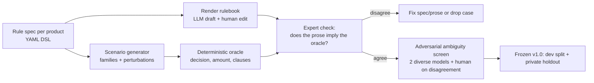

# Caudals' first public benchmark: options, comparison and plan

**Status:** draft for discussion, written from scratch. It does not depend on earlier repo docs.
**Date:** 2026-10-04. Prices, model names and market figures were checked on this date. Verify them again before you commit budget.
**Audience:** the two founders. The document is meant to support a decision, not to argue for one answer.

---

## 0. Recommendation summary

1. **Recommended concept: "FinePrint" (working name).** It is a benchmark of AI agents that apply written rulebooks to concrete customer cases. The rulebooks are policy wordings, terms and conditions, fee schedules and tariff terms. For each case the agent must **decide, compute the amount, cite the clauses that decide the outcome, and know when to ask for more information or escalate**. It covers one task class (the work of a tier-2 case handler or claims handler) across four sector slices: **insurance claims, banking and cards, travel, and energy and telecom billing**.
2. **Why this concept:**
   - It has the largest pool of buyers in both the EU and the US that already run AI on exactly this job.
   - It matches what Caudals sells: evaluating an AI system against the company's own documents.
   - Answers can be generated deterministically, which keeps gold labels cheap. A two-person team can afford that.
   - It is legitimately hard for frontier models.
   - It sits in clear white space. τ²-bench is saturated (best score about 98%). Snorkel's insurance benchmark covers commercial underwriting only. Finance and legal benchmarks are crowded in 2026.
3. **How it covers both the EU and the US without mixing.** Use fictional companies and put every governing rule inside the documents. No outside law is needed, so the task stays the same in every market. Each case family is then rendered as a **US edition and an EU edition** with identical logic. The two editions are scored as separate tracks and also compared as pairs, never pooled into one mixed set (see §6).
4. **Runner-up: "CoverageBench".** This is insurance claims only: travel, pet and home/renters. It is deeper in one sector and cheaper to build, but it has fewer buyers.
5. **Third option: "TrustBench".** Agents answer security and compliance questionnaires from a company's trust documents. It applies to every industry, and the data is cheap (about 2,479 public CAIQ self-assessments). Its buyer pool is narrower, though: mostly questionnaire-automation vendors and SaaS security teams.
6. **Size and cost (Standard tier):**
   - About 400 cases in 200 case families, with roughly 25% released publicly and the rest kept as a private holdout.
   - About $4–5k of API spend, $1–2.5k of the $7.5k Lambda credits, and about $6–9k for experts.
   - 12 weeks for two people (§10, §11).
   - A Lean tier costs about $1.7k in API spend plus about $5k for experts.
7. **Expected headline, if the difficulty is calibrated honestly:**
   - The best frontier model gets about 55–70% of cases fully right.
   - Pass^3 reliability is much lower.
   - Errors split, in measurable proportions, between overpaying or overpromising and wrongly denying.
   - We never invent failures. The difficulty comes from realistic rulebook structure (§8.5).

---

## 1. Goals, constraints and what success means

### 1.1 Goals

| Goal | How the benchmark serves it | Measurable target (proposal, first 90 days after launch) |
| --- | --- | --- |
| Attract pilot projects | A public result showing that agents get fine-print cases wrong, plus a one-click offer: "run it on your agent" or "build it on your documents" | 15+ qualified conversations, 3+ paid or paid-intent pilots |
| Collaborate with companies | Vendors submit their agents privately; experts and academics co-author | 3+ vendor submissions and 2+ co-authors or partners |
| Get clients | Sector reports become outbound collateral for insurance, banking, travel, energy and telecom | Reply rate on sector outreach at least 2× the current baseline |
| Gain recognition | arXiv paper, Hugging Face dataset, GitHub harness, leaderboard and blog | 1k+ HF downloads, 100+ GitHub stars, coverage in 2+ newsletters or podcasts |

### 1.2 Constraints (from the brief)

- Two people, limited budget, one **DGX Spark**, **$7,500 of Lambda credits**, and commercial APIs for frontier models.
- Everything is written in English.
- The subject must be **relevant to both the EU and the US**, broad (no VAT or international tax), and **homogeneous**: one class of tasks or jobs, with no mix of US-specific and EU-specific items.
- **Frontier models must not score 100%.** The benchmark must expose real flaws, including in state-of-the-art models.
- Deliverables: benchmark and leaderboard, Hugging Face dataset, GitHub code, short paper, blog post.

### 1.3 Ground rules for a public benchmark (Caudals non-negotiables)

- No adversarial testing (prompt injection, jailbreaks) of anyone's system without authorisation. "Customer pressure" turns inside our own harness and against model APIs are realistic dialogue, not attacks.
- We present evidence, not certification. Never claim that a model or system is "compliant" or "certified".

---

## 2. What the reference benchmarks teach us (landscape, October 2026)

| Benchmark (owner) | Scope | Size | Headline result | Lesson for us |
| --- | --- | --- | --- | --- |
| **FinanceQA** (AfterQuery, 2025) | Analyst tasks at hedge funds, PE firms and banks | ~1k Q | o1 ~48.7% at release; "assumption" questions ~2–4% | Questions that need judgment under **incomplete information** were the killer category. |
| **APEX-v1 / APEX-1** (Mercor) | Banking, consulting, law, medicine | 300 tasks | Top 75.7% (Gemini 4 Argon) | Expert-written rubrics; small but credible. |
| **APEX-Agents** (Mercor) | Long-horizon, cross-application work in banking, law and consulting | 240 tasks | Top 82.2% | Agentic, tool-heavy tasks are now the norm. |
| **APEX-Accounting** (Mercor + Ramp) | 10 simulated companies, accounting work | 160 tasks | Best model ~56–62%; **best model fully solved only 2.6% of tasks in all 8 runs**; 58% never solved | Simulated "worlds" are accepted. **Repeated runs and budget sweeps** produce the most memorable findings (Fable 5 scored 11.8% at a $1 budget and 55.2% at $50). |
| **Harvey LAB** (Harvey, May 2026) | Legal work across 24 practice areas | 1,200+ tasks, 75k rubric criteria | Very low top scores | Legal is now a crowded, heavily funded arena. |
| **GDPval** (OpenAI) | 44 occupations | 1,320 tasks; 220 public gold | Approaching experts on deliverables | A broad, mixed-occupation design. This is the heterogeneous shape we want to avoid. |
| **FrontierFinance** (Samaya, Aug 2026) | Investor workflows | 220 queries, 11.5k rubrics | Best frontier model 49.2%; best open model (Kimi K3) 46.4% | Finance is crowded (also Vals Finance Agent v2, BigFinanceBench, FORCE-Bench, Herculean). |
| **UNDERWRITE** (Snorkel) | Commercial P&C underwriting at a fictional insurer, multi-turn, tools | 5 task types | 37.7–78.4% by task; tool errors in 36% of conversations; some models invented products in 15–45% of cases | The closest precedent. Synthetic data plus expert (CPCU) validation works. Hallucination from **pretrained domain priors** is a key failure. It covers underwriting, not claims or customer cases. |
| **τ²-bench** (Sierra/Princeton) | Airline, retail and telecom customer service with policies and tools | ~hundreds | **Best 97.8%** (Feb 2026) | Short policies saturate. Pass^k is the right reliability metric. |
| **JourneyBench** (EACL 2026 industry track) | Customer-support SOP adherence | 703 conversations | — | Policy adherence is an active research topic, but no strong public leaderboard exists. |
| **InsLogicBench** (ACL 2026) | Claims adjudication with reasoning traces | — | — | Chinese-language market. No English counterpart exists. |
| **ClaimPilot** (2026) | Veterinary claims pipeline | 150 synthetic cases | 90% accuracy | Simple synthetic cases are **too easy**. Difficulty has to be designed in. |

**What this means for us**

1. **Benchmarks are how data and eval companies market themselves.** AfterQuery, Mercor, Snorkel, Samaya, Harvey and Vals all follow the same pattern: expert-built, small (150–300 tasks), hard, a public sample plus a private holdout, a leaderboard and an arXiv paper.
2. **150–400 cases is enough for credibility** if they are well built.
3. **Reliability across repeated runs and cost-versus-accuracy curves** make the best headlines.
4. **Avoid crowded ground.** Finance analysis and legal drafting each have 4–8 well-funded benchmarks from 2026 alone.
5. **The open gap:** long, realistic rulebooks combined with exact computation, clause citation and escalation decisions, in **customer-facing regulated sectors**. τ²-bench showed demand for this kind of test, then saturated because its policies are short.

---

## 3. How the options were scored

### 3.1 Hard gates (an option must pass all of them)

- **G1 Buyers:** hundreds of reachable organisations in **both** the EU and the US that already deploy AI on the task, plus AI vendors who sell to them.
- **G2 Data:** public or licensable English source material, or a credible way to synthesise realistic documents.
- **G3 Gold:** correct answers can be verified without months of expert time.
- **G4 Homogeneity:** a single class of task or job.
- **G5 Feasibility:** shippable in about 12 weeks by two people within the compute budget.

### 3.2 Weighted criteria (each scored 1–5)

| Criterion | Weight | What a 5 looks like |
| --- | --- | --- |
| C1 Commercial pull | 25% | Many EU and US buyers with live AI on the task; a direct bridge to a Caudals pilot |
| C2 Gold cost and verifiability | 20% | Answers are mostly deterministic (labels and amounts); experts verify rather than author |
| C3 Data availability and releasability | 15% | Abundant documents that can be released on Hugging Face without copyright risk |
| C4 White space in 2026 | 10% | No strong public benchmark exists |
| C5 Legitimate difficulty headroom | 10% | Realistic structure keeps frontier models well below 100% |
| C6 Feasibility for two people with our compute | 10% | Short documents, cheap runs, few experts |
| C7 Homogeneity and EU/US neutrality | 10% | The same skill applies in both markets, with no jurisdiction-specific knowledge needed |

---

## 4. Candidate ideas

Each idea lists the task, data, buyers, existing benchmarks, how gold answers are produced, experts, difficulty, cost and a verdict. The first four get the most detail.

### A. FinePrint: cross-sector policy application (recommended)

- **Job studied:** a tier-2 case handler (customer service, claims or billing disputes) who must apply long written rules to a specific customer situation.
- **Task:** the agent receives a customer request, an account or policy record, case documents (claim form, receipts, emails, booking, usage data as text) and the company's rulebook. The rulebook is a wording plus schedule, endorsements, a fee or tariff table and older versions. The agent must return:
  - a **decision**: approve, partial, deny, need more information, or escalate;
  - the **exact amount**;
  - the **clauses that decide the outcome**;
  - the **action**: a tool call such as `issue_refund`, `request_document` or `escalate`;
  - a short **message to the customer** that does not contradict the decision.
- **Sector slices (v1):**
  - **Insurance claims:** travel, pet and home/renters. Coverage triggers, exclusions and their exceptions, waiting periods, sub-limits, excess, depreciation, aggregate limits.
  - **Banking and cards:** fee and interest computation, penalty-rate triggers, grace periods, foreign-transaction and ATM fees, dispute and refund eligibility under the account terms.
  - **Travel:** fare rules, change and cancellation fees, refund options after schedule changes, baggage allowances, compensation clauses in a carrier's conditions of carriage.
  - **Energy and telecom billing:** tiered and time-of-use tariffs, proration, early-termination fees, price-change notice windows, contract-renewal rules.
  - Optional fifth slice: **internal expense and travel policy**, the same skill applied to an internal agent (see option F).
- **Data:**
  - Real documents of these types are public everywhere: insurers publish policy wordings, and EU insurers must publish IPIDs. The [CFPB credit card agreement database](https://www.consumerfinance.gov/credit-cards/agreements/) holds agreements from 600+ issuers, collected quarterly. EU banks publish standardised [Fee Information Documents](https://www.eba.europa.eu/eba-starts-work-to-standardise-fee-terminology-for-payment-accounts-across-the-eu) under the Payment Accounts Directive. Airline conditions of carriage and telco and energy terms are on every company's website. The [OpenEI Utility Rate Database](https://openei.org/services/doc/rest/util_rates/) has structured tariffs for 3,700+ US utilities.
  - We use these documents **as models for structure and drafting style**. We release **fictional-company bundles** written to that standard (see §7.3 on licensing and contamination).
  - Public-domain real texts can serve as an auxiliary realism check: the US NFIP [Standard Flood Insurance Policy](https://www.ecfr.gov/current/title-44/chapter-I/subchapter-B/part-61/appendix-Appendix%20A(1)%20to%20Part%2061) is federal regulation, and EU legislation is [freely reusable](https://eur-lex.europa.eu/content/help/data-reuse/reuse-contents-eurlex-details.html?locale=en).
- **Buyers with AI already doing this job** (verified examples; full lists in §12):
  - Insurance: 78% of insurers report active GenAI deployments, with claims the top use case (KPMG survey as reported by [ScienceSoft](https://www.scnsoft.com/insurance/insurance-ai-trends)). [Lassie](https://fintech.global/2026/03/06/insurtech-funding-tops-1bn-in-february-as-ai-investment-surges/) processes about 60% of German claims end-to-end in about six minutes. AI claims-agent vendors include Pace, FurtherAI, Avallon and insured.io.
  - Banking: [all top-10 US banks run chatbots](https://www.consumerfinance.gov/about-us/newsroom/cfpb-issue-spotlight-analyzes-artificial-intelligence-chatbots-in-banking/). [Revolut](https://tech.eu/2026/04/09/revolut-wins-full-uk-banking-licence-as-finally-exits-mobilisation-phase/) and [Starling](https://tech.eu/2026/03/20/starling-bank-rolls-out-uks-first-agentic-ai-financial-assistant/) launched AI assistants in 2026. [BBVA](https://www.bbva.com/en/innovation/artificial-intelligence/) runs GenAI assistants in contact centres.
  - Travel: Lufthansa Group uses Cognigy, Delta has a GenAI concierge, and ASAPP's agent handles EU261 and DOT compensation claims ([Fini](https://www.usefini.com/guides/ai-airline-cancellation-refund-automation), [CX Dive](https://www.customerexperiencedive.com/news/delta-begins-roll-out-generative-ai-virtual-assistant-concierge/803899/)).
  - Energy: [Octopus Energy](https://www.techuk.org/resource/case-study-kraken-tech-s-generative-ai-tool-for-customer-service.html) answers more than 50% of customer emails with AI assistance and launched the Arlo chatbot in 2026.
  - Customer-experience AI vendors: Sierra (about $15.8B valuation), Decagon (about $4.5B), Ada, Zendesk, Intercom Fin, Cognigy, ASAPP, Zowie ([comparison](https://fin.ai/learn/sierra-vs-decagon-vs-ada)).
  - The legal and reputational risk is public: in [Moffatt v. Air Canada](https://www.americanbar.org/groups/business_law/resources/business-law-today/2024-february/bc-tribunal-confirms-companies-remain-liable-information-provided-ai-chatbot/) the airline was held liable for policy its chatbot invented, and the [CFPB](https://www.consumerfinance.gov/about-us/newsroom/cfpb-issue-spotlight-analyzes-artificial-intelligence-chatbots-in-banking/) has warned about chatbot compliance risk.
- **Existing benchmarks:** τ²-bench (saturated, short policies), JourneyBench (SOP graphs), UNDERWRITE (underwriting only). No English benchmark combines long rulebooks, exact amounts, citations and escalation across several regulated sectors. **White space is strong.**
- **Gold method:**
  1. Encode each rulebook as a **machine-readable rule spec**.
  2. Render it into realistic legal prose; an expert edits the result.
  3. Generate case scenarios.
  4. A **deterministic oracle** computes the decision, amount and decisive clauses.
  5. An expert verifies that the prose unambiguously implies the oracle's answer.

  Experts **verify** rather than author, which makes this 3–5× cheaper than expert-written cases.
- **Experts:** one practitioner per sector: a claims handler or adjuster, a bank operations or complaints specialist, an airline or OTA customer-relations specialist, a utility or telco billing specialist. Paid at roughly $40–100/h ([Upwork insurance consultants](https://www.upwork.com/hire/insurance-consultants/)), with co-authorship offered.
- **Difficulty levers** (all of them real-world patterns):
  - exceptions to exclusions;
  - definitions that change the meaning of a clause;
  - endorsements that override the base wording;
  - selecting the right document version by date;
  - whether the deductible applies before or after the limit;
  - sub-limits and aggregate limits;
  - proration and rounding;
  - facts scattered across several documents;
  - missing information, where the right answer is to ask rather than guess;
  - out-of-policy requests, where the right answer is to escalate;
  - customer pressure to concede.
- **Cost and feasibility:** medium. Four slices mean four bundle families, but they share one schema, one harness and one oracle framework, so each extra sector costs mainly authoring and expert review.
- **Risks:**
  - Critics may call synthetic documents unrealistic. Mitigation: expert realism review plus a public-domain real-document probe.
  - Breadth could look shallow. Mitigation: depth inside each slice and sector reports.
- **Verdict:** best overall fit.

### B. CoverageBench: insurance claims coverage and payout (runner-up)

- **Task:** the same as FinePrint, restricted to personal-lines claims (travel, pet, home/renters, optionally flood). Answers are coverage decisions with payout computation.
- **Data:**
  - Wordings are public, but many US home forms are **ISO-copyrighted** (for example HO 00 03, "© Insurance Services Office"), so they cannot be redistributed.
  - The [NFIP flood policy](https://www.ecfr.gov/current/title-44/chapter-I/subchapter-B/part-61/appendix-Appendix%20A(1)%20to%20Part%2061) is public domain.
  - EU travel and pet wordings plus IPIDs serve as structural templates.
  - The release would use fictional-insurer bundles.
- **Buyers:** insurers (thousands in each market), claims TPAs, insurtech vendors (Pace, FurtherAI, Avallon, Sprout.ai, Shift, Simplifai and others). Insurtech raised [$943M in Q1 2026, about 3/4 of it AI-related](https://insurabeat.com/global-insurtech-funding-rises-27-to-943m-in-q1-2026-with-ai-accounting-for-three-quarters-of-capital-3/).
- **Existing benchmarks:** UNDERWRITE (commercial underwriting), InsLogicBench (Chinese), LegalBench's insurance-interpretation task (tiny), ClaimPilot (easy). No English personal-lines claims benchmark exists.
- **Pros:** one expert profile, deeper credibility, cheaper (about 60–70% of FinePrint's effort), and it maps directly to the insurance sector page.
- **Cons:** smaller press reach, a smaller buyer pool, and slower insurance sales cycles.
- **Verdict:** pick this if you want a narrower first release. It can later become the first slice of FinePrint.

### C. FeeBench: banking and card terms, fees and interest

- **Task:** given a card or account agreement plus statements and transactions, compute fees and interest, decide on dispute or refund eligibility, and cite the terms.
- **Data:** the best public corpus of any option. The CFPB database holds agreements from 600+ issuers, with quarterly archives of about 0.7–1 GB ([DataLumos](https://www.datalumos.org/datalumos/project/228842/version/V1/view)). EU Fee Information Documents follow a mandated standard format.
- **Gold:** almost fully deterministic (arithmetic over terms).
- **Buyers:** banks, neobanks, card issuers and customer-experience vendors. Banks buy slowly and have heavy procurement, which is hard for a two-person startup.
- **Risks:** card agreements are shorter and more formulaic, so there is less headroom. US card products and EU payment accounts are different products, which weakens the case for paired editions.
- **Verdict:** excellent as a **FinePrint slice**. Weaker as a standalone flagship.

### D. TrustBench: security and compliance questionnaire answering

- **Task:** from a company's trust documentation (security whitepaper, policies, trust-centre pages, sub-processor list), answer questionnaire items (CAIQ, SIG-style, or a vendor DPA checklist). Each answer is Yes, No, N/A or "insufficient evidence", with justification and citation. Abstaining correctly is part of the task.
- **Data:**
  - About **2,479 public CAIQ self-assessments** in the CSA STAR Registry (as of 2026-09-19, [source](https://governancedocs.com/star-level-1/)).
  - Public trust centres and whitepapers.
  - The registry's licence terms need checking.
  - Self-reported answers are not ground truth. Gold must come from the documents.
- **Buyers:**
  - Questionnaire-automation vendors (Conveyor, Loopio, Responsive, Inventive AI, Vanta, Drata/SafeBase, Whistic, Tribble, AutoRFP, Steerlab, SecurityPal). Some claim "95%+ accuracy" ([Conveyor](https://www.conveyor.com/blog/the-best-security-questionnaire-automation-software-in-2026)), and an independent benchmark would test that claim.
  - Every B2B SaaS company that answers questionnaires.
- **Existing benchmarks:** none found for evidence-grounded questionnaire answering. SecQA and SecBench test security knowledge, not this task.
- **Pros:** global frameworks, so no EU/US split. Strong novelty. Cheap compute (short documents).
- **Cons:** the buyer pool is mostly vendors plus security teams with small eval budgets. Gold needs security-compliance experts. It sits further from Caudals' sector pages.
- **Verdict:** a strong **second benchmark** (v2), not the first.

### E. TenderBench: public procurement tender analysis

- **Task:** from a tender's documents, extract the compliance matrix (mandatory requirements, eligibility, deadlines, award criteria), decide go or no-go against a bidder profile, and draft clarification questions.
- **Data:** abundant and open. EU [TED](https://ted.europa.eu/en/help/data-reuse) has daily and monthly XML bulk files back to 1993; US SAM.gov has an API.
- **Buyers:** RFP and tender AI tools (Tenderbolt, Forgent, Altura, Tendium, Loopio and others) and bid teams at contractors.
- **Problems:**
  - EU tenders are mostly not in English.
  - FAR rules and EU directives are different legal regimes, which pushes toward exactly the mixing you want to avoid.
  - Documents run to hundreds of pages.
  - Grading extraction is fuzzy and needs expert judgment.
- **Verdict:** high novelty, poor feasibility for v1.

### F. ExpenseBench: travel and expense policy audit agents

- **Task:** given a company travel and expense policy and an expense report (OCR'd receipts as text, itinerary, approvals), approve, reject or flag each line and compute the reimbursable amount with citations.
- **Data:** the US Federal Travel Regulation and GSA per diem tables (public domain), university and public-sector travel policies, and synthetic company policies. Receipt images are out of scope; use text.
- **Buyers:** [Ramp Policy Agent, Brex, Navan Audit Engine (April 2026), AppZen](https://www.kognitos.com/blog/top-ai-tools-expense-management-te-compliance-2026/), Pleo, Spendesk, Payhawk, Expensify, SAP Concur, and every finance team.
- **Pros:** fully deterministic gold, a universal task, cheap.
- **Cons:** the pool of buyers who would pay for an evaluation is narrower (about 30 vendors plus finance teams). Mercor already works with Ramp on accounting.
- **Verdict:** a great **optional FinePrint slice** for internal agents, since it is the same skill.

### G. TariffBench: energy and telecom billing

- **Task:** compute bills, check proration and fees, and decide on switching, exit-fee and renewal questions from tariff terms and usage data.
- **Data:** URDB covers 3,700+ US utilities with structured rates, and EU tariffs are published. The structured data lets an oracle compute bills exactly.
- **Buyers:** utilities, energy retailers (for example Octopus/Kraken), telcos and their customer-experience vendors. These are slow buyers, apart from retailers.
- **Verdict:** a solid **FinePrint slice**. Too narrow on its own.

### H. LeaseBench: commercial lease abstraction and rent schedules

- **Task:** abstract key terms and compute rent schedules (escalations, CPI indexation, free-rent periods, options).
- **Data:** commercial leases filed as exhibits on SEC EDGAR, which are US-heavy.
- **Buyers:** commercial real-estate tech and property managers. Caudals has no real-estate presence today.
- **Verdict:** feasible, but buyers and the EU/US fit are weaker.

### I. ServiceBench: industrial after-sales troubleshooting from manuals

- **Task:** diagnose a fault and choose the procedure from equipment manuals and service bulletins.
- **Fit:** matches the existing "industrial after-sales" sector page. Buyers include field-service AI vendors and OEMs.
- **Problems:** manuals are copyrighted. Gold needs technicians. Public-domain material (for example military technical manuals) is unrepresentative.
- **Verdict:** keep for a customer-specific pilot, not a public benchmark.

### J. LabelBench: questions answered from drug labels

- **Data:** excellent and public. DailyMed SPL bulk files contain about 15k Rx label files, and EMA SmPCs are public.
- **Problems:** a medical-safety burden; FDA and EMA labels differ (mixing again); medical benchmarking is crowded (HealthBench, MedHELM); pharma sales cycles are slow.
- **Verdict:** not for a two-person first release.

### K. Contract playbook review (legal)

- **Status:** very crowded in 2026: Harvey LAB, the Vals legal report, ContractEval, RedlineBench, ContractScrub and CLAUSE.
- **Problems:** lawyers' time is expensive, and gold labels are judgment-heavy.
- **Verdict:** skip.

### L. Financial analysis or credit memos

- **Status:** crowded (FinanceQA, FrontierFinance, Finance Agent v2, CorpFin, BigFinanceBench, FORCE-Bench).
- **Problems:** a GAAP versus IFRS split breaks homogeneity.
- **Verdict:** skip.

### Also considered and dropped

- **HR handbook and leave entitlements:** statutory leave law differs by jurisdiction.
- **E-commerce returns:** τ²-bench retail is saturated.
- **Health prior authorisation:** US-only and carries PHI risk.
- **KYC/AML onboarding:** PII and regulated data.
- **ESG reporting:** CSRD versus SEC rules means mixing.
- **Customs and Incoterms:** jurisdiction-heavy.

---

## 5. Comparison

### 5.1 Scores

| Option | C1 Comm. (25) | C2 Gold (20) | C3 Data (15) | C4 Novel (10) | C5 Headroom (10) | C6 Feasible (10) | C7 Homog. (10) | **Weighted /5** |
| --- | --- | --- | --- | --- | --- | --- | --- | --- |
| **A FinePrint** (4 slices) | 5 | 4 | 4 | 4 | 4 | 3 | 5 | **4.25** |
| B CoverageBench | 4 | 4 | 3 | 4 | 4 | 4 | 4 | 3.85 |
| F ExpenseBench | 3 | 5 | 4 | 4 | 3 | 4 | 4 | 3.85 |
| C FeeBench | 3 | 5 | 4 | 4 | 3 | 4 | 3 | 3.75 |
| G TariffBench | 3 | 5 | 4 | 4 | 3 | 4 | 3 | 3.75 |
| D TrustBench | 3 | 3 | 4 | 5 | 3 | 4 | 5 | 3.65 |
| H LeaseBench | 2 | 4 | 4 | 4 | 3 | 4 | 3 | 3.30 |
| K Contract playbook | 4 | 2 | 4 | 1 | 4 | 3 | 3 | 3.10 |
| E TenderBench | 3 | 2 | 5 | 4 | 4 | 2 | 2 | 3.10 |
| I ServiceBench | 3 | 2 | 2 | 4 | 4 | 3 | 5 | 3.05 |
| L Financial analysis | 3 | 3 | 5 | 1 | 3 | 3 | 2 | 3.00 |
| J LabelBench | 2 | 3 | 5 | 3 | 3 | 3 | 2 | 2.95 |

These are judgment scores, not measurements. Their purpose is to make the trade-offs explicit.

### 5.2 Sensitivity

- **If commercial reach matters most,** FinePrint stays first, and its margin grows.
- **If cost and speed matter most,** ExpenseBench, FeeBench and TariffBench move up because their gold is deterministic. That is the reason to use them **as slices** of FinePrint.
- **If depth in one sector matters most,** CoverageBench is the choice.
- **If novelty and press matter most,** TrustBench moves up, but it narrows the buyer pool.
- **The structural point:** FinePrint is the four best single-sector ideas (B, C, G plus travel) sharing one schema, harness and oracle. Its extra cost over CoverageBench is mostly document authoring and three more expert reviewers.

---

## 6. Covering the EU and the US without a mixed benchmark

You asked for a homogeneous task class that matters on both sides of the Atlantic, without one item governed by US rules and the next by EU rules. There are three viable patterns.

| Pattern | How it works | Pros | Cons |
| --- | --- | --- | --- |
| **P1 Closed-world, neutral** | Fictional companies; **every rule the agent needs is in the bundle**; no outside law is needed or rewarded | Cheapest; perfectly homogeneous; any company in either market recognises the job | No explicit EU-versus-US story; currency and terms are cosmetic |
| **P2 Paired market editions** (recommended at Standard tier) | Each case family is rendered twice with **identical logic**: a US edition (USD, "deductible", declarations-page conventions) and an EU edition (EUR, "excess", IPID-style summary, EU drafting). The editions are scored **as separate tracks** and **compared as matched pairs**; they are never pooled | Covers both markets explicitly; adds a new research question ("do models behave differently on EU-styled versus US-styled documents with identical logic, and do they import outside legal assumptions?"); every slice has a US and an EU leaderboard | Second-edition rendering and review add about 30–40% to document effort; double the episodes, or half as many families, for the same cost |
| **P3 Single market first** | v1 is US-only or EU-only; the other market follows in v1.1 | Simplest story | Leaves half the market without coverage at launch |

**Recommendation:** use **P2 with P1 discipline**. All rules stay in-bundle, so neither edition rewards jurisdictional knowledge. Any answer that relies on outside law (for example quoting EU261 when the conditions of carriage say something else) is scored as an **imported-assumption error**. Snorkel observed this failure in underwriting, and it makes a strong headline finding.

If budget is tight, ship P1 (one neutral edition) and add the second edition in v1.1.

---

## 7. Design space for FinePrint (variants to choose from)

### 7.1 Scope variants

| Variant | Slices | Cases (families × editions) | Effort | When to choose |
| --- | --- | --- | --- | --- |
| V1 Narrow | Insurance only (travel, pet, home) | 240 (120 × 2) | Low | Fastest launch, insurance-led sales |
| V2 Consumer core | Insurance, banking, travel | 360 (180 × 2) | Medium | Balanced choice |
| **V3 Recommended** | Insurance, banking, travel, energy and telecom | **400 (200 × 2)** | Medium-high | Maximum reach; matches five existing sector pages |
| V4 Wide | V3 plus internal expense policy | 480 (240 × 2) | High | Add internal agents and finance vendors |

### 7.2 Interaction-mode variants (we run more than one; each is reported separately)

- **Mode L: long-context.** The whole bundle goes into the prompt and the model returns structured JSON. This is the cheapest mode and supports batch APIs.
- **Mode T: tool-using agent.** This is the primary mode. The agent must find information through tools: `search_documents`, `read_section`, `get_account`, `get_case_file`, `calculator`, then finish with `request_information`, `escalate` or `submit_decision`. This mode measures retrieval, tool use and action correctness, and it mirrors deployed agents.
- **Mode P: pressure subset.** Two or three **scripted** follow-up customer turns, such as "your colleague promised me…" or a new document. These are deterministic, not an LLM-simulated user, to keep reproducibility high. The mode measures whether the agent concedes when it should not, and whether it updates correctly when the facts change.
- **Mode D: deployed systems (private).** Vendors or companies point the harness at their own agent, by API or our connector. Results stay private unless the owner consents to publication. This is the commercial bridge.

### 7.3 Document strategy

| Strategy | Credibility | Release on HF | Contamination resistance | Cost |
| --- | --- | --- | --- | --- |
| Real company documents, link-only release | High | Links and hashes only; copyright risk if mirrored | Low (documents may be in pretraining data) | Low |
| Real public-domain documents (NFIP, EU legislation) | High | Full | Low to medium | Low, but limited coverage |
| **Synthetic fictional-company documents** rendered from rule specs and expert-edited | Medium to high with expert attestation | Full (CC BY) | **High** | Medium |
| **Hybrid (recommended)** | Synthetic core, about 85%, plus a **real-document probe** of public-domain texts, about 15%, reported separately | Full | High | Medium |

**Realism safeguards for the synthetic documents:**

- Use real documents of each type as structural templates. Paraphrase structure, never copy text.
- Use several renderer models plus human editing, so the prose does not read as written by one model.
- Include definitions sections, cross-references, schedules, endorsements and stale versions.
- A sector expert signs a realism attestation for each bundle.
- Pilot gate: if performance on synthetic documents is much higher than on the real-document probe, the synthetic documents are too clean and must be revised.

### 7.4 Naming

FinePrint is a working name. Alternatives: *Clause & Effect*, *RuleBench*, *CaseHandler*. Check Hugging Face, arXiv and GitHub for collisions before announcing.

---

## 8. Recommended design (blueprint)

### 8.1 Case anatomy

```text
bundle/                     one fictional company + product, one market edition
  rulebook/
    wording_v3.2.md         current terms (effective dates in header)
    wording_v3.1.md         superseded version (version-selection trap)
    schedule.md             limits, sub-limits, excess/deductible, fees
    endorsement_E07.md      overrides part of the wording
    faq_public.md           marketing FAQ; NOT contractual (precedence clause says so)
  rule_spec.yaml            private: machine-readable rules the oracle executes
case/
  request.md                customer message
  account.json              policy/account record (dates, plan, holders, usage)
  case_file/                claim form, receipts, emails, booking, doctor's note (text)
gold/ (private for holdout)
  decision, amount, decisive_clauses, required_action, prohibited_actions, tags
```

### 8.2 Output contract (what the agent must return)

```json
{
  "decision": "approve | approve_partial | deny | need_information | escalate",
  "amount": { "value": "3000.00", "currency": "EUR" },
  "decisive_clauses": ["W3.2:4.1", "W3.2:DEF.12", "W3.2:7.3(b)", "E07:1-2", "SCH:B2", "W3.2:9.2"],
  "missing_information": [],
  "customer_message": "≤120 words, consistent with the decision"
}
```

In Mode T, the same fields are passed as arguments to the `submit_decision` tool, and the final state of the tools is checked as well.

### 8.3 Worked example (insurance slice, EU edition, illustrative)

- **Bundle:** *Northwind Mutual TravelSafe Single Trip*. Wording v3.2 has been in effect since 2026-01-01; v3.1 is still in the bundle. The schedule sets the cancellation limit at €3,000 per insured person, with a €150 excess per claim. Endorsement E07 is a waiver of the pre-existing-condition exclusion. It applies if the policy is bought within 14 days of the first trip payment and the insured had no known reason to cancel at the time of purchase.
- **Facts, spread over three documents:**
  - First trip payment 2026-02-20; policy bought 2026-03-02; trip 2026-05-10 to 05-20.
  - Cancelled 2026-04-28 because the insured's mother was hospitalised. Her heart condition was diagnosed in 2025-11, and her medication was changed on 2026-02-15.
  - Non-refundable costs are €4,200.
- **Correct reasoning:**
  1. Cancellation cover applies, because a parent counts as a "close relative" under DEF.12.
  2. The pre-existing exclusion in 7.3(b) would apply: the condition was not "stable" in the 90 days before purchase, because the medication changed.
  3. **But** endorsement E07 waives that exclusion: purchase came 10 days after the first payment, within the 14-day window.
  4. Clause 9.2 says the excess is deducted **before** the limit applies: €4,200 − €150 = €4,050, capped at €3,000.
  5. v3.1, with its €5,000 limit, is superseded and does not apply.
- **Gold answer:** `approve_partial`, **€3,000.00**, with the six decisive clauses.
- **Typical failures:**
  - deny under 7.3(b) without checking E07;
  - pay €2,850 by applying the excess after the limit;
  - pay €4,050 by using the v3.1 limit;
  - say "fully covered" in the customer message while the decision is partial.

**Sketches for the other slices:**

- **Banking:** a late payment triggers the penalty rate only after two consecutive late payments within 12 months, per the agreement. Compute the interest change and the fee cap, and decide on a fee-waiver request against the courtesy-waiver clause (once per 12 months).
- **Travel:** a non-refundable fare, but a schedule change of more than 3 hours gives the passenger a choice: rebook or refund to the original form of payment. The agent must pick the option the conditions of carriage allow, not a generic compensation from memory.
- **Energy and telecom:** a price-change notice gives a 30-day window to leave without an exit fee. The customer left on day 34 under a dual-fuel plan with proration. Compute the final bill and exit fee, citing the clause on notices that are deemed received.

### 8.4 Skills and failure-mode taxonomy (tags on every case)

1. Coverage or eligibility trigger.
2. Exclusion.
3. **Exception to an exclusion**, and exceptions to exceptions.
4. Definitions that change scope.
5. Precedence between documents (endorsement over wording over FAQ).
6. Version selection by effective date.
7. Limits, sub-limits and aggregates.
8. Order of deductible or excess against the limit.
9. Proration and rounding.
10. Waiting periods and other time windows.
11. Facts spread across several documents.
12. Missing information, where the right move is to ask.
13. Outside the agent's authority, where the right move is to escalate.
14. Conflicting evidence in the case file.
15. Customer pressure and false claims of prior promises.
16. Imported outside knowledge, such as invoking laws or products that are not in the bundle.
17. Consistency between the decision and the customer message.

### 8.5 Difficulty design (honest, not rigged)

- **Targets on the frozen holdout:** best frontier model 55–75% strict pass; pass^3 at or below 50%; median open model 25–45%.
- **Where the difficulty comes from:** composition. Two to four interacting rules from the taxonomy, long bundles (20–90k tokens), distractor documents and realistic noise. Never trick wording or contradictory gold.
- **Every hard case must be:**
  1. a pattern the sector expert has seen in real work;
  2. unambiguous given the documents (the expert answers it alone and matches the oracle);
  3. tagged with what makes it hard.
- **Representative core plus challenge set.** Keep about 30% "routine" cases. This shows the benchmark is not a gotcha collection and lets us report routine versus complex accuracy, which is a strong business message.
- **Calibration loop.** Run pilots on the DGX, free models and two cheap API models only. Freeze before the full runs. Never tune against the final holdout results.

### 8.6 How gold answers are produced



- **Rule spec:** a small YAML language (conditions, dates, amounts, precedence). One person can build the oracle in about a week, and it is reused across all four sectors.
- **Families:** each family is one logical scenario with three to five perturbations: changed dates, amounts, which document holds which fact, and the market edition. Splits and statistics use **families**, never single cases.
- **Expert checking, two-tier:**
  - The founders verify 100% of cases against the oracle.
  - Experts verify all bundles, all challenge cases, a 30% sample of routine cases, and every case disputed after pilot runs.
- **Ambiguity budget:** below 3% of cases flagged after release. Publish errata and a changelog.

### 8.7 Scoring

| Metric | Definition | Graded by |
| --- | --- | --- |
| **Strict pass (headline)** | Correct decision **and** amount within 0.01 under the stated rounding **and** every decisive clause cited **and** no prohibited action | Deterministic |
| Decision accuracy | Label match | Deterministic |
| Amount accuracy | Exact match under the stated rounding; signed error recorded | Deterministic |
| Citation precision and recall | Against the decisive and acceptable clause sets | Deterministic |
| Ask/escalate calibration | Precision and recall of `need_information` and `escalate` on answerable versus non-answerable cases | Deterministic |
| **Asymmetric error rate** | **Overpromise or overpay** (company loss, Air Canada-type liability) versus **wrongful denial or underpay** (consumer harm, regulatory risk) | Deterministic |
| Message consistency | Does the customer message contradict the decision or misstate the rules? | LLM judge, calibrated |
| Reliability | pass^k over k = 3 runs (k = 5 on a subset) | Deterministic |
| Cost and latency | $ per case, $ per strict pass, tokens, wall time | Measured |

- **About 85% of the score is deterministic.** The only judged criterion is message consistency. The judge is calibrated on 60+ expert-labelled examples, with agreement of at least 85% reported. Use an open-weight judge for reproducibility, plus a second commercial judge on a sample. The published methodology should say this prominently.
- **Statistics:**
  - Wilson intervals per model, and a cluster bootstrap over families.
  - Paired comparisons between models and between editions.
  - Results labelled "inconclusive" when the intervals overlap.
  - With 400 cases, the overall 95% half-width is about ±5 points; per slice it is about ±10 points. Say so in the paper.

### 8.8 Research questions for the paper

1. **RQ1:** How accurately do frontier and open models apply long, realistic rulebooks?
2. **RQ2:** Which rule structures cause failures (exceptions, precedence, ordering, time windows)?
3. **RQ3:** Do errors lean toward overpaying or toward wrongful denial, by model and by sector?
4. **RQ4:** How reliable are the models across runs (pass^k)?
5. **RQ5:** Do tools and agentic retrieval beat the long-context mode, and at what cost?
6. **RQ6:** How does accuracy change with reasoning budget? This produces a cost-accuracy frontier chart.
7. **RQ7:** Do models know when to ask or escalate?
8. **RQ8:** Do models perform differently on EU-styled and US-styled editions of identical logic, and do they import outside law?
9. **RQ9 (optional, high-value commercially):** Does a modest, targeted training set from the same rule engine let a 27B open model close the gap? This is a direct demonstration of Caudals' custom-dataset service (Track D, §9.4).

### 8.9 Model roster (October 2026; confirm availability at freeze)

| Group | Models | Run via |
| --- | --- | --- |
| Frontier proprietary | Claude Fable 5.x, Claude Opus 5.5, GPT-6 Astra, GPT-5.6 Sol, Gemini 4 Argon, Grok 4.6, Meta Muse Spark 1.2 | Provider APIs |
| Mid and cheap proprietary | Claude Sonnet 5.5, Claude Haiku 4.5, Gemini 3.8 Flash, GPT-5.6 Luna or Terra, Mistral Medium 3.5 | Provider APIs |
| Large open-weight | Kimi K3 (2.8T), DeepSeek V4 Pro (1.6T-A49B), GLM-5.3 (about 750B-A39B) | Cheap third-party APIs; renting 8×B200 for them costs more |
| Self-hostable open-weight | DeepSeek V4 Flash (284B-A13B), GLM-5.3-Flash (320B-A18B, MIT), Qwen3.6-27B, Qwen3.6-35B-A3B, gpt-oss-120b, gpt-oss-20b | **Lambda** (vLLM/SGLang) and the **DGX Spark** for the small ones |
| Optional ceiling probe | GPT-5.5 Pro | One run on a 100-case subset (expensive) |

This roster supports a strong EU message: how far behind are the models a European company can self-host for data sovereignty?

---

## 9. Implementation (technical)

### 9.1 Repositories and formats

- **GitHub `caudals/fineprint`** (Apache-2.0):
  - `spec/`: the rule-spec language and JSON Schemas;
  - `oracle/`;
  - `generators/`: scenarios and perturbations;
  - `render/`: document rendering prompts and templates;
  - `harness/`;
  - `scoring/`;
  - `analysis/`: notebooks for the paper's figures;
  - `leaderboard/`: static JSON for the website.
- **Harness:** build on **[Inspect AI](https://inspect.aisi.org.uk/)**, the UK AI Security Institute's open-source eval framework.
  - It supports tools and agents, OpenAI, Anthropic and Google models, vLLM, Ollama and OpenRouter, logging and reproducible runs.
  - It is credible to researchers.
  - Contributing the benchmark to `inspect_evals` adds visibility.
  - Alternative: a minimal custom harness in the τ²-bench style. More control, more work.
- **Dataset on Hugging Face `caudals/fineprint`:**
  - `dev` split public: about 25% of families, with documents, cases and gold.
  - `holdout`: cases and gold kept private. Only the hashes and a sample are published.
  - Dataset card with intended use, limitations and a canary GUID.
  - Croissant metadata.
  - Gated access with a "do not train on this data" request.
  - Licence CC BY 4.0 for the released content.
- **Private bridge:** the same cases export to the internal Caudals evaluation platform for Mode D (customer agents). Customer runs never touch the public repo.

### 9.2 Compute plan

| Resource | Use | Notes |
| --- | --- | --- |
| **DGX Spark** (128 GB unified memory; about 40–55 tok/s generation on gpt-oss-120b, about 1.7k tok/s prefill) | All iteration: draft rendering overnight, pilot runs on Qwen3.6-35B-A3B and gpt-oss models, judge prototyping, small-model baselines | Paid APIs only see frozen runs. Bandwidth-bound, so batch jobs overnight ([benchmarks](https://www.glukhov.org/llm-performance/benchmarks/dgx-spark-vs-mac-studio-vs-rtx4080/)) |
| **Lambda** (H100 SXM $3.99/GPU-h, B200 $6.69/GPU-h, GH200 $2.29/GPU-h; [pricing](https://gpucost.org/provider/lambda)). Lambda's own inference API was retired in 2025, so credits buy GPU instances | Self-host the mid-size open models on 8×H100 (about $32/h) with vLLM; the open-weight judge; optional Track D fine-tune | An 8×H100 node ≈ 235 h of credits. Each mid-size model for 3 runs × 400 cases ≈ 2–5 h, or $100–250 including weight download and warm-up. Check whether the credits expire |
| **Third-party APIs** for the huge open models | Kimi K3, DeepSeek V4 Pro, GLM-5.3 | Cheaper than renting 8×B200 for 1–3T-parameter models |
| **Provider APIs** | Proprietary models | Use prompt caching (bundles are shared prefixes) and **batch APIs** (about 50% off) for Mode L and judge calls |

### 9.3 Run protocol

1. **Freeze** v1.0: hashes of every bundle and case, the harness commit, prompts, tool definitions and scoring version.
2. **Smoke test** each model on 10 dev cases to check output format and tool-call support.
3. **Full runs:** Mode T × 3 seeds for every model. Mode L × 1 seed. Mode P on its subset.
4. **Budget sweep:** 3–4 models × 3 reasoning-effort levels on 100 cases.
5. **Human baseline:** experts solve 40 cases with timing. This yields a headline like "experts take N minutes at X% accuracy; the best model gets Y% at $Z".
6. **Grade, run statistics, manually code a 150-failure sample** against the failure taxonomy.
7. **Freeze results.** Republish only with versioned errata.

### 9.4 Optional tracks

- **Track R (real-document probe):** about 60 cases on public-domain texts, such as the NFIP flood policy and EU-legislation-based scenarios. Reported separately per market. It answers the "synthetic isn't real" critique.
- **Track D (data demo):** LoRA fine-tune of Qwen3.6-27B on about 2–5k training cases generated from **separate families**, then rerun on the holdout. Cost about $50–300 of Lambda time. If the gain is real, it is the best possible advertisement for Caudals' dataset service. If it is not, report that honestly.

### 9.5 Paper, blog and leaderboard

- **Paper** (arXiv cs.CL, 8–10 pages plus appendix):
  - Sections: motivation (the Air Canada case, CFPB concerns, τ²-bench saturation); task and taxonomy; construction and gold pipeline; experiments; results (RQ1–RQ8); failure analysis; limitations; ethics.
  - **arXiv endorsement:** first-time submitters may need an endorser, so line one up early or co-author with an academic.
  - Later venues: a Datasets & Benchmarks track or an industry track. Check 2027 deadlines.
- **Blog post:** "We gave 20 AI agents the fine print. Here's what they got wrong." Lead with the asymmetric-error chart, the pass^k drop and three anonymised failure stories. Republish on LinkedIn and in *The Data Gap*.
- **Leaderboard page** on caudals.com:
  - a static table per slice and edition, with intervals, cost per strict pass and a link to the paper, dataset and code;
  - a "Submit your agent (private)" call to action.

---

## 10. Budget

Assumptions for Mode T, per case per run:

- about 80k input tokens in total, of which about 75% is a cache hit billed at about 0.1×;
- about 8k output tokens, including reasoning.

So each full run of 400 cases is about 32M input (8M uncached + 24M cached) and 3.2M output. Prices are as listed on 2026-10-01 ([BenchLM](https://benchlm.ai/llm-pricing)); verify them at freeze.

### 10.1 Cost per full Mode T run (400 cases)

| Model | $ in / out per 1M | ≈ $ per run |
| --- | --- | --- |
| Claude Fable 5 | 10 / 50 | 264 |
| GPT-6 Astra | 10 / 50 | 264 |
| Claude Opus 5.5 | 4 / 20 | 106 |
| GPT-5.6 Sol | 4 / 20 (promo) | 106 |
| Kimi K3 (API) | 3 / 15 | 79 |
| Gemini 4 Argon | 2 / 10 | 53 |
| Claude Sonnet 5.5 | 2 / 10 | 53 |
| Grok 4.6 | 2 / 6 | 40 |
| Mistral Medium 3.5 | 1.5 / 7.5 | 40 |
| GLM-5.2/5.3 (API) | 1.4 / 4.4 | 29 |
| Muse Spark 1.2 | 1.25 / 4.25 | 27 |
| DeepSeek V4 Pro (API) | 1.32 / 3.96 | 27 |
| Claude Haiku 4.5 | 1 / 5 | 26 |
| Gemini 3.8 Flash | 0.75 / 3.75 | 20 |
| GPT-5.6 Luna | 0.2 / 1.2 | 6 |
| **Total, 15 models** | | **≈ $1,140 per run** |
| GPT-5.5 Pro (100-case subset) | 30 / 180 | ≈ 220 |

Reasoning-heavy settings can produce 2–3× the output tokens assumed here. Cap output and reasoning per case and record those caps in the methodology.

### 10.2 Three budget tiers

| Item | Lean | **Standard** | Full |
| --- | --- | --- | --- |
| Scope | 300 cases, 10 API models × 2 runs, Mode T only | 400 cases, 15 models × 3 runs, Mode L × 1, Mode P | Standard + GPT-5.5 Pro subset, budget sweep, k = 5 subset, Track R |
| API: target runs | ~$1.4k | ~$3.4k | ~$4.6k |
| API: other (judge sample, Mode L, sweep, dev margin of about 20%) | ~$0.3k | ~$1.0k | ~$2.0k |
| **API total** | **~$1.7k** | **~$4.4k** | **~$6.6k** |
| Lambda credits (open models, judge, Track D) | ~$0.8k | ~$1.5k | ~$2.5k |
| DGX Spark | $0 (electricity) | $0 | $0 |
| Experts: bundle realism + case checks + disputes + human baseline | ~$5k (about 70 h) | ~$8k (about 110 h) | ~$12k (about 160 h) |
| Misc (arXiv, domain, design) | ~$0.1k | ~$0.3k | ~$0.5k |
| **Cash total, excluding Lambda credits** | **≈ $6.8k** | **≈ $12.7k** | **≈ $19.1k** |

**Ways to cut cash:**

- **Pay experts partly with co-authorship.** This is standard for benchmarks and often halves the cash needed.
- Recruit experts through professional bodies, such as insurance institutes and banking-operations communities, or through university partners (insurance, banking and transport-law programmes).
- Apply to the research-credit programmes of model providers.
- Use batch APIs wherever an episode has a single turn.
- Run CoverageBench (V1) first, then extend.

---

## 11. Timeline (12 weeks, two people)

Founder A owns data and gold. Founder B owns the harness, runs and launch.

| Week | Founder A (data and gold) | Founder B (harness and launch) | Gate |
| --- | --- | --- | --- |
| 1 | Decisions (§14); taxonomy; rule-spec DSL v0; recruit 4 experts | Inspect harness skeleton; tool API; output schema; DGX endpoint | — |
| 2–3 | Insurance slice: 3 products × 2 editions, oracle, 40 pilot cases | Mode L + Mode T on the DGX and free models; scoring v0 | **G-A:** expert agrees with oracle on ≥95% of pilot; best cheap model below 85% |
| 4–5 | Banking and travel slices; scenario families | Judge calibration set (60 cases); cost meter; Lambda vLLM recipe | — |
| 6 | Energy/telecom slice; Mode P scripts | Dry runs with 3 cheap API models; budget re-estimate | **G-B:** projected spend fits the tier |
| 7 | Expert verification wave; ambiguity screen; **freeze v1.0** | Leaderboard JSON and page; HF dataset card draft | **G-C:** ambiguity flags below 3% |
| 8–9 | Human baseline; code a sample of failures | Full runs (APIs + Lambda); budget sweep; Track D optional | — |
| 10 | Paper: results and analysis | Paper: methods, figures; GitHub release prep | — |
| 11 | Sector one-pagers (4); outreach lists | Blog; LinkedIn series; briefings for friendly vendors before launch | — |
| 12 | Launch: arXiv + HF + GitHub + blog + leaderboard + newsletter | Outreach waves | — |

Starting 2026-10-05, week 12 falls in the Christmas period. Two choices:

- Publish an **insurance-slice preview** in mid-December and the full launch in the **week of 2027-01-18**.
- Compress to 10 weeks for a launch around 2026-12-10, before the holidays.

---

## 12. Go-to-market: turning the benchmark into pilots

### 12.1 Offer ladder

1. **Public:** the paper, the dataset and the leaderboard.
2. **"FinePrint on your agent":** a private Mode D run against a vendor's or company's deployed agent, delivered as a report. Cheap and fast, and a natural first paid pilot.
3. **"FinePrint on your documents":** the same pipeline applied to the customer's own terms, wordings and fee schedules, producing a private golden set. This is Caudals' core pilot.
4. **Monthly re-runs and custom datasets:** new case families every month, plus training data for their policy agents (Track D shows why it pays off).

### 12.2 Targets (examples verified in this research; build the full lists with Apollo or RocketReach)

| Segment | Examples | Hook |
| --- | --- | --- |
| Customer-experience AI vendors | Sierra, Decagon, Ada, Zendesk AI, Intercom Fin, Cognigy, ASAPP, Zowie, plus EU voice and chat vendors | "Independent evidence on hard policy cases; submit privately" |
| Insurers and insurtech | Claims-agent vendors (Pace, FurtherAI, Avallon, insured.io); digital insurers (Lassie and peers); carriers with GenAI in claims | Insurance slice report: overpay-versus-wrongful-denial rates |
| Banks and neobanks | Revolut, Starling, BBVA (contact-centre GenAI), Santander and others; all top-10 US banks run chatbots | Banking slice report plus the CFPB chatbot-risk framing |
| Travel | Airlines and OTAs using Cognigy, ASAPP or Zowie; Delta's GenAI concierge | Travel slice report: refund and compensation errors |
| Energy and telecom | Octopus/Kraken (AI-assisted email at scale), energy retailers, telcos | Billing slice report: proration and exit-fee errors |
| Expense and finance (if V4) | Ramp, Brex, Navan, AppZen, Pleo, Spendesk, Payhawk | Expense slice report |

Each slice report also serves as collateral for the existing sector pages: insurance, banking, travel, energy and telecom.

### 12.3 Launch playbook

- **Embargoed briefings** one week before launch for 5–10 friendly vendors and experts, offering each the chance to submit privately before launch.
- **Content series:** launch post, then one post per slice, then "what the errors cost", then the EU-versus-US finding, then the open-weight gap.
- **Track:** HF downloads, GitHub stars, inbound forms tagged "FinePrint", private submissions and pilots opened.

---

## 13. Risks and mitigations

| Risk | Mitigation |
| --- | --- |
| "Synthetic documents aren't realistic" | Expert realism attestations; structure modelled on real documents; Track R real-document probe; report the gap between synthetic and real documents |
| Models saturate quickly | Private holdout; the generator produces fresh families; plan v1.1 for about 6 months later; stable core plus refreshed challenge set (mirrors the subscription story) |
| Disputed gold or ambiguity | Oracle + expert + two-model screen; ambiguity budget below 3%; public errata; never change scoring silently |
| Looks like "gotchas" | 30% routine core; every hard case expert-attested as a real pattern; publish the taxonomy and examples |
| Budget overrun | Token and reasoning caps; staged runs with gates; caching and batch; drop to Lean scope |
| Copyright | No real company text is redistributed; real-document probe uses public-domain or EU-reusable texts only |
| Naming companies | Only models and opt-in agents appear publicly. Deployed-system results stay private without written consent |
| Seen as legal or insurance advice | State clearly: fictional products; measures rule application, not legal conformity; "evidence, not certification" |
| Contamination of the public dev split | Holdout private; canary GUID; do-not-train notice; refresh families |
| Two-person bandwidth | Cut V3 to V2 (three slices) or ship P1 (one edition) before cutting quality |

---

## 14. Decisions needed from you

1. **Concept:** FinePrint (multi-sector), CoverageBench (insurance only) or another option.
2. **Slices in v1:** pick 3–4 of insurance, banking and cards, travel, energy and telecom, internal expenses.
3. **EU/US pattern:** P2 paired editions (recommended) or P1 neutral edition first.
4. **Documents:** hybrid (recommended), synthetic only, or link-only real documents.
5. **Modes:** T + L + P (recommended); Mode D offered privately from launch.
6. **Size and tier:** Lean, Standard or Full; 300 or 400 cases.
7. **Experts:** one per slice; co-authorship offer yes or no; target hourly rate.
8. **Release policy:** public dev split plus private holdout (recommended); gated HF access.
9. **Track D fine-tune demo:** in v1 or v1.1.
10. **Name and launch date:** preview in December plus full launch in January, or a compressed December launch.

Once these are settled, the next step is the technical spec: the rule-spec language, the oracle, the harness tools and the scoring code.

---

## 15. Sources

**Reference benchmarks**

- [FinanceQA paper](https://arxiv.org/abs/2501.18062) · [HF](https://huggingface.co/datasets/AfterQuery/FinanceQA)
- [Mercor APEX family](https://www.mercor.com/apex/) · [APEX-Accounting](https://www.mercor.com/blog/introducing-the-ai-productivity-index-for-accounting/) · [APEX paper](https://arxiv.org/html/2509.25721)
- [Harvey LAB](https://www.harvey.ai/blog/introducing-harveys-legal-agent-benchmark) · [LawNext on LAB](https://www.lawnext.com/2026/05/some-thoughts-on-harveys-launch-of-lab-an-open-source-long-horizon-benchmark-for-legal-ai-agents.html)
- [GDPval](https://openai.com/index/gdpval/)
- [FrontierFinance](https://arxiv.org/abs/2608.11683) · [Vals AI benchmarks](https://www.vals.ai/home)
- [Snorkel UNDERWRITE build notes](https://snorkel.ai/blog/building-the-benchmark-inside-our-agentic-insurance-underwriting-dataset/) · [paper](https://www.alphaxiv.org/abs/2602.00456)
- [τ²-bench leaderboard summary](https://benchlm.ai/benchmarks/tau-bench) · [τ-bench](https://sierra.ai/blog/tau-bench-shaping-development-evaluation-agents)
- [JourneyBench / Beyond IVR](https://aclanthology.org/2026.eacl-industry.15/)
- [InsLogicBench](https://aclanthology.org/2026.acl-long.1035.pdf) · [ClaimPilot](https://www.mdpi.com/1999-5903/18/9/465) · [INS-MMBench](https://arxiv.org/html/2406.09105v2)
- [ContractEval](https://arxiv.org/abs/2508.03080) · [RedlineBench](https://github.com/crosbylegal/redline-bench) · [ContractScrub](https://arxiv.org/html/2608.20204)

**Data sources**

- [CFPB credit card agreement database](https://www.consumerfinance.gov/credit-cards/agreements/) · [DataLumos archive](https://www.datalumos.org/datalumos/project/228842/version/V1/view)
- [EBA fee terminology / Payment Accounts Directive](https://www.eba.europa.eu/eba-starts-work-to-standardise-fee-terminology-for-payment-accounts-across-the-eu)
- [IPID requirements (FCA ICOBS 6 Annex 3)](https://handbook.fca.org.uk/handbook/icobs6/icobs6s10)
- [NFIP Standard Flood Insurance Policy, eCFR](https://www.ecfr.gov/current/title-44/chapter-I/subchapter-B/part-61/appendix-Appendix%20A(1)%20to%20Part%2061)
- [ISO HO 00 03 copyright example](https://www.iii.org/sites/default/files/docs/pdf/HO3_sample.pdf)
- [EUR-Lex reuse policy](https://eur-lex.europa.eu/content/help/data-reuse/reuse-contents-eurlex-details.html?locale=en)
- [OpenEI Utility Rate Database API](https://openei.org/services/doc/rest/util_rates/)
- [TED data reuse](https://ted.europa.eu/en/help/data-reuse)
- [CSA STAR registry counts](https://governancedocs.com/star-level-1/)
- [DailyMed bulk downloads](https://dailymed.nlm.nih.gov/dailymed/spl-resources-all-indexing-files.cfm)

**Market and buyers**

- [CFPB chatbots spotlight](https://www.consumerfinance.gov/about-us/newsroom/cfpb-issue-spotlight-analyzes-artificial-intelligence-chatbots-in-banking/)
- [Moffatt v. Air Canada (ABA)](https://www.americanbar.org/groups/business_law/resources/business-law-today/2024-february/bc-tribunal-confirms-companies-remain-liable-information-provided-ai-chatbot/)
- [Insurance AI trends (ScienceSoft)](https://www.scnsoft.com/insurance/insurance-ai-trends) · [InsurTech Q1 2026 funding](https://insurabeat.com/global-insurtech-funding-rises-27-to-943m-in-q1-2026-with-ai-accounting-for-three-quarters-of-capital-3/) · [InsurTech funding Feb 2026 (Lassie)](https://fintech.global/2026/03/06/insurtech-funding-tops-1bn-in-february-as-ai-investment-surges/) · [insured.io claims agent](https://fintech.global/2026/05/14/insurtech-firm-insured-io-launches-ai-claims-agent/)
- [Revolut AI assistant](https://tech.eu/2026/04/09/revolut-wins-full-uk-banking-licence-as-finally-exits-mobilisation-phase/) · [Starling agentic assistant](https://tech.eu/2026/03/20/starling-bank-rolls-out-uks-first-agentic-ai-financial-assistant/) · [BBVA AI](https://www.bbva.com/en/innovation/artificial-intelligence/)
- [Airline AI refund automation](https://www.usefini.com/guides/ai-airline-cancellation-refund-automation) · [Delta GenAI concierge](https://www.customerexperiencedive.com/news/delta-begins-roll-out-generative-ai-virtual-assistant-concierge/803899/)
- [Octopus Energy / Kraken AI](https://www.techuk.org/resource/case-study-kraken-tech-s-generative-ai-tool-for-customer-service.html)
- [Customer-experience AI vendors compared](https://fin.ai/learn/sierra-vs-decagon-vs-ada) · [Decagon valuation](https://valueaddvc.com/blog/decagon-valuation-2026-4-5b-35m-arr-ai-customer-service-boom)
- [Security questionnaire tools 2026](https://www.conveyor.com/blog/the-best-security-questionnaire-automation-software-in-2026)
- [AI expense audit tools 2026](https://www.kognitos.com/blog/top-ai-tools-expense-management-te-compliance-2026/)

**Costs and compute**

- [LLM API pricing, 2026-10-01 (BenchLM)](https://benchlm.ai/llm-pricing)
- [Lambda GPU pricing](https://gpucost.org/provider/lambda)
- [Lambda inference API retirement](https://research.contrary.com/company/lambda)
- [DGX Spark performance](https://www.glukhov.org/llm-performance/benchmarks/dgx-spark-vs-mac-studio-vs-rtx4080/)
- [Open-weight model landscape, Oct 2026](https://www.morphllm.com/best-open-source-llm) · [GLM-5.3 hardware](https://www.spheron.network/blog/deploy-glm-5-3-gpu-cloud/) · [DeepSeek V4 sizes](https://www.latent.space/p/ainews-deepseek-v4-pro-16t-a49b-and)
- [Upwork insurance consultant rates](https://www.upwork.com/hire/insurance-consultants/)
